<h1 align="center">CanSat EDF Rocket with ATmega128</h1>

<p align="center"><a href="README.md">한국어</a> · <b>English</b></p>

<p align="center">
  A 3D-printed launch vehicle that lifts a CanSat on a single 90 mm electric ducted fan (EDF)
</p>

<p align="center"><sub>This repository is the version built under a course condition: the flight computer is made with the <b>ATmega128</b>. STM32 and FPGA versions are planned as separate projects later.</sub></p>

<p align="center"><a href="docs/diagrams/README.md"><b>📐 Block diagrams · flowcharts</b></a> (system, power, avionics, mechanical stack, flight and ejection sequence, firmware states, control loop, development flow; Korean)</p>

<p align="center">
  
  
  
  
  
  
</p>

<p align="center">
  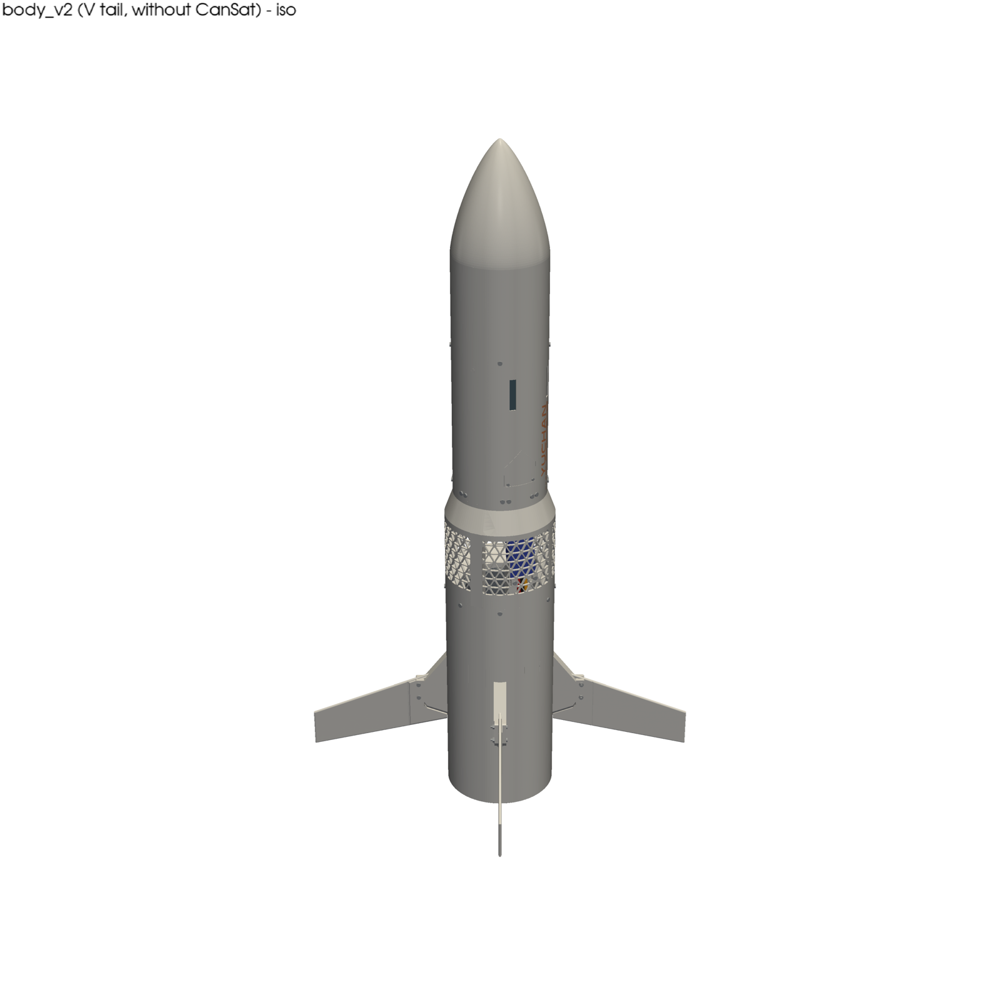
  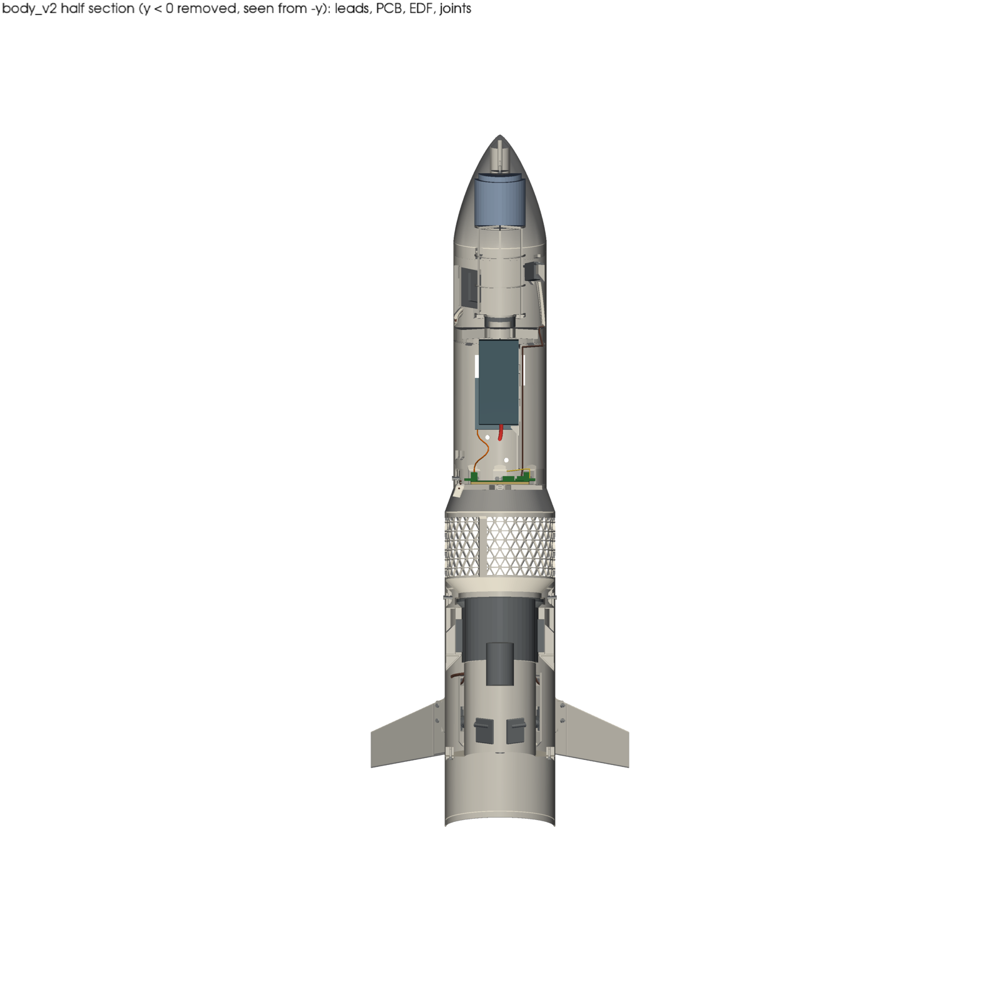
  <br>
  <sub>New body v1.0 (CAD v2, without the CanSat). Left: whole vehicle; right: half section (leads, carrier PCB, EDF, joints). Renders of the CadQuery geometry, 2026-11-20.</sub>
</p>

The rocket climbs vertically, cuts the motor, opens the nose cone at apogee to release the CanSat, and comes down on its own parachute.
Attitude is held by four exhaust vanes (direct-drive MG90S servos), and all flight computing runs on four ATmega128A chips. The four chips, sensors, radio and logger sit on one [carrier PCB rev 3.1](#avionics-carrier-pcb-rev-31).
**User decision 2026-11-18: the VTOL vehicle is dropped; rocket only.** VTOL configs, CAD, simulations and firmware builds were removed.

> **No flight or thrust test yet.** The numbers below come from CAD, the slicer, simulations and KiCad tools (M = measured by a tool, E = estimate, A = assumption). The carrier PCB has not been built yet.

## Current status (2026-11-20)

* **New body v1.0 (CAD v2)**: 21 printed part types as print-ready CAD; all integration checks pass (`all_ok = True`, M). The power layout (ESC standing on the intake-module wall, XT60 grip collar; no new parts bought, no leads cut) went through four review rounds. Details (Korean): [cad/body_v2/README_ko.md](cad/body_v2/README_ko.md).
* **Thrust is short.** The 2026-11-18 bench test (about 1.70 kg lifted at 93 % PWM) gives an estimated maximum EDF thrust of 17.9-19.3 N (E). Even without the CanSat the new body has T/W 0.954-0.969 at 20 N, so **it cannot lift off with the current thrust.** The direction is decided after measuring thrust with a genuine rotor.
* **PLA ground-test rotor**: a 9-blade rotor designed for printing. After the user measured the drive head (17 × 11 × 8 mm) the test cap was lowered to 11,000 rpm (safety factor 4.16, E). Never for flight. [docs/EDF_로터_설계.md](docs/EDF_로터_설계.md) (Korean)
* **Carrier PCB rev 3.1**: tool checks pass (ERC · DRC 0, routing rules 21 / 21), but the board has never been built or powered.
* **Firmware**: the VTOL code was removed from the four-chip firmware (2026-11-18/19) and the rocket's ground bring-up builds were restored. The control / firmware round for the new body has not started.

## Open items (not hidden)

* **EDF thrust measurement**: load-cell thrust with a genuine rotor is needed. With the current estimate (17.9-19.3 N) the rocket cannot lift off with or without the CanSat (new body T/W 0.954-0.969 at 20 N, 0.84-0.85 with the CanSat, E).
* **Bench tests**: ESC-into-intake-column coupon, cup-support coupon (27 N side load, E), XT60 grip clamp setting, ESC vibration at full power with a genuine rotor, measuring lead lengths and thicknesses ([cad/body_v2/README_ko.md](cad/body_v2/README_ko.md) chapter 10). Strength is hand calculation only (E), no FEA.
* **Rotor ground test**: behind a guard, after balancing, at 11,000 rpm or less ([test procedure](docs/EDF_로터_시험절차.md), Korean).
* **Carrier PCB**: build, power-up and function are all NOT_VERIFIED. Module dimensions (GY-521, BMP280, OpenLog, NEO-7M) are assumed.
* **Firmware and radio**: never run on real chips. An ESP-NOW ground range test of 1 km or more is needed.
* **Control**: the 2026-11-18 validation found vane side force at 16 % of the project model (CFD, grid not converged), and static margin and drag also differed from the model. Updating to the new body's mass and inertia and the S5 (gain ±50 %) backlash compensation are for the next control round.
* **Two-colour logo purge volumes** (150 / 210 mm³) are assumed; a short two-colour test print is needed before long prints.

## Block diagrams · flowcharts

Textbook-style figures (Korean labels). Click a figure for its document with the annotation table. The full list and the detailed set with source tables are in [docs/diagrams](docs/diagrams/README.md).

<p align="center"><a href="docs/diagrams/01_시스템_블록도.md"></a><br><sub><b>Figure 1-1. System block diagram</b></sub></p>
<p align="center"><a href="docs/diagrams/02_전기_전원_블록도.md">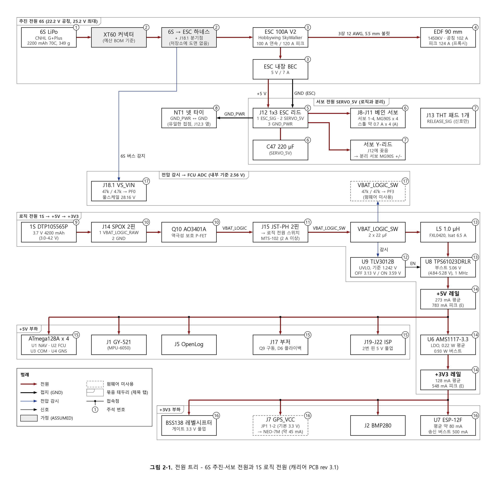</a><br><sub><b>Figure 2-1. Electrical / power block diagram (power tree)</b></sub></p>
<p align="center"><a href="docs/diagrams/03_항공전자_데이터_블록도.md"></a><br><sub><b>Figure 3-1. Avionics data block diagram</b></sub></p>
<p align="center"><a href="docs/diagrams/05_비행_순서도.md"></a><br><sub><b>Figure 5-1. Flight flowchart (pad to landing and recovery)</b></sub></p>
<p align="center"><a href="docs/diagrams/06_펌웨어_상태도.md"></a><br><sub><b>Figure 6-1. Firmware state diagram (UML)</b></sub></p>

<details>
<summary><b>Show the other 12 figures</b></summary>

<p align="center"><a href="docs/diagrams/02_전기_전원_블록도.md"></a><br><sub><b>Figure 2-2. Grounding</b></sub></p>
<p align="center"><a href="docs/diagrams/04_기계_구성도.md"></a><br><sub><b>Figure 4-1. Mechanical stack</b></sub></p>
<p align="center"><a href="docs/diagrams/04_기계_구성도.md"></a><br><sub><b>Figure 4-2. Hidden wiring routes</b></sub></p>
<p align="center"><a href="docs/diagrams/04_기계_구성도.md">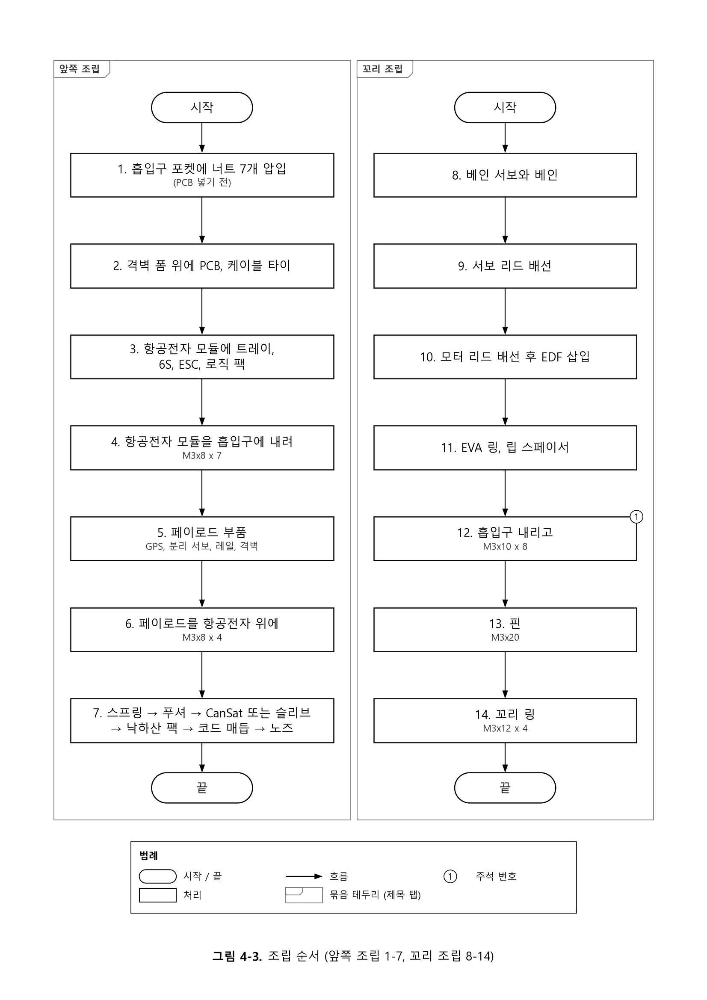</a><br><sub><b>Figure 4-3. Assembly order</b></sub></p>
<p align="center"><a href="docs/diagrams/06_펌웨어_상태도.md"></a><br><sub><b>Figure 6-2. One supervisor tick</b></sub></p>
<p align="center"><a href="docs/diagrams/07_제어_루프_순서도.md"></a><br><sub><b>Figure 7-1. One NAV tick</b></sub></p>
<p align="center"><a href="docs/diagrams/07_제어_루프_순서도.md"></a><br><sub><b>Figure 7-2. One FCU tick (control loop)</b></sub></p>
<p align="center"><a href="docs/diagrams/07_제어_루프_순서도.md"></a><br><sub><b>Figure 7-3. Timing of one cycle</b></sub></p>
<p align="center"><a href="docs/diagrams/08_사출_순서도.md"></a><br><sub><b>Figure 8-1. Apogee ejection flowchart</b></sub></p>
<p align="center"><a href="docs/diagrams/08_사출_순서도.md">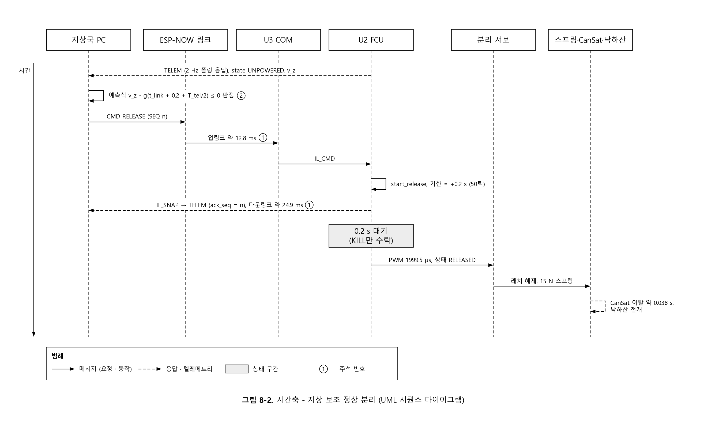</a><br><sub><b>Figure 8-2. Ejection timing</b></sub></p>
<p align="center"><a href="docs/diagrams/09_개발_검증_흐름도.md"></a><br><sub><b>Figure 9-1. Development and verification flow</b></sub></p>
<p align="center"><a href="docs/diagrams/09_개발_검증_흐름도.md"></a><br><sub><b>Figure 9-2. Test plan</b></sub></p>

</details>

## New body v1.0 (CAD v2)

| Item | Value | Kind |
|---|---|:-:|
| Printed parts | 21 types (4 fins + 2 spares included), each one valid solid, watertight STL, fits the P2S bed | M |
| Mass (without CanSat, MID) | 2,089 g (CAD solids) / 2,053 g (slicer grams) | E |
| Static margin | nominal +1.093 / +1.092 cal (OpenRocket / RocketPy). At the aft CG bound +0.92 cal → 49-51 g nose ballast needed | M / E |
| T/W (20 N, aft bound + ballast) | 0.954-0.969 → **cannot lift off** | E |
| One full print | 33.8 h, 1,411 g filament (parts 1,156 g), Bambu P2S, Bambu PLA Matte | M |
| Integration checks | all-pairs interference over 12,880 pairs: 0 defects; 14 lead paths: 0 overlaps; connector pass order; ESC insertion 30 poses × 2 thicknesses: 0 overlaps; finger access | M |

| 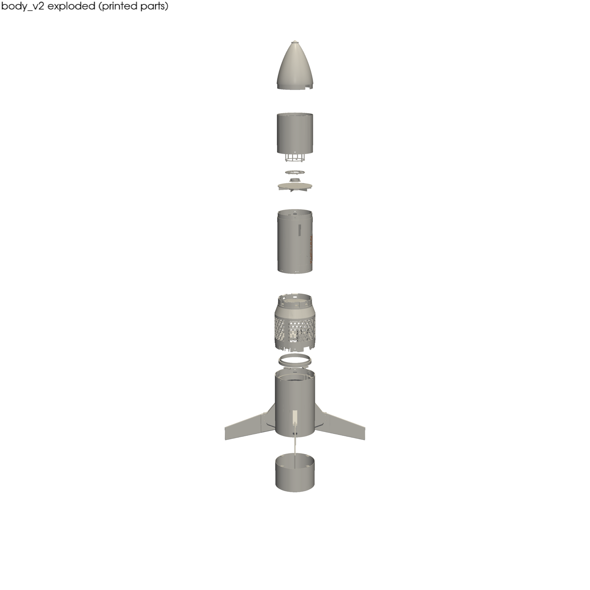 | 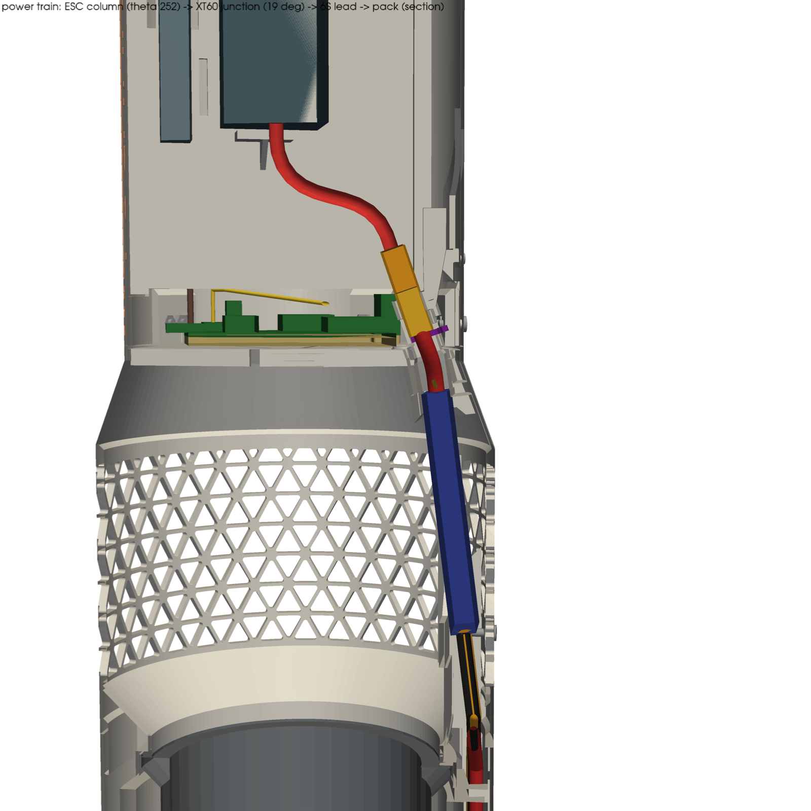 |
|:-:|:-:|
| <sub>Exploded view</sub> | <sub>Power layout close-up: ESC standing on the intake-module wall, XT60 junction tilted 19° above the bulkhead</sub> |
| 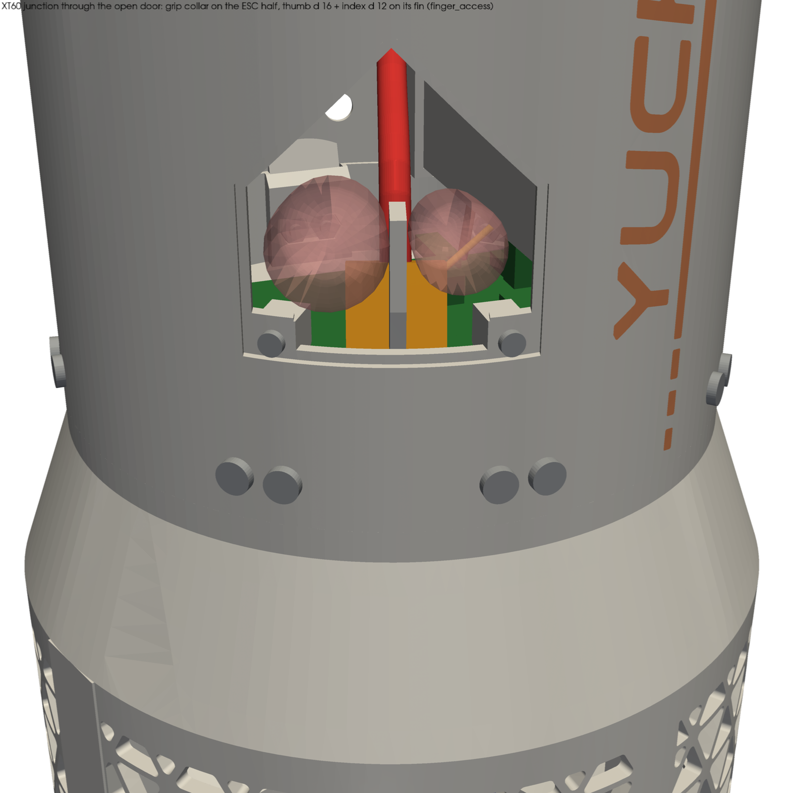 | 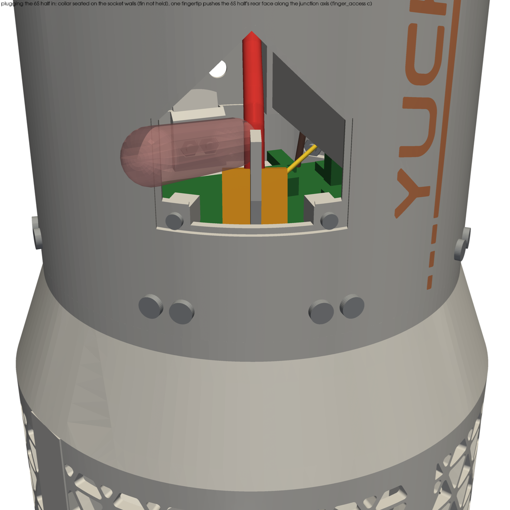 |
| <sub>XT60 junction, grip collar and finger access seen through the door</sub> | <sub>Plugging the XT60</sub> |

* **Print files**: [`cad/body_v2/out/print/`](cad/body_v2/out/print/) - Bambu Studio projects (`*.3mf`), sliced results (`*.gcode.3mf`), print-oriented STL (`*_print.stl`), per-part time and grams (`slice_report.json`).
* **CAD**: [`cad/body_v2/out/`](cad/body_v2/out/) - part STEP / STL in rocket coordinates, the OpenRocket model `body_v2_V.ork`, check reports (`check_body_v2.json` and others), renders (`render/`).
* Assembly order, cable list, things to check by hand (Korean): [cad/body_v2/README_ko.md](cad/body_v2/README_ko.md).

## Simulation validation (2026-11-18)

The **previous body (v0.9 rocket with the carrier PCB)** was re-checked with tools real rocket teams use (OpenRocket, RocketPy, OpenFOAM) and the project 6-DOF. [Report](sim/validation_2026-11-18/README.md) (Korean)

* With the bench-estimated thrust (17.9-19.3 N) the rocket carrying the CanSat cannot lift off (all three tools, M).
* Without the CanSat the static margin fell from +0.29 to -0.02 cal (M). The new body fixes this: nominal +1.09 cal.
* In CFD the vane side force was 16 % of the project model and the drag coefficient 0.89-0.91 (model 0.6), grid not converged. The 6-DOF results are therefore optimistic.

<p align="center">
  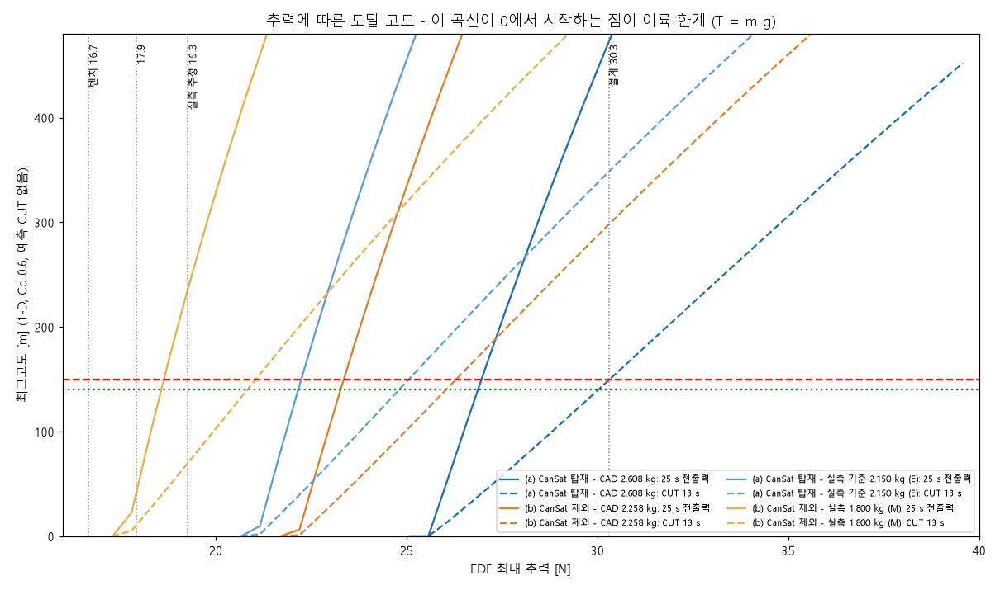<br>
  <sub>Apogee vs thrust (2026-11-18 validation round)</sub>
</p>

## EDF rotor (PLA, ground tests only)

| 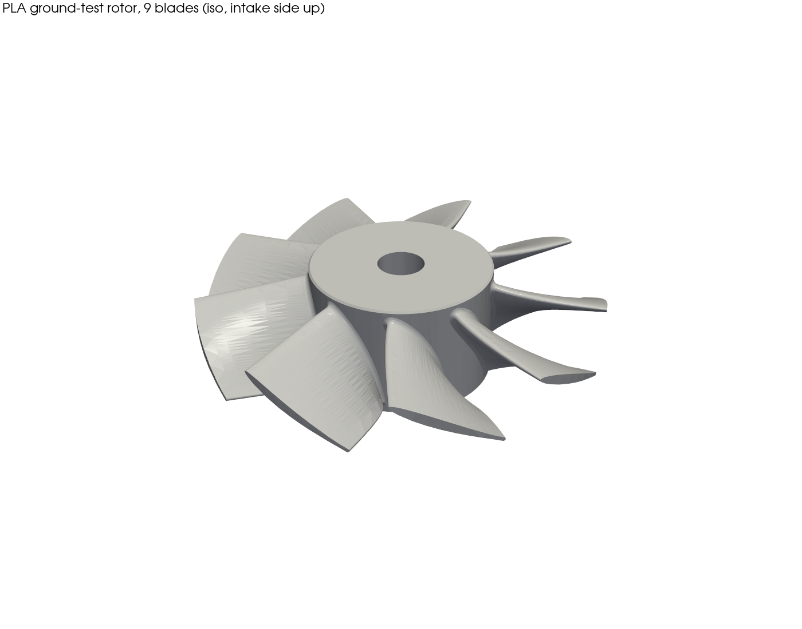 | 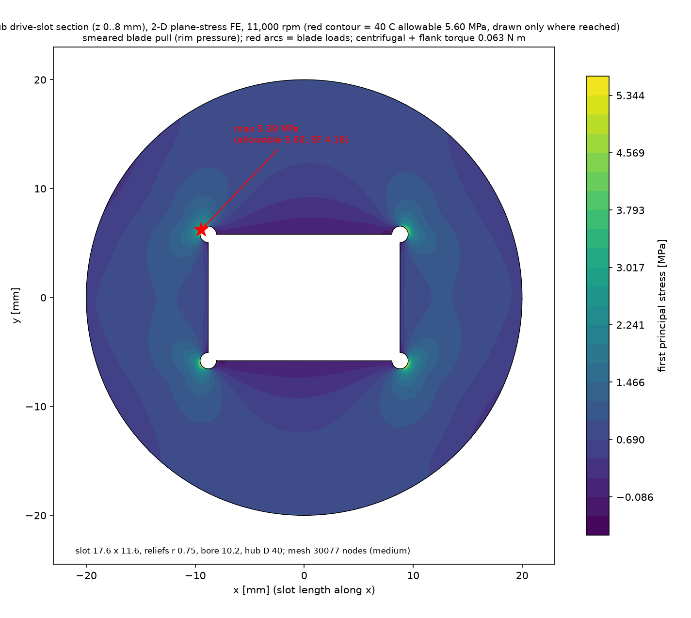 |
|:-:|:-:|
| <sub>9-blade PLA rotor</sub> | <sub>2-D FE stress in the drive-slot section</sub> |

* Target: a test replacement rotor for the Hobbyocean 90 mm 12-blade EDF (6S 1450KV). **Never for flight.**
* Test cap **11,000 rpm** (safety factor 4.16, peak stress 5.39 MPa / allowable 5.60 MPa, E), thrust there about 3.1 N (E), first throttle end point 27 % or less.
* 44 CAD checks PASS (M). Output files: [`cad/exports/rotor/`](cad/exports/rotor/) (STEP / STL, mirrored STL for the opposite rotation, balancer stand, Bambu project and G-code).
* Design: [docs/EDF_로터_설계.md](docs/EDF_로터_설계.md), test procedure: [docs/EDF_로터_시험절차.md](docs/EDF_로터_시험절차.md) (Korean).

## Avionics carrier PCB rev 3.1

One carrier board with the four flight-computer chips, sensors, Wi-Fi and logger, made with KiCad 10 (kicad-cli) and Freerouting. It started as rev 1 on 2026-11-04; rev 3.1 (2026-11-13) is the current revision (the folder name `vtol_carrier` is the old name).
**It has never been built or powered (NOT_VERIFIED).** Every PASS below is a tool check, not proof that the board works.

| 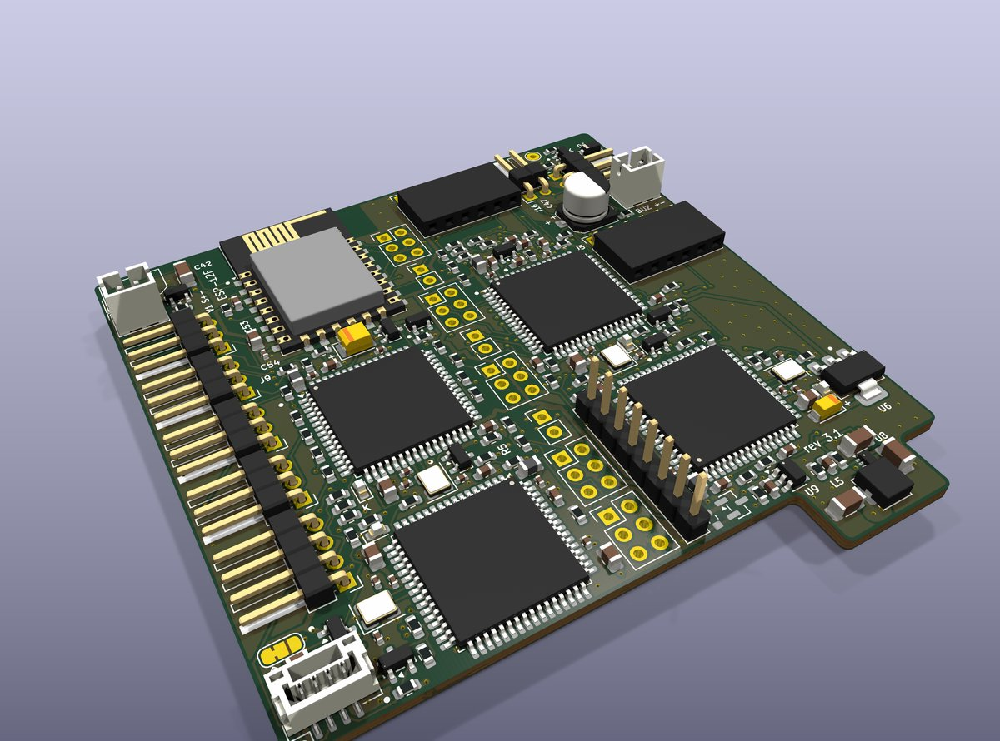 | 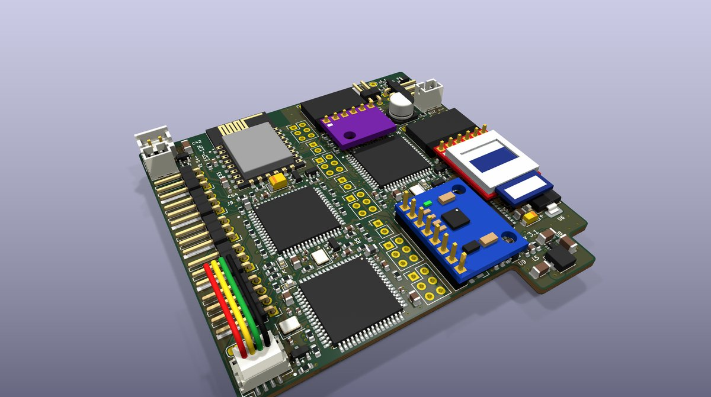 |
|:-:|:-:|
| <sub>rev 3.1 top 3/4 render with library 3D models of all parts (kicad-cli)</sub> | <sub>After hand assembly: 4 MCUs, ESP-12F, GY-521 (J1), BMP280 (J2), OpenLog (J5), GPS plug (J7). Module shapes use assumed dimensions (A), not proof of fit</sub> |
| 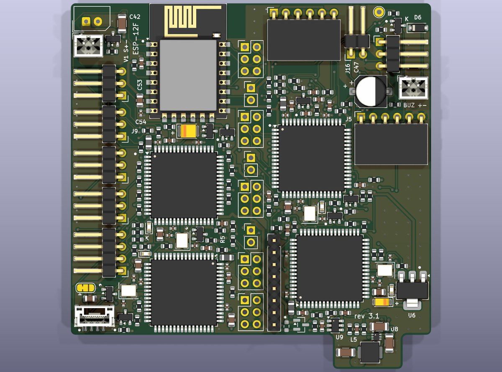 | 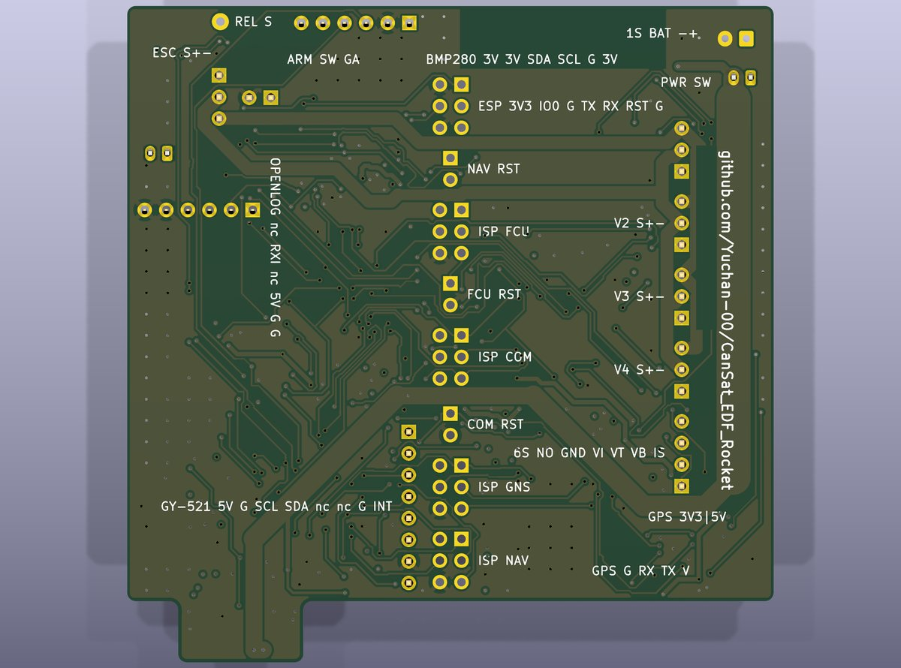 |
| <sub>Top (kicad-cli). The 5 V boost converter sits on the tab at the lower edge</sub> | <sub>Bottom: pin labels and the repository address in silkscreen (the contact line is masked in the README image)</sub> |

<p align="center">
  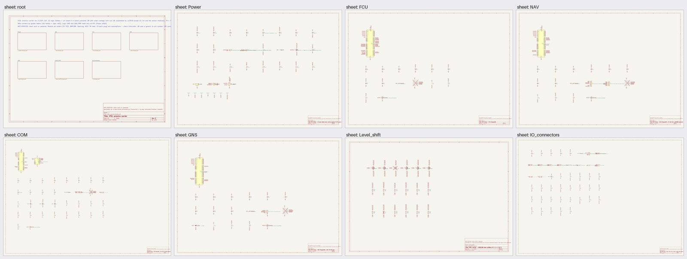<br>
  <sub>8 schematic sheets (top, power, FCU, NAV, COM, GNS, level shifter, connectors), rev 3.1 re-exported with kicad-cli</sub>
</p>

| Item | Value | Kind |
|---|---|:-:|
| Size | 76 × 70 mm body + lower-edge tab (boost converter) → 76 × 77.2 mm bounding box, 1.6 mm, 4 layers (signal / GND plane / +5V plane / signal). Parts on top only | design |
| Flight computer | ATmega128A-AU × 4 (NAV · FCU · COM · GNS), 16 MHz, 5 V | design |
| Radio | ESP-12F (ESP8266 Wi-Fi, ESP-NOW relay), hand-soldered by the user | design |
| Sensors · logger | GY-521 (IMU), BMP280 (baro), OpenLog, NEO-7M GPS (cable to J7) | design |
| Power | 1S logic battery (J14) → reverse protection → switch → 5 V boost TPS61023 + undervoltage cut-off TLV3012B → +5V plane → AMS1117 → 3.3 V | design / E |
| Rocket release servo (rev 3.1) | FCU (U2) PE5 / OC3C → R22 220 Ω → J13 (1-pin plated pad). Servo power from the ESC lead J12 via a Y lead | design |
| Assembly | JLC Economic PCBA places only the 145 SMT parts (33 BOM lines), lead-free HASL. ESP-12F and 12 through-hole connectors soldered by the user | design |

* **Checks (M, kicad-cli 10.0.6)**: ERC 0 errors · 0 warnings, DRC 0 violations · 0 warnings · 0 unconnected · 0 schematic mismatches, routing rules 21 / 21 PASS, determinism PASS, JLC parts 33 / 33 lines in stock and orderable (as of 2026-11-13). Tool release verdict: **ORDERABLE (tool checks only, hardware not verified)**.
* **Known weaknesses**: battery-path copper resistance exceeds its target at 60 °C (0.03583 Ω > 0.035 Ω, E). Boost SW pad clearance margin 0.124 mm (M). Switching noise and ripple are NOT_VERIFIED until measured on a board.
* Details (Korean): [PCB README](pcb/vtol_carrier/README_ko.md), [order guide](pcb/vtol_carrier/out/ORDER_ko.md), [assembly render index](pcb/vtol_carrier/out/render/INDEX_ko.md).

## Firmware · ground station

* **Flight firmware** ([firmware/atmega128_fc](firmware/README.md), Korean): four ATmega128A chips (NAV attitude estimate and altitude filter, FCU supervisor, attitude control and servo/ESC, COM radio and telemetry, GNS GPS), avr-gcc + PlatformIO. Host unit tests (`host_test/`) and simavr bench C code (`tools/`) are included.
* **Radio bridges**: [firmware/esp_bridge](firmware/esp_bridge/README.md) (ESP8266 ESP-NOW, default), [firmware/ground_bridge](firmware/ground_bridge/) (Arduino Nano for the spare SPI LoRa). Their config headers are generated from `params.json` at build time (`extra_gen.py`).
* **Ground station** (`tools/ground_station.py`, Python): launch / motor cut / nose release commands, telemetry, assist (CUT at the target altitude, RELEASE at apogee), logging, practice mode. The `sim/` modules and `cad/layout.py` it imports are included. Usage (Korean): [docs/지상국_사용법.md](docs/지상국_사용법.md).

```bash
python tools/ground_station.py --sim          # practice mode (virtual vehicle, no hardware)
python tools/ground_station.py --port COM5    # real link (check the port in Device Manager)
```

## YUCHAN logo

<p align="center">
  <br>
  <sub>Final logo: the "launch" design running vertically along the vehicle axis. P2S + AMS two-colour inlay (only the outer wall line of the white body is orange)</sub>
</p>

## Folder structure

| Path | Contents |
|---|---|
| [`cad/body_v2/`](cad/body_v2/) | **New body v1.0**: print files, STEP / STL, check reports, renders, description |
| [`cad/exports/rotor/`](cad/exports/rotor/) | PLA ground-test rotor output files and check reports |
| [`cad/exports/`](cad/exports/) | Output files and check reports of the previous body v0.9 (reference) |
| [`pcb/vtol_carrier/`](pcb/vtol_carrier/) | Carrier PCB rev 3.1: KiCad project, Gerber / BOM / CPL, check reports, renders, order guide |
| [`firmware/`](firmware/) | ATmega128A four-chip firmware, ESP-NOW bridge, ground bridge |
| [`tools/ground_station.py`](tools/ground_station.py), [`sim/`](sim/) | Ground station and the modules it uses |
| [`sim/validation_2026-11-18/`](sim/validation_2026-11-18/README.md) | Simulation validation report, comparison tables, plots, videos |
| [`docs/`](docs/) | Block diagrams and flowcharts, specification, change documents, build guide, budget, test / safety / regulations, rotor design |
| `params.json` | Design values (read by the firmware config generators and the ground station) |

<sub>This repository holds **only the latest results, as a single commit** (decision 2026-11-20). CAD generation / check scripts, simulation run scripts, PCB generation scripts and raw result data (csv / json) are not published, and older versions (v0.9 and earlier) are kept on the author's PC in per-version folders. Script names in the documents refer to the tools that produced those results.</sub>

## License

[CC BY-NC 4.0](https://creativecommons.org/licenses/by-nc/4.0/) - share and adapt for non-commercial purposes with attribution. See [LICENSE](LICENSE). Third-party material follows its own license.

<sub>The PCB and logo images in this README are cropped or scaled copies of existing renders. Sources and sha256: [docs/images/SOURCES.md](docs/images/SOURCES.md)</sub>
