<h1 align="center">CanSat EDF Rocket</h1>

<p align="center"><a href="README.md">한국어</a> · <b>English</b></p>

<p align="center">
  A 3D-printed launch vehicle that carries a CanSat up on a single 90 mm ducted fan (EDF),<br>
  and a light vertical takeoff and landing (VTOL) vehicle built from the same propulsion module
</p>

<p align="center">
  
  
  
  
  
  
</p>

<p align="center">
  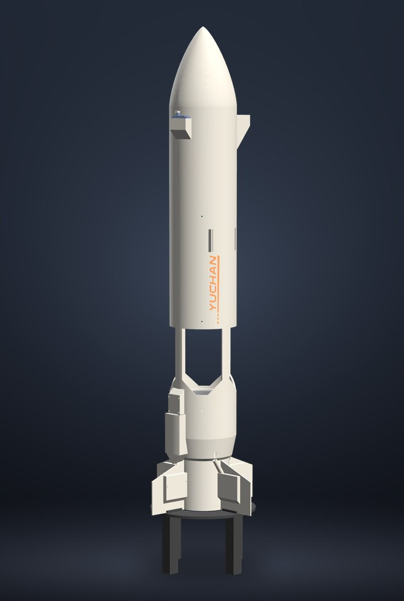
  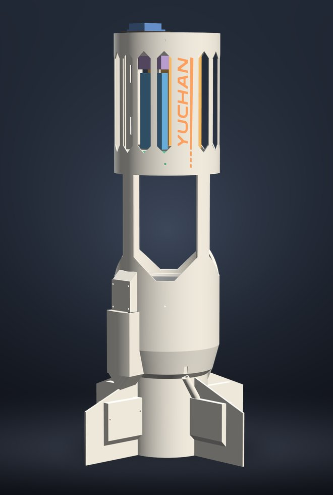
  <br>
  <sub>Left: rocket configuration (ballistic launch + CanSat ejection) · Right: VTOL battery configuration. Renders of the CadQuery geometry drawn with PyVista (VTK) (colors are for display), 2026-11-04.</sub>
</p>

The rocket climbs vertically, cuts the motor, opens the nose cone at apogee to release the CanSat, and descends on its own parachute.
The VTOL is a test vehicle with a short electronics section on the same propulsion and intake modules, with three power configurations: battery, tethered and hybrid.
Attitude is held by 4 vanes in the exhaust (MG90S direct drive), and all flight computing is done by 4 ATmega128A chips.

> **No real flight or thrust tests yet.** The numbers below come from CAD, the slicer and simulation.

## At a glance

| Item | Value | Type | Source |
|---|---|:-:|---|
| Rocket configuration mass | **2,599.2 g** | M | `cad/exports/cadquery_report.json` |
| VTOL mass (battery / tethered / hybrid) | **1,653.7 / 1,405.8 / 1,526.8 g** | M | `cadquery_report_vtol*.json` |
| Body | Ø120 mm, wall 1.2 mm | Design | `params.json` `body` |
| Height (rocket / VTOL battery / tethered·hybrid) | 856.3 / 485.9 / 500.3 mm (excluding launch pad) | Design | CadQuery report `vehicle_h_mm` |
| Propulsion | 90 mm 12-blade EDF, 6S, 100 A ESC | Part | [Budget](docs/budget/예산안.md) (Korean) |
| EDF thrust | 2.14–3.09 kgf (22.2 V) - **not measured yet** | A | 3.09 = seller's thrust table (proxy value), 2.14 = design lower bound (battery VTOL T/W 1.3), `params.json`. Flying within the acceptance criteria needs about 2.6 kgf or more ([results document](docs/v0.9_시뮬레이션_제어_결과.md) (Korean)) |
| Flight computer | ATmega128A × 4 (NAV · FCU · COM · GNS), 16 MHz, 250 Hz control tick | Design | `params.json` `flight_computer` |
| Budget (rocket / VTOL battery) | KRW 421,232 / KRW 375,192 | M + A | 2026-10-13 retail prices, some lines estimated ([rocket](docs/budget/예산안.md), [VTOL](docs/budget/예산안_vtol.md) (Korean)) |
| Print time (rocket / VTOL) | 47 h 29 min / 32 h 41 min | M + A | Bambu Studio slice, logo purge volume is an assumed value ([provisional print plan](cad/exports/print/provisional_v09_cadquery/print_plan_provisional.md) (Korean): CadQuery STL slice, before the Fusion run) |

<sub>M = value measured with a tool (CadQuery, slicer) · E = estimate · A = assumption (input not measured yet) · Design = `params.json` input value · Part = purchased-part specification from the budget. Masses are CAD totals with printed parts entered at slicer values, and some electronics masses are assumed values. Rocket print time includes the launch pad.</sub>

## Gallery

|  |  |  | 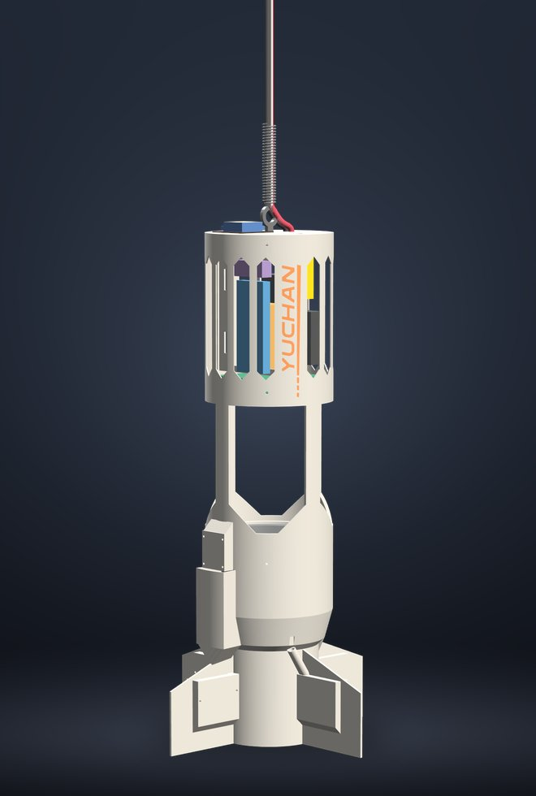 |
|:-:|:-:|:-:|:-:|
| <sub>Rocket · 2,599.2 g</sub> | <sub>VTOL battery · 1,653.7 g</sub> | <sub>VTOL tethered · 1,405.8 g</sub> | <sub>VTOL hybrid · 1,526.8 g</sub> |

| 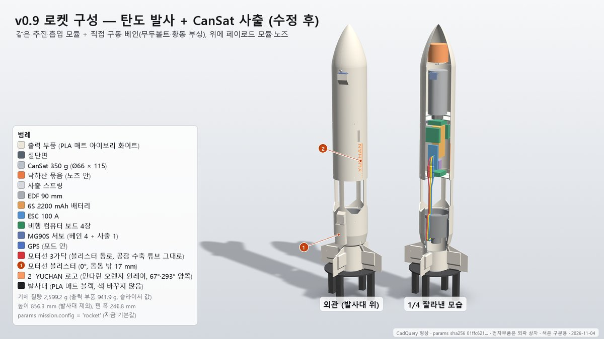 | 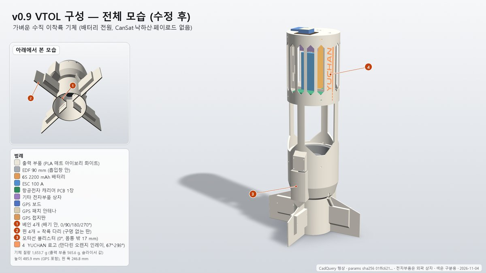 |
|:-:|:-:|
| <sub>Rocket configuration: exterior and 1/4-cutaway interior (CanSat 350 g, parachute, EDF, battery)</sub> | <sub>VTOL configuration: the vehicle without parachute and CanSat, with a short electronics section on top</sub> |
| 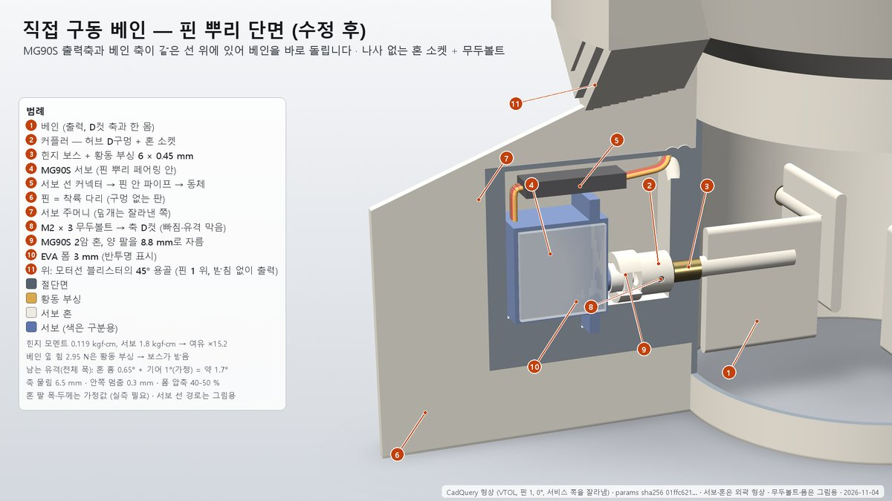 | 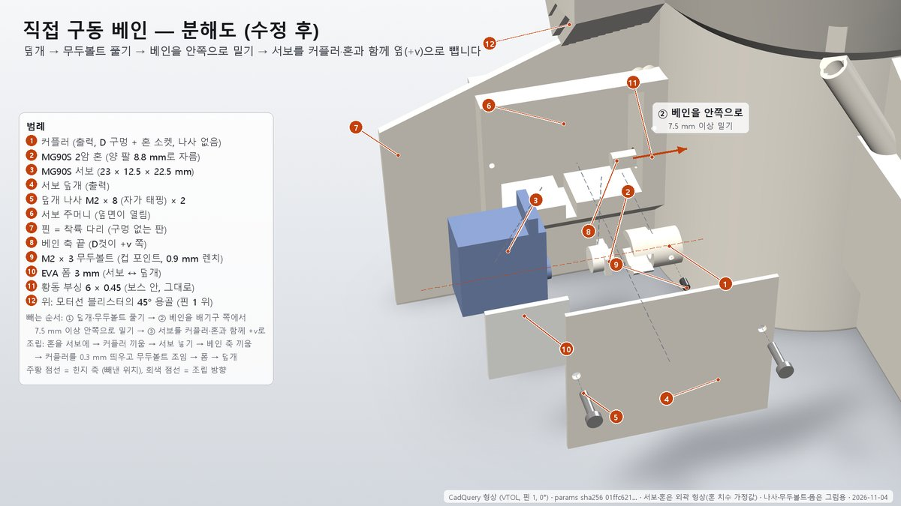 |
| <sub>Direct-drive vane section: servo shaft and vane shaft on one line, screwless horn socket</sub> | <sub>Exploded view of the same vane</sub> |
| 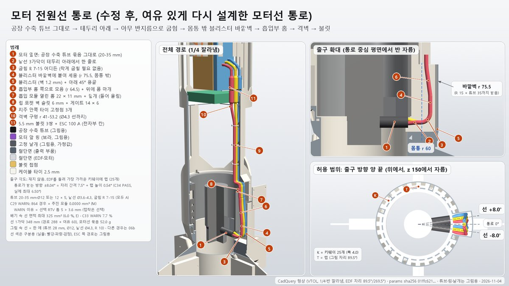 | 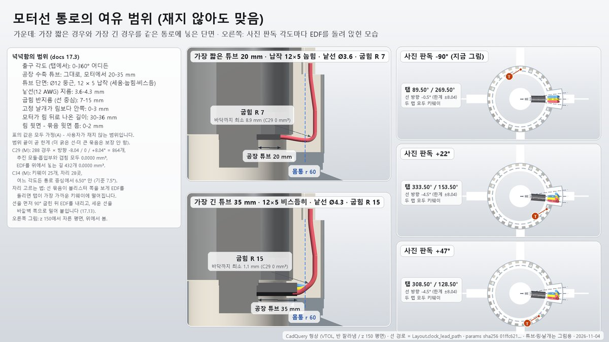 |
| <sub>Motor power lead passage section (clock mount, blister outside the body)</sub> | <sub>Passage tolerance range: the range designed to fit without measuring (exit angle 0–360°, lead diameter 3.6–4.3 mm)</sub> |
| 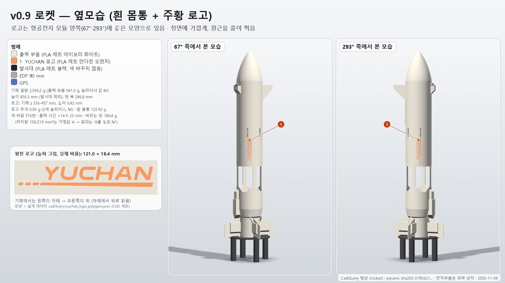 | 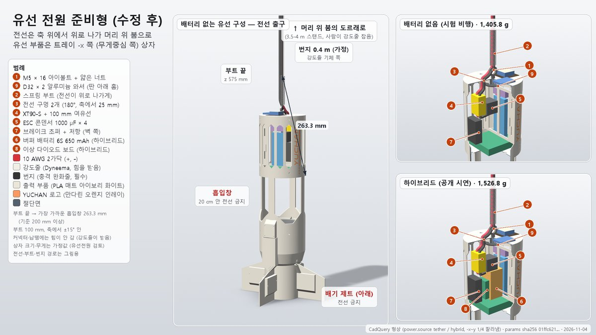 |
| <sub>Rocket side view: logos on both sides of the electronics module (67° / 293°)</sub> | <sub>Tether-power-ready VTOL (battery-less tethered, hybrid)</sub> |

<sub>All images are renders of the CadQuery geometry. Electronic components are drawn as bounding boxes, and some wires, foam and screws are drawn for illustration.</sub>

## YUCHAN logo

<p align="center">
  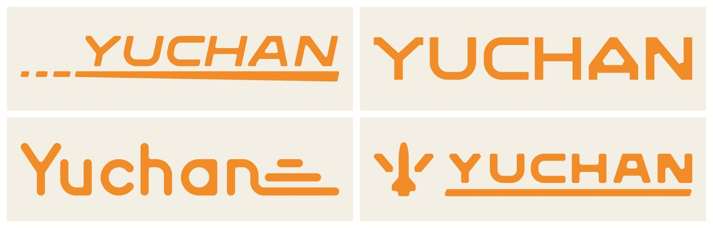<br>
  <sub>① 4 candidates - from top left: launch, extended, retro, patch. The user chose <b>launch</b>.</sub>
</p>
<p align="center">
  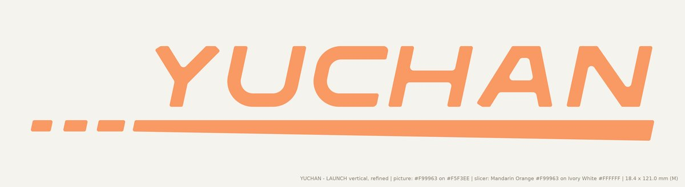<br>
  <sub>② Final shape, refined to run vertically along the vehicle axis (unrolled size 121.0 × 18.4 mm)</sub>
</p>
<p align="center">
  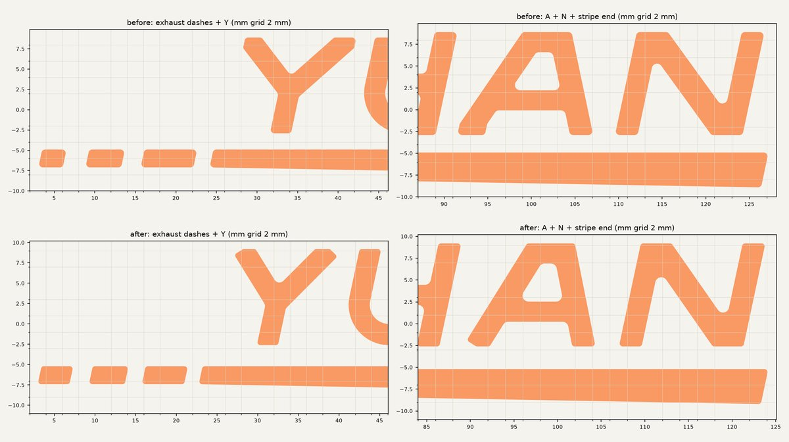<br>
  <sub>③ Close-up comparison before (top) and after (bottom) refinement, 2 mm grid</sub>
</p>

| 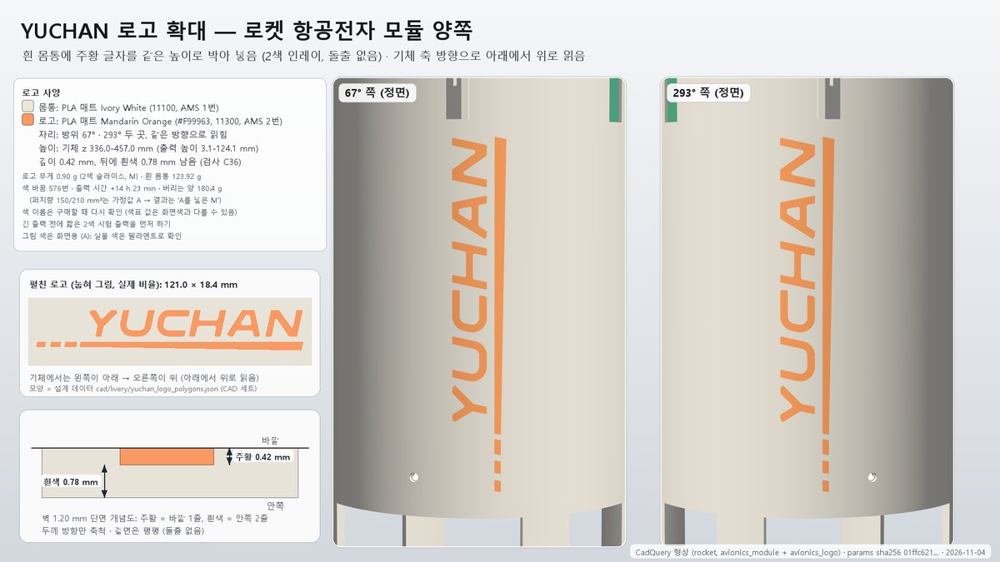 | 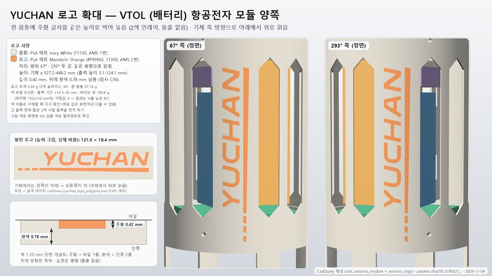 |
|:-:|:-:|
| <sub>④ On the vehicle: both sides of the rocket electronics module</sub> | <sub>④ On the vehicle: both sides of the VTOL electronics module</sub> |

* **How it is printed**: P2S + AMS 2-color inlay. Only the single outer wall line (0.42 mm) of the white body (PLA Matte Ivory White 11100) is orange (Mandarin Orange 11300); nothing protrudes.
* **Placement**: electronics module azimuths 67° / 293°, reading from bottom to top. Geometry check C36 PASS (at least 3 mm from windows, slots and holes; thinnest stroke 2.20 mm).
* **AMS cost (slicer M; purge volumes 150 / 210 mm³ are assumption A)**: 576 color changes, print +14 h 23–26 min, 180.4 g purged.
* Details: [hardware changes document, chapter 18](docs/v0.9_하드웨어_변경.md) (Korean), [build guide, chapter 2](docs/제작가이드.md) (Korean).

## Development

**v0.6.3 → v0.8.1 (2026-10-13 to 10-21)** - The budget rocket was modeled separately in two programs, a Fusion 360 script and CadQuery, and the two were checked against each other. v0.8.1 added a fourth chip (GNS) that handles GPS position hold.

| 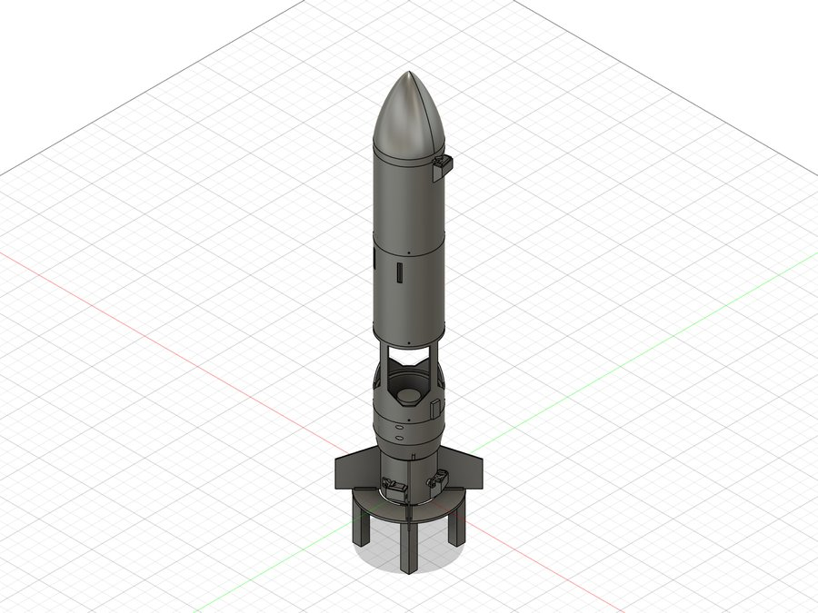 | 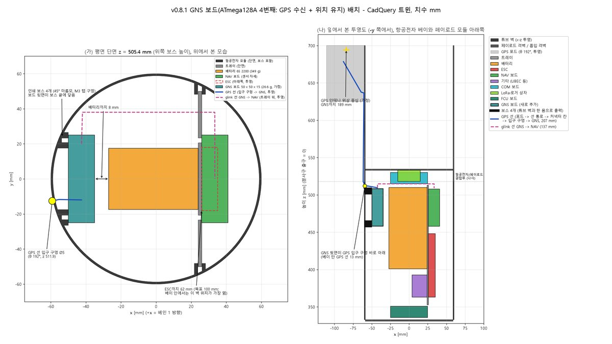 |
|:-:|:-:|
| <sub>Result of running the Fusion 360 script v0.6.3 (2026-10-20, 41 components)</sub> | <sub>v0.8.1 GNS board layout (CadQuery twin image)</sub> |

**v0.9 (2026-10-28)** - Light VTOL configuration, direct-drive vanes, control round (C1–C7), review-fix round (F1–F10) and tether power rules (T1–T6). At every change, before / after were compared side by side in simulations under the same conditions.

<p align="center">
  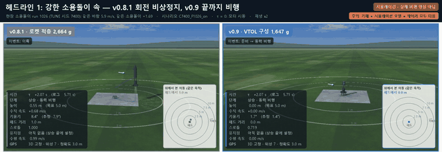<br>
  <sub><b>Simulation (not real flight footage), 2× speed.</b> In the same strong swirling wind, the v0.8.1 rocket stack (left) spins up, makes an emergency stop and deploys its parachute, while the v0.9 VTOL (right) keeps flying.
  The airframe, simulation model and control all differ, so the whole difference cannot be attributed to the control changes. The vehicle in the video is the black version from before the white livery, and the masses are the values at the time the video was made.</sub>
</p>

<p align="center">
  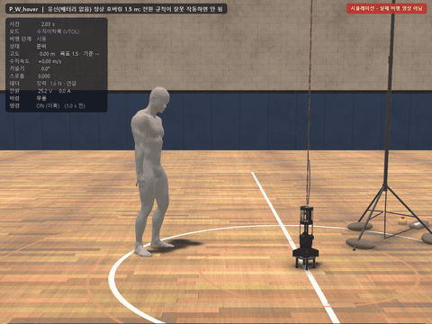<br>
  <sub><b>Simulation, real time.</b> The battery-less tethered VTOL rises to 1.5 m indoors and hovers. The human figure is for scale. The vehicle in the video is the black version from before the white livery.</sub>
</p>

**Motor lead passage (2026-10-28 to 11-04)** - The first two versions assumed the motor lead exit; on 10-29 the exit was confirmed from a photo of the real part. On 11-03 the design was changed to one that fits at any exit angle without measuring: the EDF is rotated to bring the lead bundle into a single passage, and the mounting tabs go into the nearest of 25 keyways around the circumference (clock mount).

<p align="center">
  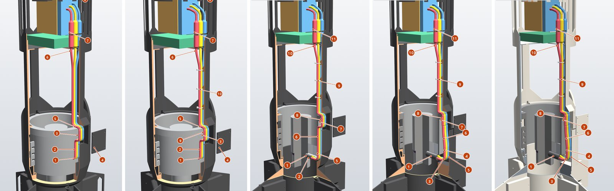<br>
  <sub>From left: 10-28 first → 10-28 revised → 10-29 exit based on the real-part photo → clock mount (11-03 design, after the 11-04 fix round, black) → 11-04 white. 1/4-cutaway sections.</sub>
</p>

| 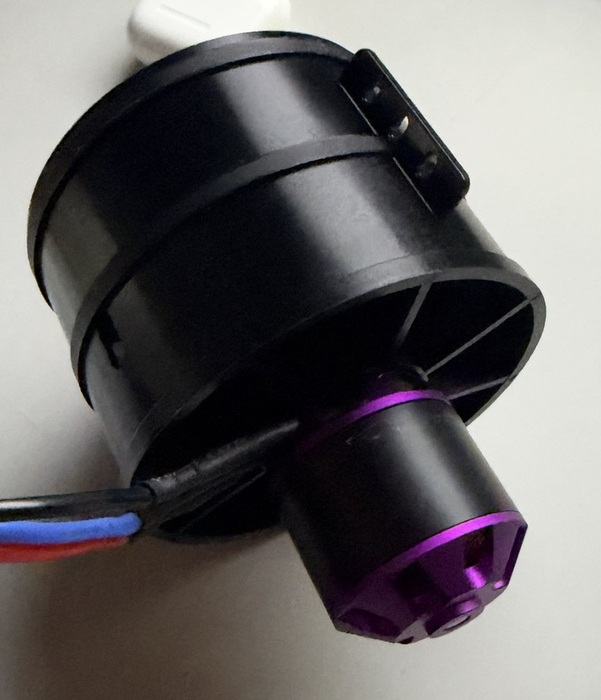 | 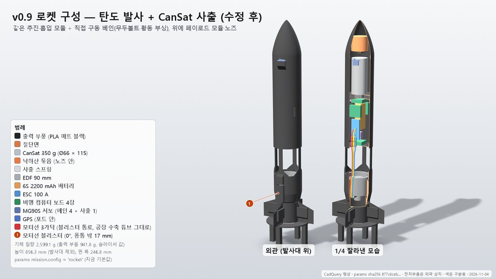 |
|:-:|:-:|
| <sub>The real EDF (2026-10-29): the position where the motor lead bundle exits was set from this photo</sub> | <sub>The rocket just before the change to white (2026-11-04 morning, black PLA). The gallery above shows it as it is now</sub> |

## Verification approach

Design values come from one place (`params.json` → `cad/layout.py`), and pass/fail is decided with fixed tools and criteria.

* **Geometry checks C1–C36** (CadQuery): all four configurations. FAIL / WARN - rocket 0 / 5, VTOL battery 0 / 3, tethered 1 / 2, hybrid 1 / 2.
* **Fusion 360 cross-check**: the same specification is also built with a Fusion script. In this round, a simulated run (replay) of the script was used to check boolean differences against the CadQuery geometry (logo 0.0000 mm³). A Fusion GUI run (0.9.6) still has to be done by a person.
* **Slicing**: real slicing with the Bambu Studio CLI; weight, time and the number of color changes are counted from the G-code.
* **6-DOF simulation + campaign**: 500 runs under field conditions, 18 % pass, 13 % emergency stop ([results document](docs/v0.9_시뮬레이션_제어_결과.md) (Korean)).
* **4-chip co-simulation** (simavr): the NAV · FCU · COM · GNS firmware runs together instruction by instruction. All 22 acceptance criteria pass (2026-10-29, [firmware results](docs/v0.9_펌웨어_결과.md) (Korean)). Because the headers were regenerated on 11-04, row 21 (ballistic image hash) is waiting for the user to re-declare it with the new hash ([hardware changes 18.8](docs/v0.9_하드웨어_변경.md) (Korean)).
* **Independent review**: in every round a different reviewer reruns everything on a copy to find defects, and what was fixed and what was left is recorded in the documents.

> **Still open**
> * EDF thrust has not been measured. No real printing, assembly or flight, and no measurements on real chips, yet.
> * C33 lateral offset: tethered **FAIL 14.0 %**, hybrid **FAIL 11.2 %** - user decision (e.g. moving the center of gravity).
> * 5 scenario tests for the light VTOL vehicle have failed from the start (2026-11-04 pytest, [hardware changes 17.9](docs/v0.9_하드웨어_변경.md), [firmware results](docs/v0.9_펌웨어_결과.md) section 6).
> * The AMS purge volumes 150 / 210 mm³ are assumed values. A short 2-color test print is needed before long prints.

## Folder structure

| Path | Contents |
|---|---|
| [`cad/`](cad/) | Layout (`layout.py`), Fusion 360 script, CadQuery twin + geometry checks, logo (`livery/`), print files |
| [`sim/`](sim/) | 6-DOF flight simulation, reference implementations of the vehicle supervisor logic and links, gain tuning, campaigns |
| [`firmware/`](firmware/) | ATmega128A 4-chip firmware (avr-gcc), ground bridge, simavr co-simulation |
| [`sizing/`](sizing/) | Mass, thrust, energy, stability and strength calculations |
| [`tools/`](tools/) | Ground station, print-file generation, budget, simulation video tools |
| [`docs/`](docs/) | Specification, change documents, build guide, budget, testing, safety and regulations |
| [`render/`](render/) | Blender render pipeline (for simulation videos) |

<sub>`sim/out/` and the STL · STEP · F3D files are generated files, so they are not in the repository. How to regenerate them is described in the technical details below.</sub>

## License

[CC BY-NC 4.0](https://creativecommons.org/licenses/by-nc/4.0/) - you may share and adapt it for non-commercial purposes with attribution. See [LICENSE](LICENSE) for details. Material by others is under its own license ([render/assets/CREDITS.md](render/assets/CREDITS.md)).

<sub>All images in the README are cropped or downscaled copies of existing renders, photos and videos. Sources and sha256: [docs/images/SOURCES.md](docs/images/SOURCES.md) (Korean)</sub>

---

## Technical details (original README)

<sub>Below is the earlier README content, kept as it was (here in translation). Paragraphs with dates are records of that time.</sub>

# CanSat EDF Rocket — a ducted-fan-powered CanSat launch vehicle

A launch vehicle that carries a CanSat, climbs vertically, cuts the motor, separates the nose cone at apogee to release the CanSat, and descends on its own parachute.
Propulsion is 1 × 90 mm electric ducted fan (EDF); attitude control uses 4 vanes in the exhaust (MG90S servos).
All flight computing is done by **ATmega128A** chips (v0.6.3: 3, NAV·FCU·COM; from v0.8.1, 4 with GNS added), all structures are printed on a <b>Bambu Lab P2S in PLA Matte white (Ivory White)</b>, and an orange (Mandarin Orange) **YUCHAN** logo is inlaid on both sides of the electronics module using AMS 2-color inlay (2026-11-04; the launch pad is black).

The baseline design is the **budget version `BUDGET_90mm_6S`** (CanSat excluded), and the current version is **v0.9** (2026-10-28). Numbers in the table below and in "Verification methods" dated before 2026-10-16 are values for the v0.6.3 rocket.
The original design (KAIST 1 kg CanSat, 12S) remains as it was, as the `KAIST_90mm_12S` preset in `params.json`.

## Current status (v0.9, 2026-10-28)

* **Hardware v0.9**: direct-drive vanes, light **VTOL configuration** (battery 1,653.6 g, battery-less tethered 1,405.7 g, hybrid 1,526.7 g; no parachute or CanSat). The rocket configuration is 2,599.1 g. **On 2026-11-03 the motor lead passage was changed to "fits without measuring" (clock mount)**: the EDF is rotated to bring the lead bundle into a single passage at 0° (a blister outside the body), and the tabs go into the nearest of 25 keyways around the circumference (no tab screws; 2026-11-04 fix round: the teeth between the keyways have a safety factor of 5.9 even when a single tab takes the motor torque, and the leads are bent first, then the EDF is lowered). With the factory heat-shrink sleeve as is, it accepts exit angles 0-360°, lead diameter 4.3 mm and bends of 7-15 mm, with 0 mm³ overlap in every case (C29, C34). The mass targets (1,650 / 1,400 g) are exceeded by 3.6 / 5.7 g. Lateral offset check C33 (including lead drag, worst azimuth and Cd): tethered **FAIL 14.0 %**, hybrid **FAIL 11.2 %**, battery WARN 7.7 %, rocket WARN 5.7 % - user decision (e.g. moving the center of gravity). Nothing has to be measured before printing (only a thrust test as assembled is needed). The flight computer is 4 ATmega128A chips (NAV·FCU·COM·GNS, since v0.8.1). Details: [docs/v0.9_하드웨어_변경.md](docs/v0.9_하드웨어_변경.md) (Korean) chapter 17.
* **White body + YUCHAN logo (2026-11-04)**: all printed airframe parts were changed to white (Bambu PLA Matte Ivory White, 11100), and a vertical orange (Mandarin Orange, 11300) logo was added on both sides of the electronics module (67° / 293°) as a flush 2-color inlay (one outer wall line, 0.42 mm). Both rocket and VTOL. New check C36 PASS (at least 3 mm from windows, slots, holes and ends; stroke 2.20 mm). AMS cost (slicer M; purge volumes 150/210 mm³ are assumed values A): 576 color changes, +14 h 26 min, 180 g purged. The orange is printed so that it is laid down only once (thin-wall detection, independent review F1). Masses: VTOL battery 1,653.7 g, tethered 1,405.8 g, hybrid 1,526.8 g, rocket 2,599.2 g. Details: [docs/v0.9_하드웨어_변경.md](docs/v0.9_하드웨어_변경.md) chapter 18; how to print: [docs/제작가이드.md](docs/제작가이드.md) (Korean) chapter 2.
* **Simulation and control v0.9 (Python reference code only)**: attitude gains fitted to the VTOL vehicle, takeoff and landing control, tether power rules, independent review applied. On the sample first used (FRESH2), 120 field runs: passes 5 → 22, emergency stops 26 → 17. Campaign on a new sample, 500 field runs: 18 % pass, 13 % emergency stop. Results document: [docs/v0.9_시뮬레이션_제어_결과.md](docs/v0.9_시뮬레이션_제어_결과.md) (Korean).
* **EDF thrust has not been measured yet.** The simulation assumes 2.14–3.09 kgf at 22.2 V. Flying within the acceptance criteria needs about 2.6 kgf or more (minimum 2.46 kgf).
* **Main remaining risks**: emergency stop when the residual rotation is opposite to the rotor direction, demonstration push (5–15 N) not possible (safe at about 3 N or less), takeoff overshoot (tethered up to about 1.3 m → pulley at 4.5 m or higher).
* **The firmware is still v0.8.1.** Porting the v0.9 control changes to C, regenerating the headers (`params_gen.h`, `gains.h`, `bridge_config_gen.h`), cross-validation vectors and the 4-chip co-simulation will be done in the next firmware round. Until then the header generator tests fail.
* **Python tests (2026-10-28, whole project)**: 1,097 passed, 58 failed, 15 errors, 8 skipped, 2 expected failures. Of the 73 failures and errors, 67 are because the header generator rejects the new control keys (firmware round), 1 is the ground bridge header being STALE, 1 is a pre-existing test, and 4 are VTOL scenario tests for the light vehicle (reasons: results document, chapter 10).

## Control scheme (v0.4, flight computer v0.6.3)

* **Only attitude control is done on board.** The flight computer is split across 3 ATmega128A chips.
  * **NAV**: reads the MPU-6050 and MS5611 and runs attitude estimation and the altitude filter. Every tick (250 Hz) it sends a 72-byte navigation frame to the FCU over SPI (nlink).
  * **FCU**: vehicle supervisor logic (commands, safety interlocks I1–I10), attitude control, servo and ESC pulses, logging. All flight decisions are made here. A tick starts when a navigation frame arrives; if none arrives within 4.6 ms, it runs on its own timer and treats that tick's sensors as failed.
  * **COM**: LoRa radio, command decoding, telemetry built from snapshots sent by the FCU. Connected to the FCU over UART (ilink, 250 kbaud).
  * NAV and COM make no flight decisions. The safety interlocks cannot be turned off by any command.
  * Sources: `params.json` `flight_computer`, `firmware/atmega128_fc/src/core/nlink_proto.h`, `ilink_proto.h`.
* **Launch, motor cut and nose separation are commanded by the ground station over LoRa.** `tools/ground_station.py` on a laptop polls the vehicle 2 times per second, and the vehicle answers with telemetry only then.
* The ground station's **assist mode** (on by default) automatically sends CUT at the target altitude and RELEASE at apogee. Since v0.6.3, even at the moment a reply does not arrive (reply timeout), it extrapolates the last telemetry forward by its age and decides with the same rules. The operator can command directly or turn it off at any time.
* Even if the link drops or slows, the vehicle ends the flight safely on its own. A 2-second dropout on the pad goes to SAFE; a 3-second dropout in flight cuts the motor and deploys the parachute. When the predicted apogee reaches 150 m it cuts the motor (I4), and if it falls without an ejection command it ejects on its own (I6). If NAV resets in flight, attitude is considered lost and it ABORTs (I9).
* Two kinds of LoRa module are supported. UART types (Ebyte E22/E220/E32) connect as they are; SPI types must be **900 MHz SX1276 modules** (RFM95W, Ra-01H). Ra-01/Ra-02 are 433 MHz and do not fit. SPI types need an Arduino Nano bridge on the ground side (`firmware/ground_bridge/`).

Usage is described in [지상국_사용법.md](docs/지상국_사용법.md) (Korean), wiring in [firmware/README.md](firmware/README.md) (Korean).

| Item | Value | Source |
|---|---|---|
| Budget | KRW 342,082 (all bought new). KRW 319,014 if you already have 1 ATmega128 board and the screws. The 7 estimated-price (ASSUMED) lines total KRW 22,000: servo extension leads 7,000, 4 mm bullet connectors 5,000, parachute cord 3,000, ejection spring 3,000, ilink and nlink wiring 1,500 each, divider resistors 1,000 | `docs/budget/예산안.md` (2026-10-13 retail prices, links included) |
| Without a charger and ISP | +KRW 38,500 | Same document |
| Ground side, depending on the LoRa module type | Up to +KRW 7,761 (USB-UART converter or Nano bridge, estimated price) | Same document |
| CanSat that can be carried | International standard Ø66 × 115 mm, 350 g | Limit of about 3 kg of thrust within the budget |
| Airframe | Outer diameter 120 mm, wall 1.2 mm, overall length 856 mm | `cad/layout.py` |
| Flight computer | 3 ATmega128A, 16 MHz, 250 Hz. NAV board on the tray (the former FC position), FCU board on top of the intake module bulkhead with 3 mm foam tape + cable tie, COM board on 4 bosses under the payload bulkhead with M3×5. Radio/logger box (LoRa module, OpenLog, level shifter, AMS1117) under the bulkhead next to COM | `params.json` `electronics`, `payload_module.com_mount`; geometry checks C22, C24, C25 |
| Takeoff mass | CAD 2.59 kg (2585.7 g, printed parts 1029 g). Sizing flight mass 2.60 kg (2595.7 g, including the remaining 10 g of spring and piston hardware) | CadQuery mass report (0.003 % agreement with Fusion 360), `sizing/sizing_report.md` |
| Propulsion | Hobbyocean 90 mm 12-blade EDF 6S, 100 A ESC, 6S 2200 mAh | |
| EDF mounting (2026-11, clock mount) | The EDF's 2 mounting tabs go into the nearest of 25 keyways around the circumference (no tab screws). Above: the intake shelf; below: foam pads under the tabs and 3 mm floor pads. Motor wires go through a single passage (blister) at 0° (ESC side). Dimensions are based on the seller's drawing | `docs/SPEC.md` 3.7c, `docs/v0.9_하드웨어_변경.md` chapter 17 |
| Servo wiring (v0.6) | Leads of the 4 vane servos: pod window → outside next to the fin → passage inside the propulsion module → servo passage in the intake module → hole in the intake bulkhead → end at the FCU board on top of the bulkhead (bottom of the electronics bay). Extension lengths 524 / 434 / 450 / 539 mm (servos 1–4) | `cad/layout.py`, geometry check C23 |
| Thrust-to-weight ratio | 1.19 (flight mass 2.60 kg), 1.195 (CAD mass 2.59 kg). Based on the nominal 30.3 N of the proxy thrust table. Check C12 warning (pass threshold 1.30) | `sizing/sizing_report.md`, `cad/exports/cadquery_checks.md` |
| Static stability margin | 0.50–0.51 calibers: simulation 0.50, CAD check C13 0.51, sizing 0.51. Warning line 0.5, recommended 1.0 | `sim/out/sim_report.md`, `cadquery_checks.md`, `sizing_report.md` §6 |
| Flight (S2) | Target 140 m, UART-type link loss 5 %. Apogee 144.8 m, assist CUT at 122.3 m, nose separation 0.12 s after apogee (v_z −1.2 m/s), landing 6.2 m/s | 6-DOF simulation S2 |
| S2 extra seeds, Monte Carlo | All 10 extra seeds pass (apogee 135.2–148.7 m; in 1, I4 cut the motor first). 19 of 20 Monte Carlo runs pass (1 exceeded the 5 m/s criterion with v_z −5.01 m/s at separation). All 20 have apogee below 150 m (134.6–148.3 m) | Same report |
| Other scenarios | S1: tilt 10° → within 1° in 0.68 s. S4: stuck vane → ABORT after 0.37 s, landing 6.3 m/s. S5: gains ±50 %, all 10 cases stable. S6: link lost in flight → ABORT after 3 s, ejection 0.5 s later, landing 6.2 m/s. S7: assist off → I4 cuts the motor, I6 ejects 1.34 s after apogee, landing 6.2 m/s. S8: 30 % loss → pass, all 10 extra seeds pass | Same report |
| LoRa round-trip latency | UART type 0.437 s (reply timeout 0.531 s), SPI type 0.198 s (0.292 s). Model values, need to be measured | `sim/link_model.py` |
| Control latency | IMU sample → last vane PWM register: max 4.66 ms, in-flight median 4.24 ms. The 6-DOF simulation flies with 4.71 ms | 3-chip co-simulation (simavr, not real hardware), `sim/fc_timing.py` |
| Chip load | Time-critical section of the 4 ms tick: FCU max 2.58 ms (64 %, including fault injection), NAV max 2.24 ms (56 %), upper bound including the full MPU burst 2.43 ms (61 %). Criterion 80 %. Flash FCU 27,956 B, NAV 17,332 B, COM 10,280 B (UART type) / 10,756 B (SPI type) | `firmware/atmega128_fc/host_test/build/cosim_report.json` |
| Printing | Airframe 24 h 50 min, PLA 1070 g (including the launch pad 30 h 21 min, 1272 g) | Real slice in Bambu Studio, `cad/exports/print/print_plan.md` |

## Opening in Fusion 360

1. Install the script (once only):
   ```bash
   .venv/Scripts/python.exe tools/install_fusion_script.py
   ```
2. In Fusion 360, `Shift+S` (Utilities → Scripts and Add-Ins) → `CanSatEDFRocket` → Run.
3. 41 components are created in a new design and the following files are generated. On this PC it took about 2 min 30 s (151.8 s).
   * `cad/exports/fusion/CanSatEDFRocket.f3d` — Fusion archive
   * `cad/exports/fusion/CanSatEDFRocket.step`, `cad/exports/fusion/stl/*.stl`
   * `cad/exports/fusion360_report.json` — per-part volume, mass, center of gravity, moment of inertia
4. In the run log, check the required feature lines and `41/41 components OK`. The lines to check are listed in [cad/fusion360/README.md](cad/fusion360/README.md) (Korean).

To see the original 12S design, change the last line of `cad/fusion360/preset.txt` to `KAIST_90mm_12S` and run it again.
Change dimensions in `params.json` and rerun the script. Fusion's user parameter table does not drive the geometry directly.

## Running the ground station

Practice mode (virtual vehicle, no hardware):

```bash
.venv/Scripts/python.exe tools/ground_station.py --sim
```

Real flight (Ebyte module connected through a USB-UART converter; check the port name in Device Manager):

```bash
.venv/Scripts/python.exe tools/ground_station.py --port COM5
```

## Folders

| Path | Contents |
|---|---|
| `params.json` | All dimensions, masses, gains, pin assignments and link settings. The original design is in `alt_presets` |
| `cad/layout.py` | Derives all heights and radii from the parameters (`python cad/layout.py [preset]`) |
| `cad/fusion360/` | Fusion 360 API script |
| `cad/cadquery/` | CadQuery model for independent verification + geometry checks C1–C25, X1–X2 |
| `cad/exports/print/` | **STLs with print orientation applied**, the Bambu project `intake_module.3mf` for the intake module with support blockers in every window, the print plan `print_plan.md` |
| `docs/budget/` | Budget, raw price-research data (source URLs), configuration comparison |
| `sizing/` | Mass, thrust, energy, control authority, parachute, stability and regulation calculations |
| `sim/` | 6-DOF flight simulation, reference implementations of the vehicle supervisor logic, the LoRa link and the inter-chip links (ilink, nlink), gain tuning |
| `firmware/atmega128_fc/` | 3 flight firmwares (avr-gcc, PlatformIO): NAV `src/nav/`, FCU `src/main.c`, COM `src/com/`, shared `src/core/`. Guides for wiring, fuses, calibration and range tests |
| `firmware/atmega128_fc/tools/cosim/` | Co-simulation running the three chips together (simavr) |
| `firmware/ground_bridge/` | Arduino Nano ground bridge for SPI-type LoRa |
| `tools/ground_station.py` | Laptop ground station (commands, telemetry, assist, logging, practice mode) |
| `tools/make_print_files.py` | Fusion STL → print files, Bambu Studio slicing, check for support inside the intake module windows, `--check` to check whether files are up to date |
| `docs/SPEC.md` | Engineering specification (in English) and change history |
| `docs/제작가이드.md` | Parts, printing, assembly order |
| `docs/지상국_사용법.md` | Ground station setup, flight sequence, practice mode |
| `docs/시험_안전_법규.md` | Staged testing, safety, Korean regulations |

## Verification methods

Design values come from one place (`params.json` → `cad/layout.py`) and were cross-checked with mutually independent tools. To see which `params.json` a report came from, see the "params.json hashes" item below.

* **Fusion 360 ↔ CadQuery**: two programs model the same specification separately. All 11 printed parts agree within 0.45 % in volume, 0.082 mm in center of gravity and 0.62 % in moment of inertia, and the total mass differs by 0.003 % (2585.80 g / 2585.73 g) (`cad/exports/crosscheck_fusion_vs_cadquery.txt`). This comparison used the 2026-10-15 Fusion run (earlier `params.json`); Fusion is to be rerun with the current `params.json`.
* **Geometry checks (BUDGET)**: of C1–C25, 22 pass, 3 warn (C10 0.97 mm wall of the spigot ring outside the keyways (2026-11 clock mount; before that, 0.69 mm next to the tab screw holes), C12 thrust-to-weight ratio, C13 static stability margin), 0 fail. Extra checks X1, X2 pass. The KAIST preset: 18 pass, 2 warn, 0 fail, 5 not applicable. The EDF tabs, the motor wire bundle, the servo lead route (C23), the bands, struts and 45° gables of the intake windows (C9), the COM board (C22), the radio/logger box (C24) and the FCU board (C25) are checked as real geometry.
* **Slicing**: all parts were actually sliced with the Bambu Studio CLI using the P2S + PLA Matte system profiles. The intake module is sliced as a project with support blockers, and support inside the windows is counted from the G-code: 0 mm in all 4 windows (58,229 mm when sliced without blockers). The source STLs of the 10 sliced parts have the same hashes as the current v0.6.3 Fusion export.
* **Simulation**: S1, S2, S4–S8 pass; S3 is for reference. S2 extra seeds 10/10, S8 extra seeds 10/10, S2 Monte Carlo 19/20. These flights include the vehicle supervisor logic, the LoRa link model (latency and loss), the measured chip latencies and the ground station assist.
* **Firmware ↔ Python reference**: the same inputs were fed to C and Python and compared. Controller vane angle difference max 2.2e-6 rad (13,624 samples), vehicle supervisor logic 0 mismatches over 506,232 ticks, LoRa frames 0 mismatches over a stream of 3,000, ilink 0 mismatches over a stream of 3,000, nlink 0 mismatches over 20,000 buffers, attitude estimator and altitude filter within criteria (`crosscheck_report*.json`).
* **3-chip co-simulation**: the NAV·FCU·COM firmware runs together instruction by instruction in a single simavr process. In 80 normal flights and 20 fault-injection runs (link loss, COM reset, noise, NAV halt/reset, nlink corruption), all 43 criteria pass (`cosim_report.json`, 2026-10-16). The reasons for two judging limits are written in `firmware/atmega128_fc/tools/run_cosim.py`: sample → PWM is compared not with one tick (4 ms) but with the 4.71 ms computation delay used by the 6-DOF simulation, and with NAV halted the fallback tick interval is allowed up to tick + 60 µs (the same value as the ±60 µs of the first interval).
* **Firmware unit tests**: `test_core` 20,173 checks, 0 failures.
* **Python tests**: 494. The 2026-10-16 run: 491 passed, 3 skipped, 0 failed. The 3 skipped are CadQuery tests that apply only to the lip-clamp preset; they are skipped because the default preset is tab mount ("tab-mount preset").
* **Not verified on hardware**: the firmware, the LoRa modules and the vehicle have not been tested for real yet. Follow the range test procedure in `docs/시험_안전_법규.md` and `firmware/README.md`.

### params.json hashes

Not every report records the `params.json` hash.

* **Recorded**: the CadQuery mass report and geometry checks (`cad/exports/cadquery_*`), the sizing reports (`sizing/sizing_report*`), the simulation results (`sim/out/metrics.json`, `sim_report.md`), the gains (`sim/out/gains.json`), the generated header `params_gen.h` (`FC_PARAMS_SHA256_PREFIX`, `FC_PARAMS_TAG`) and the ground bridge header (`firmware/ground_bridge/src/bridge_config_gen.h`), the Fusion 360 report (`fusion360_report.json`), the print plan (`print_plan.json`, `print_plan.md`). `gains.h` records the hash of `gains.json`, and sets `GAINS_PARAMS_STALE` to 1 if the params hash in `gains.json` differs from the current `params.json`.
* **Not recorded**: the budget outputs (`docs/budget/`), the standalone chip measurement, co-simulation and cross-validation reports (`firmware/atmega128_fc/host_test/build/*.json`). These are tied to `params.json` only by the run order (run after the generated headers are made) and by the `FC_PARAMS_TAG` built in. The co-simulation's COM reset run leaves the FCU log line "params tag 0x6E match".
* **As of 2026-10-16**: everything except the Fusion 360 run and the print plan was regenerated with the current `params.json` (sha256 `0a5c261b…`, `FC_PARAMS_TAG` 0x6E). The Fusion run (`3f31c0a1…`) and the print plan (`a07c805b…`) are to be rerun.

## Remaining risks (must be checked before flight)

* **There are no hardware tests.** All the numbers above come from simulation, CAD and a cycle-accurate simulator (simavr). Start with bench and tie-down tests.
* **EDF thrust is an estimate.** Hobbyocean does not publish a thrust table for the 90 mm, so the table of a similar Powerfun 90 mm (3.09 kg at 22.2 V) was used. The load-cell test must show 30 N or more with a fully charged battery and 120 A or less current before flying.
* **The EDF dimensions are read from the seller's drawing.** Housing Ø98, flared lip Ø112 × about 11 mm, lip face to housing end 81.1 mm, tabs 114.2 mm across the outside and 42.3 mm long. The tab thickness is not on the drawing and was assumed to be 3.0 mm. When the part arrives, measure it, enter the values in `params.json` and regenerate (`docs/제작가이드.md` assembly step 2).
* **The static stability margin is only just above the warning line (0.50–0.51 calibers, warning line 0.5, recommended 1.0).** Simulation 0.50, CAD 0.51, sizing 0.51. During powered flight the vanes hold attitude; the problem phase is the 1–3 seconds from motor cut to apogee. Avoid changes that add weight low down, and measure the real center of gravity and enter it in `params.json`.
* **Several masses are assumed values (ASSUMED).** FCU board 20 g, COM board 20 g, radio/logger box 20 g, servo extension leads 10 g/m, etc. Weigh them on a scale, enter them in `params.json` and rerun CAD and the simulation. The center of gravity and the static stability margin will change.
* **Problems left by link loss.** If the assist's CUT or RELEASE exchange itself is lost, it is resent after 0.531 s. In that time the predicted apogee rises about 11.5 m, while the gap between the 140 m target and the 150 m I4 limit is 10 m. So in some flights I4 cuts the motor before the assist does.
  * Practice mode (5 % loss, seeds 1–100): 10 times for the UART type, 6 times for the SPI type. All apogees are below 150 m (`docs/지상국_사용법.md` section 6. These results were run while writing that document and were not saved as report files).
  * 31 S2-type flights in the 6-DOF simulation: 2 flights where I4 cut the motor first, 1 flight that exceeded |v_z| 5 m/s at separation (−5.01 m/s). That is why the S2 Monte Carlo is 19/20.
  * All are safe-side outcomes, but INTERLOCK appears on the screen. Reducing them needs a faster link (shorter reply timeout and poll interval) or a target altitude of 133 m or less (`sim/out/sim_report.md` findings).
* **The LoRa latency is a model value.** The internal latency of the Ebyte modules is assumed, and at an air data rate of 2.4 kbps the maximum poll rate is 2.29 Hz, so 2 times per second is close to the limit. Measure the real round-trip time and loss rate from the ground station log, and if loss exceeds 10 %, fix the antenna or the location. Raising the air data rate reduces the latency.
* **The roll loop margin is small.** With 50 Hz analog servos, the roll phase margin is 30.1° at the reference phase and 28.7° at the worst PWM phase (criterion 30°). The 6-DOF gain margin is 3.08×. The yaw error reaches up to 38° in S2. It does not affect tilt control. Swirl feedforward has not been added.
* **If NAV resets in flight, the flight ends.** A reset NAV cannot restart attitude estimation without pad alignment, so the FCU treats it as an IMU failure and ABORTs (I9) 0.1 s after the last good frame. This is by design, but secure the NAV power and the nlink wiring firmly.
* **The motor wires are passed through bare.** The entrance of the wire passage in the intake module is 6 mm, so bullet connectors do not fit through. Solder the connectors on after passing the wires through (`docs/제작가이드.md` assembly steps 3 and 5).
* **The servo lead dimensions are assumed values.** Check the ribbon 3.6 × 1.3 mm and which side of the case the MG90S lead exits (`lead_exit_ASSUMED`) on the real part before printing.
* **The ESC is marginal.** Running the 100 A ESC at full power on a fully charged battery may exceed its rating for the first few seconds (124 A per the proxy table). Check on the bench that it stays within the 120 A burst rating.
* **Print file freshness (Fusion rerun pending).** The Fusion 360 run (`fusion360_report.json`, params sha256 `3f31c0a1…`) and the print plan (`print_plan.md`, `a07c805b…`) were made with an earlier `params.json`. Fusion is to be rerun with the current `params.json` (`0a5c261b…`), and until then `python tools/make_print_files.py --check` reports STALE (exit code 2). The print folder has no `launch_pad.stl`, and has 3 files that are not in the print plan (`launch_pad---------------.stl`, `nose_cone------------------.stl`, `propulsion_module------------.stl`; the last two have older dates). Use only the files listed in the print plan (`print_plan.md`). Before printing, rerun the Fusion script and check that `--check` exits with 0. Nothing is pending on the flight firmware side. The generated headers (`params_gen.h`, `gains.h`, the ground bridge header) match the current `params.json` (`--check` all up to date, `GAINS_PARAMS_STALE` 0), and the headers do not read the Fusion report.
* **Korean regulations**: since the vehicle exceeds 2 kg, vehicle registration and a pilot certificate (class 3) are judged to be required. For LoRa, use a KC-certified 920 MHz band module. Whether 433 MHz may be used could not be confirmed. See `docs/시험_안전_법규.md`.
