<h1 align="center">CanSat EDF Rocket</h1>

<p align="center"><b>한국어</b> · <a href="README.en.md">English</a></p>

<p align="center">
  90 mm 덕티드팬(EDF) 하나로 캔위성을 싣고 올라가는 3D 프린트 발사체,<br>
  그리고 같은 추진 모듈로 만든 가벼운 수직 이착륙(VTOL) 기체
</p>

<p align="center">
  
  
  
  
  
  
</p>

<p align="center">
  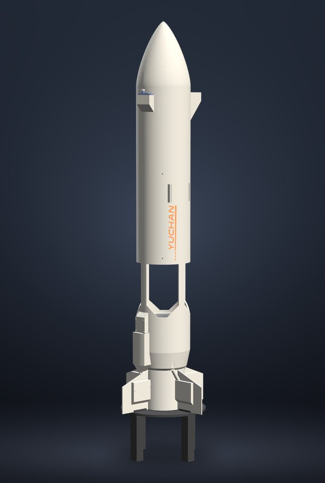
  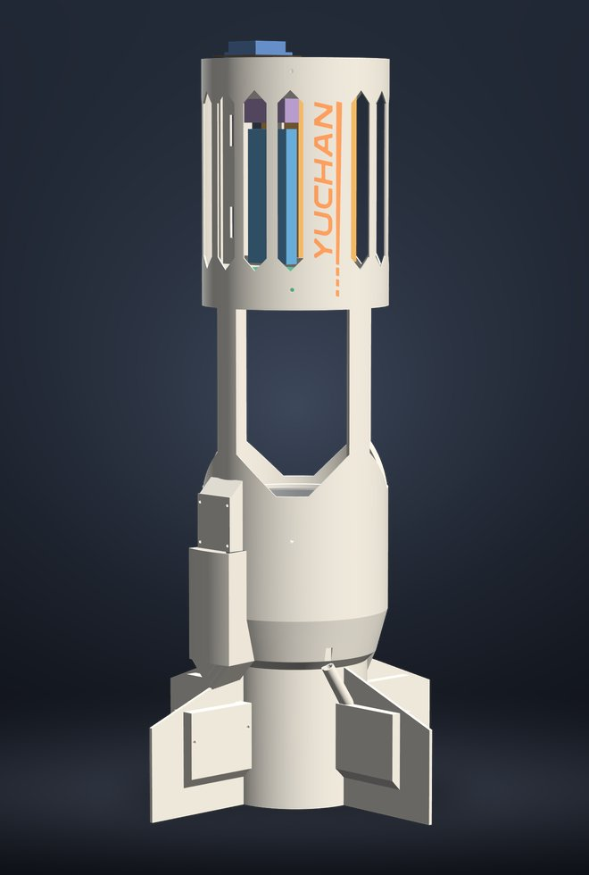
  <br>
  <sub>왼쪽: 로켓 구성(탄도 발사 + 캔위성 사출) · 오른쪽: VTOL 배터리 구성. CadQuery 형상을 PyVista(VTK)로 그린 렌더(색은 화면용), 2026-11-04.</sub>
</p>

로켓은 수직으로 올라가 모터를 끄고, 정점에서 노즈콘을 열어 캔위성을 내보낸 뒤 자체 낙하산으로 내려옵니다.
VTOL은 같은 추진·흡입 모듈에 짧은 전자부를 얹은 시험용 기체로, 배터리·유선·하이브리드 세 가지 전원 구성이 있습니다.
자세는 배기구의 베인 4개(MG90S 직접 구동)로 잡고, 비행 계산은 모두 ATmega128A 칩 4개가 합니다.

> **실물 비행·추력 시험 전입니다.** 아래 숫자는 CAD, 슬라이서, 시뮬레이션에서 나온 값입니다.

## 한눈에 보기

| 항목 | 값 | 종류 | 근거 |
|---|---|:-:|---|
| 로켓 구성 질량 | **2,599.2 g** | M | `cad/exports/cadquery_report.json` |
| VTOL 질량 (배터리 / 유선 / 하이브리드) | **1,653.7 / 1,405.8 / 1,526.8 g** | M | `cadquery_report_vtol*.json` |
| 몸통 | Ø120 mm, 벽 1.2 mm | 설계 | `params.json` `body` |
| 높이 (로켓 / VTOL 배터리 / 유선·하이브리드) | 856.3 / 485.9 / 500.3 mm (발사대 제외) | 설계 | CadQuery 보고서 `vehicle_h_mm` |
| 추진 | 90 mm 12엽 EDF, 6S, 100 A ESC | 부품 | [예산안](docs/budget/예산안.md) |
| EDF 추력 | 2.14–3.09 kgf (22.2 V) - **아직 재지 않음** | A | 3.09 = 판매자 추력표(대리값), 2.14 = 설계 하한(배터리 VTOL T/W 1.3), `params.json`. 판정 기준 안에서 날려면 약 2.6 kgf 이상 필요([결과 문서](docs/v0.9_시뮬레이션_제어_결과.md)) |
| 비행 컴퓨터 | ATmega128A × 4 (NAV · FCU · COM · GNS), 16 MHz, 250 Hz 제어 틱 | 설계 | `params.json` `flight_computer` |
| 예산 (로켓 / VTOL 배터리) | 421,232원 / 375,192원 | M + A | 2026-10-13 판매가, 추정 줄 일부 ([로켓](docs/budget/예산안.md), [VTOL](docs/budget/예산안_vtol.md)) |
| 출력 시간 (로켓 / VTOL) | 47 h 29 min / 32 h 41 min | M + A | Bambu Studio 슬라이스, 로고 퍼지량은 가정값 ([임시 출력 계획](cad/exports/print/provisional_v09_cadquery/print_plan_provisional.md): CadQuery STL 슬라이스, Fusion 실행 전) |

<sub>M = 도구로 잰 값(CadQuery, 슬라이서) · E = 추정 · A = 가정(아직 재지 않은 입력) · 설계 = `params.json` 입력값 · 부품 = 예산안의 구매 부품 사양. 질량은 출력 부품을 슬라이서 값으로 넣은 CAD 합계이고, 일부 전자부품 질량은 가정값입니다. 로켓 출력 시간은 발사대 포함.</sub>

## 갤러리

|  |  |  | 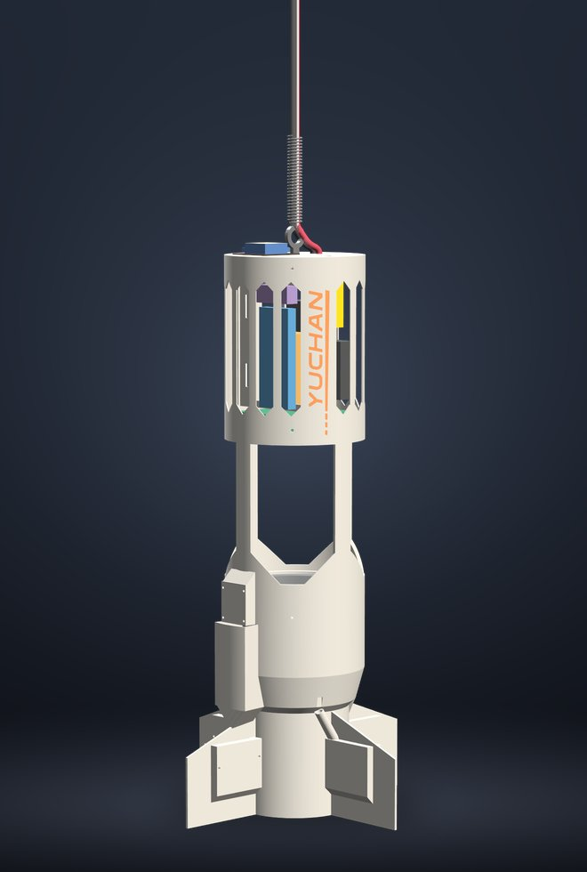 |
|:-:|:-:|:-:|:-:|
| <sub>로켓 · 2,599.2 g</sub> | <sub>VTOL 배터리 · 1,653.7 g</sub> | <sub>VTOL 유선 · 1,405.8 g</sub> | <sub>VTOL 하이브리드 · 1,526.8 g</sub> |

| 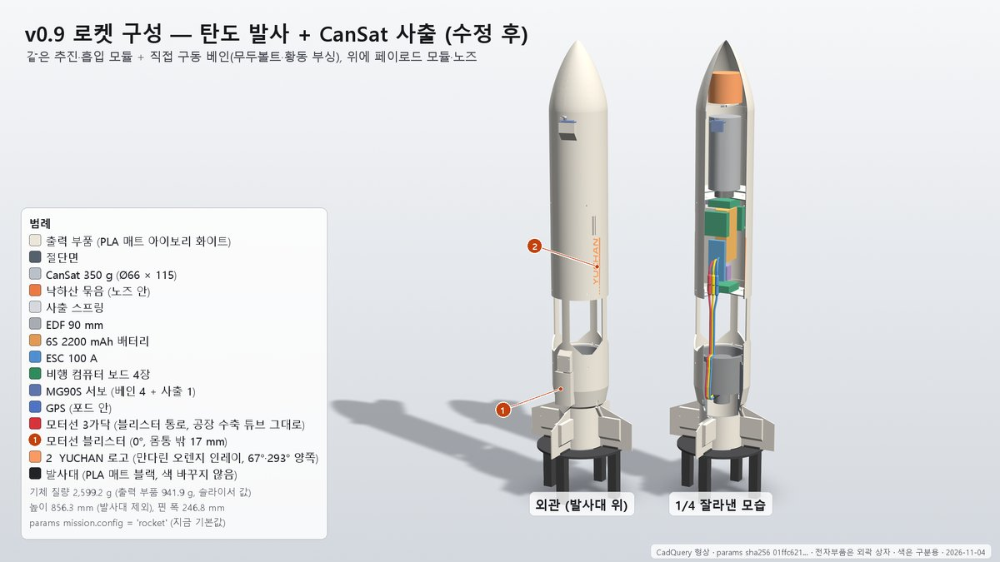 | 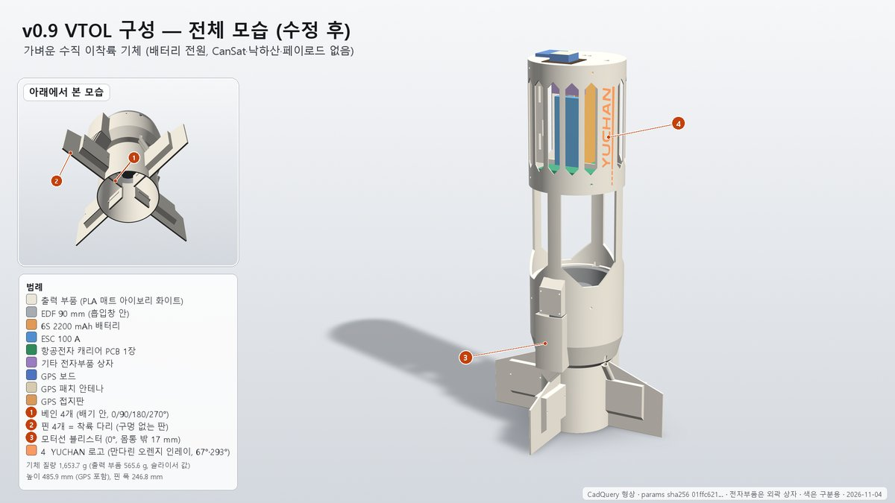 |
|:-:|:-:|
| <sub>로켓 구성: 외관과 1/4 잘라낸 내부 (캔위성 350 g, 낙하산, EDF, 배터리)</sub> | <sub>VTOL 구성: 낙하산·캔위성을 빼고 짧은 전자부를 얹은 기체</sub> |
| 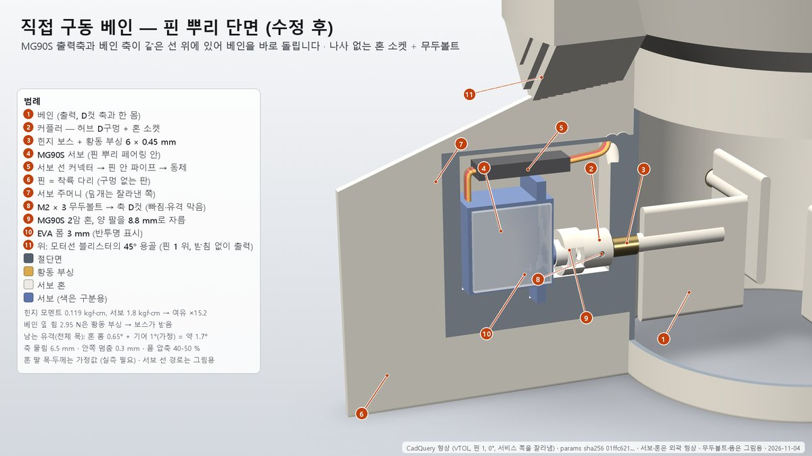 | 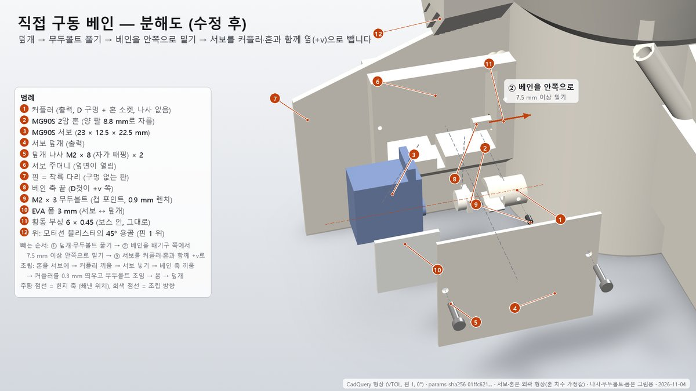 |
| <sub>직접 구동 베인 단면: 서보 축과 베인 축이 한 선 위, 나사 없는 혼 소켓</sub> | <sub>같은 베인의 분해도</sub> |
| 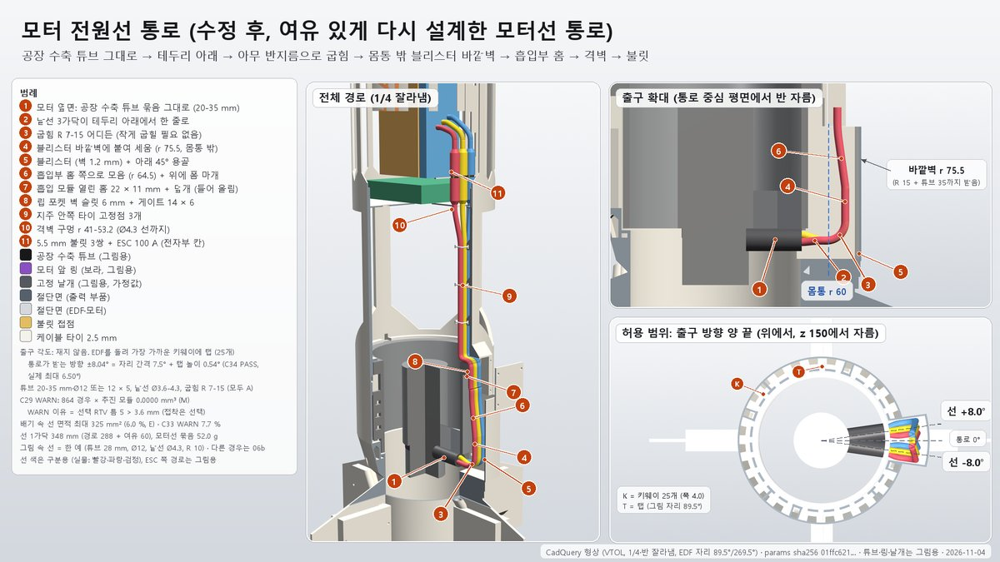 | 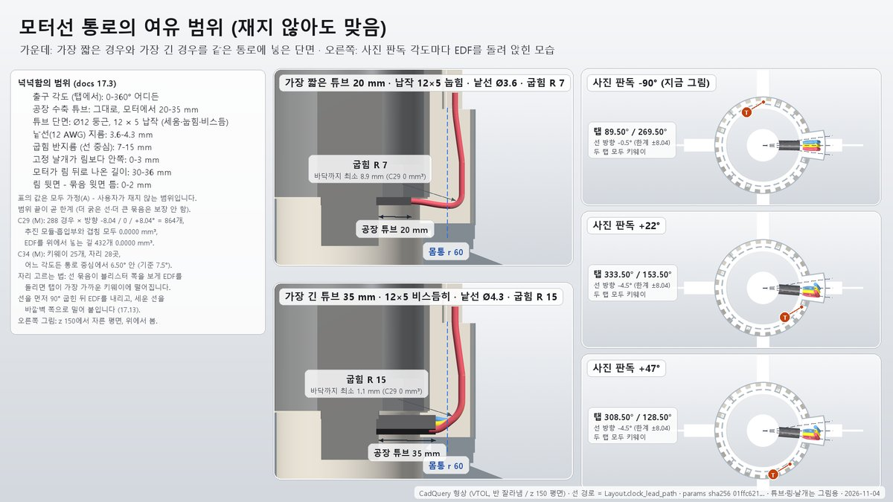 |
| <sub>모터 전원선 통로 단면 (시계 장착, 몸통 밖 블리스터)</sub> | <sub>통로의 여유 범위: 재지 않아도 맞게 설계한 범위 (출구 각도 0–360°, 선 지름 3.6–4.3 mm)</sub> |
| 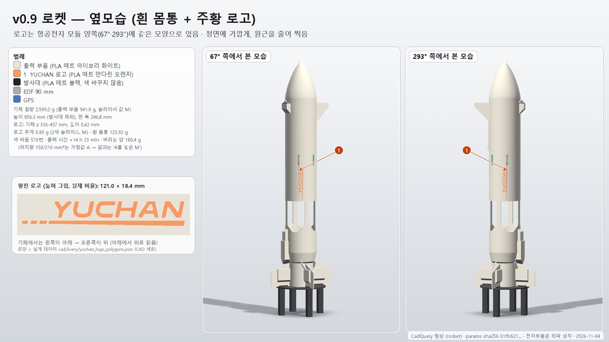 | 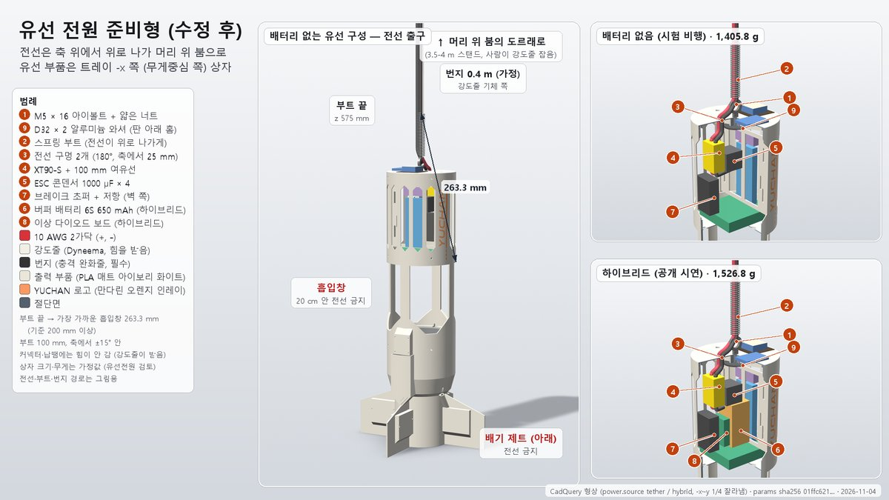 |
| <sub>로켓 옆모습: 로고는 전자부 모듈 양쪽(67° / 293°)</sub> | <sub>유선 전원 준비형 VTOL (배터리 없는 유선, 하이브리드)</sub> |

<sub>모든 그림은 CadQuery 형상의 렌더입니다. 전자부품은 외곽 상자로, 선·폼·나사 일부는 그림용으로 그렸습니다.</sub>

## YUCHAN 로고

<p align="center">
  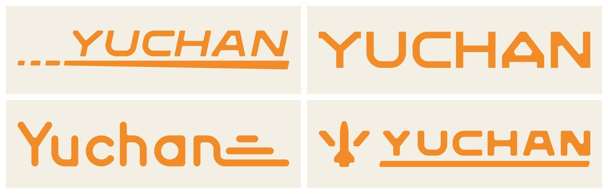<br>
  <sub>① 후보 4개 - 왼쪽 위부터 launch, extended, retro, patch. 사용자가 <b>launch</b>를 골랐습니다.</sub>
</p>
<p align="center">
  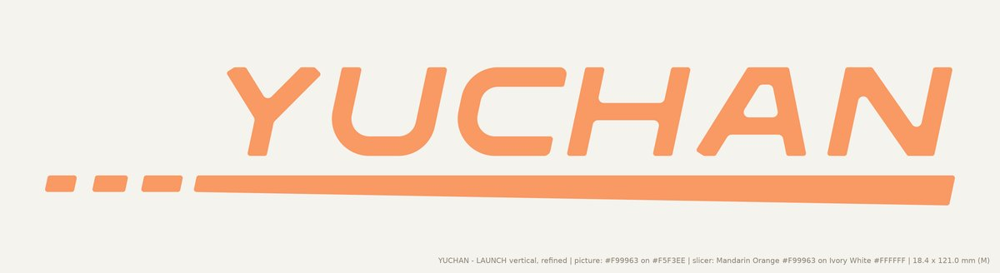<br>
  <sub>② 기체 축을 따라 세로로 넣도록 다듬은 최종 모양 (펼친 크기 121.0 × 18.4 mm)</sub>
</p>
<p align="center">
  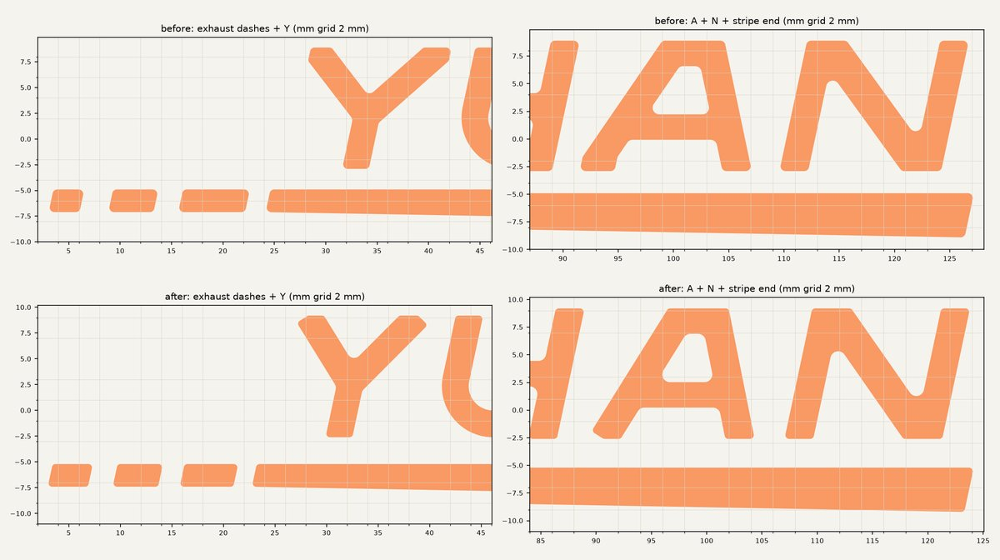<br>
  <sub>③ 다듬기 전(위)과 후(아래) 확대 비교, 2 mm 격자</sub>
</p>

| 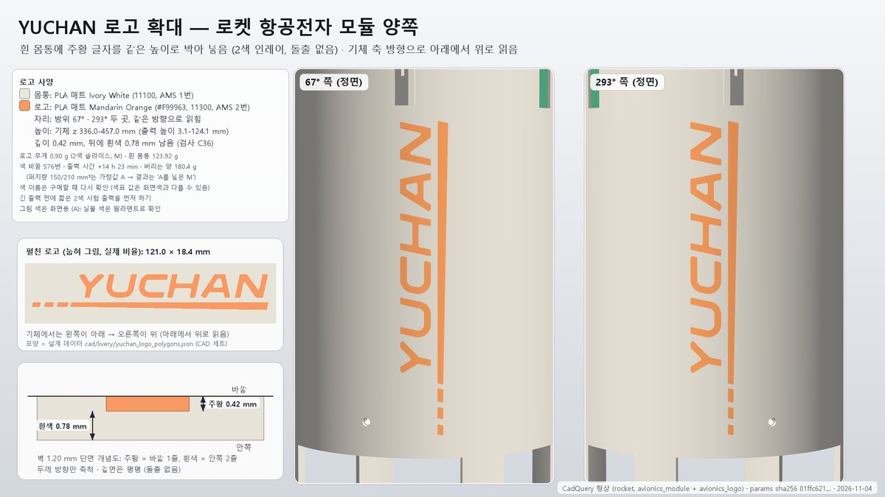 | 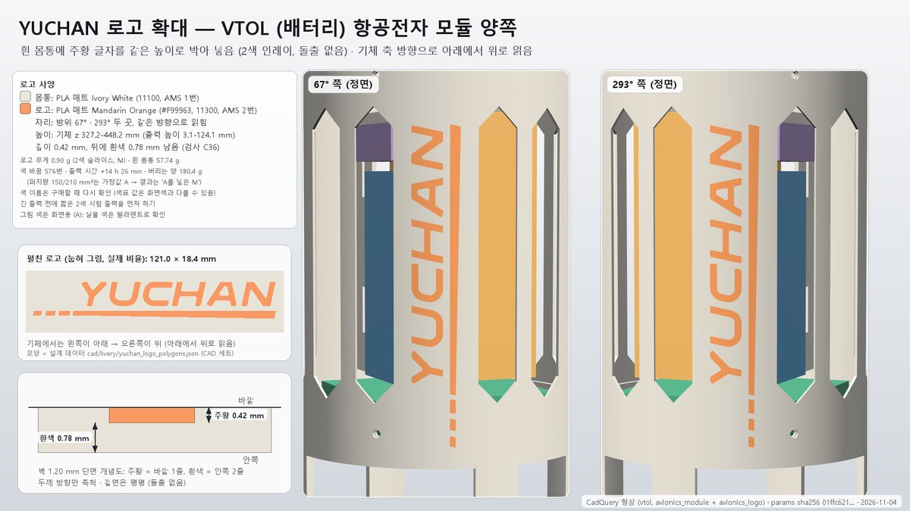 |
|:-:|:-:|
| <sub>④ 기체 위: 로켓 전자부 모듈 양쪽</sub> | <sub>④ 기체 위: VTOL 전자부 모듈 양쪽</sub> |

* **찍는 방법**: P2S + AMS 2색 상감. 흰 몸통(PLA Matte Ivory White 11100)의 바깥 벽 한 줄(0.42 mm)만 주황(Mandarin Orange 11300)으로, 튀어나오지 않습니다.
* **자리**: 전자부 모듈 방위 67° / 293°, 아래에서 위로 읽음. 형상 검사 C36 PASS (창·슬롯·구멍에서 3 mm 이상, 가장 가는 획 2.20 mm).
* **AMS 비용 (슬라이서 M, 퍼지량 150 / 210 mm³는 가정 A)**: 색 바꿈 576번, 출력 +14 h 23–26 min, 버리는 양 180.4 g.
* 자세한 내용: [하드웨어 변경 문서 18장](docs/v0.9_하드웨어_변경.md), [제작 가이드 2장](docs/제작가이드.md).

## 개발 과정

**v0.6.3 → v0.8.1 (2026-10-13 ~ 10-21)** - 예산판 로켓을 Fusion 360 스크립트와 CadQuery 두 프로그램으로 따로 모델링해 서로 확인했습니다. v0.8.1에서 GPS 위치 유지를 맡는 네 번째 칩(GNS)을 더했습니다.

| 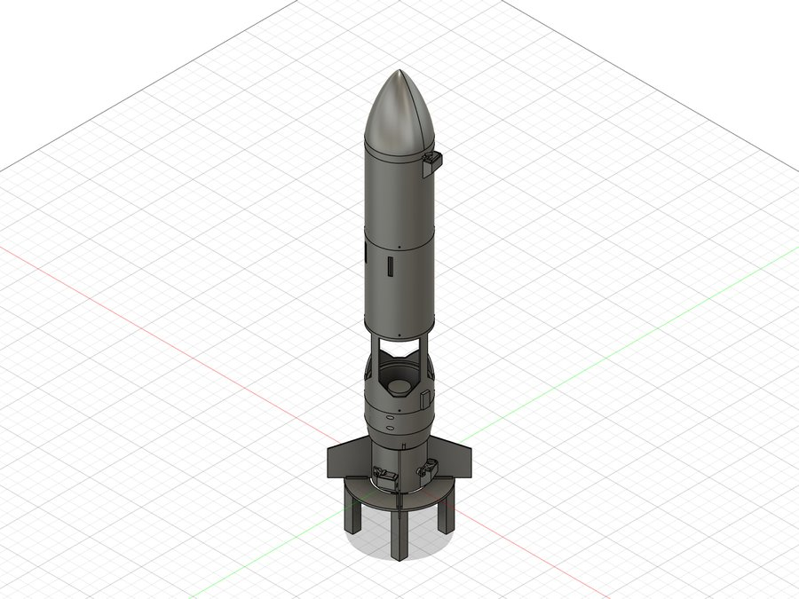 | 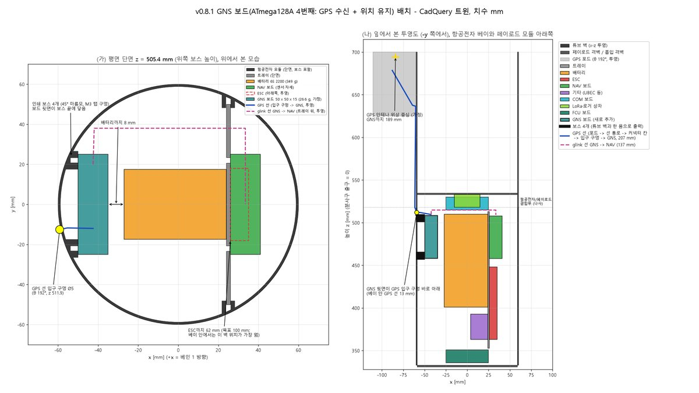 |
|:-:|:-:|
| <sub>Fusion 360 스크립트 v0.6.3 실행 결과 (2026-10-20, 컴포넌트 41개)</sub> | <sub>v0.8.1 GNS 보드 배치 (CadQuery 트윈 그림)</sub> |

**v0.9 (2026-10-28)** - 가벼운 VTOL 구성, 직접 구동 베인, 제어 라운드(C1–C7), 검토 수정 라운드(F1–F10)와 유선 전원 규칙(T1–T6). 바뀔 때마다 이전 / 이후를 같은 조건의 시뮬레이션으로 나란히 비교했습니다.

<p align="center">
  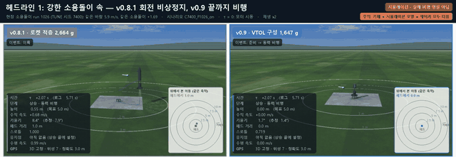<br>
  <sub><b>시뮬레이션 (실제 비행 영상 아님), 2배속.</b> 같은 강한 소용돌이 바람에서 v0.8.1 로켓 적층(왼쪽)은 회전이 커져 비상정지하고 낙하산을 펼치고, v0.9 VTOL(오른쪽)은 계속 비행합니다.
  기체·시뮬레이션 모델·제어가 모두 달라서 차이 전부를 제어 변경의 효과로 볼 수는 없습니다. 영상 속 기체는 흰색 도색 전의 검정판이고, 질량은 영상을 만들 때의 값입니다.</sub>
</p>

<p align="center">
  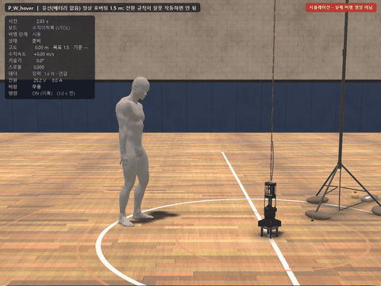<br>
  <sub><b>시뮬레이션, 실시간.</b> 배터리 없는 유선 VTOL이 실내에서 1.5 m까지 떠올라 호버링합니다. 사람 모형은 크기 비교용입니다. 영상 속 기체는 흰색 도색 전의 검정판입니다.</sub>
</p>

**모터선 통로 (2026-10-28 ~ 11-04)** - 처음 두 판은 모터선 출구를 가정했고, 10-29에 실물 사진으로 출구를 확인했습니다. 11-03에는 어느 각도로 나와도 재지 않고 맞는 설계로 바꿨습니다: EDF를 돌려 선 묶음을 통로 하나에 맞추고, 장착 탭은 둘레의 키웨이 25개 중 가까운 곳에 들어갑니다(시계 장착).

<p align="center">
  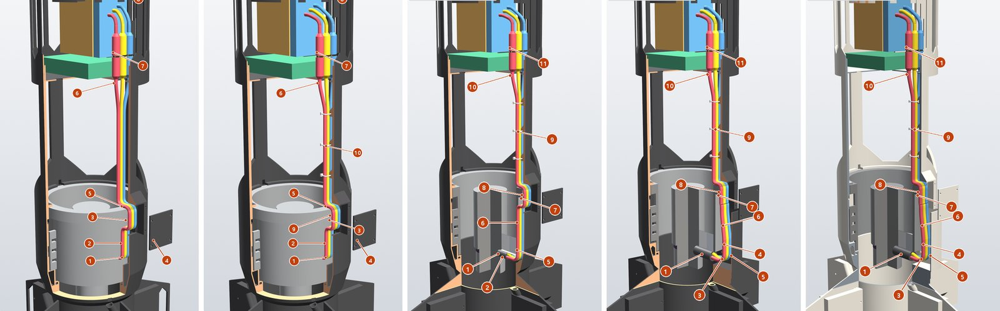<br>
  <sub>왼쪽부터 10-28 처음 → 10-28 수정 → 10-29 실물 사진 기준 출구 → 시계 장착(11-03 설계, 11-04 수정 라운드 뒤, 검정) → 11-04 흰색. 1/4 잘라낸 단면.</sub>
</p>

| 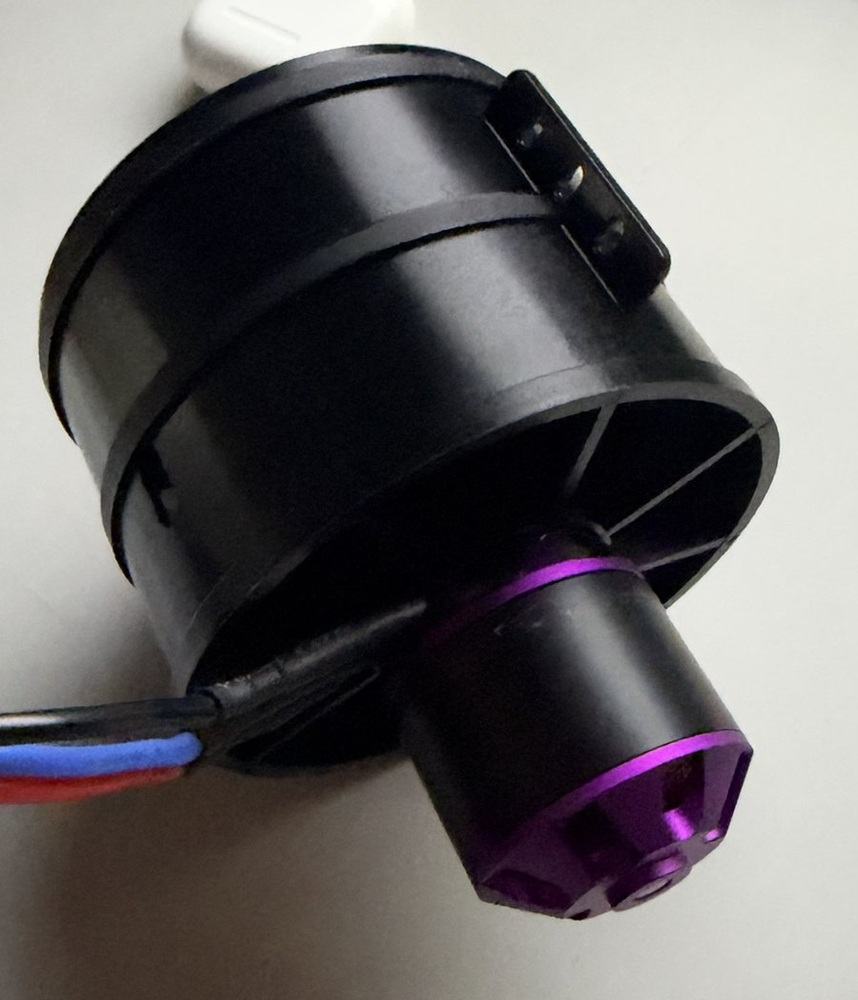 | 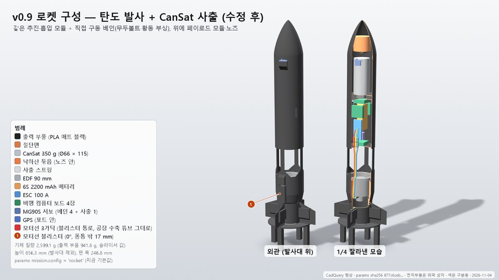 |
|:-:|:-:|
| <sub>실물 EDF (2026-10-29): 모터선 묶음이 나오는 자리를 이 사진으로 정했습니다</sub> | <sub>흰색 도색 직전의 로켓 (2026-11-04 오전, 검정 PLA). 위 갤러리가 지금 모습입니다</sub> |

## 검증 방식

설계값은 한 곳(`params.json` → `cad/layout.py`)에서 나오고, 합격·불합격은 정해진 도구와 기준으로 판정합니다.

* **형상 검사 C1–C36** (CadQuery): 네 구성 모두. FAIL / WARN - 로켓 0 / 5, VTOL 배터리 0 / 3, 유선 1 / 2, 하이브리드 1 / 2.
* **Fusion 360 교차 확인**: 같은 사양을 Fusion 스크립트로도 만듭니다. 이번 라운드는 스크립트 모의 실행(재생)으로 CadQuery 형상과의 불리언 차이를 봤습니다(로고 0.0000 mm³). Fusion GUI 실행(0.9.6)은 아직 사람이 해야 합니다.
* **슬라이스**: Bambu Studio CLI로 실제 슬라이스하고 무게·시간·색 바꿈 수를 G-code에서 셉니다.
* **6자유도 시뮬레이션 + 캠페인**: 현장 조건 500회에서 통과 18 %, 비상정지 13 % ([결과 문서](docs/v0.9_시뮬레이션_제어_결과.md)).
* **4칩 공동 시뮬레이션** (simavr): NAV · FCU · COM · GNS 펌웨어를 명령어 단위로 함께 돌립니다. 합격 기준 22개 모두 통과(2026-10-29, [펌웨어 결과](docs/v0.9_펌웨어_결과.md)). 11-04에 헤더를 다시 만들어서 21행(탄도 이미지 해시)은 새 해시로 사용자 재선언을 기다립니다([하드웨어 변경 18.8](docs/v0.9_하드웨어_변경.md)).
* **독립 검토**: 라운드마다 다른 검토자가 복사본에서 다시 돌려 결함을 찾고, 고친 것과 남긴 것을 문서에 적습니다.

> **아직 열려 있는 것**
> * EDF 추력을 재지 않았습니다. 실물 출력·조립·비행, 실제 칩 측정도 아직 없습니다.
> * C33 옆 치우침: 유선 **FAIL 14.0 %**, 하이브리드 **FAIL 11.2 %** - 무게중심 이동 등 사용자 결정.
> * 가벼운 VTOL 기체의 시나리오 시험 5개가 원래부터 실패합니다(2026-11-04 pytest, [하드웨어 변경 17.9](docs/v0.9_하드웨어_변경.md), [펌웨어 결과](docs/v0.9_펌웨어_결과.md) 6장).
> * AMS 퍼지량 150 / 210 mm³는 가정값입니다. 긴 출력 전에 짧은 2색 시험 출력이 필요합니다.

## 폴더 구조

| 경로 | 내용 |
|---|---|
| [`cad/`](cad/) | 레이아웃(`layout.py`), Fusion 360 스크립트, CadQuery 트윈 + 형상 검사, 로고(`livery/`), 출력 파일 |
| [`sim/`](sim/) | 6자유도 비행 시뮬레이션, 기체 감독 로직·링크 기준 구현, 게인 튜닝, 캠페인 |
| [`firmware/`](firmware/) | ATmega128A 4칩 펌웨어(avr-gcc), 지상 브리지, simavr 공동 시뮬레이션 |
| [`sizing/`](sizing/) | 질량·추력·에너지·안정성·강도 산정 |
| [`tools/`](tools/) | 지상국, 출력 파일 생성, 예산, 시뮬레이션 영상 도구 |
| [`docs/`](docs/) | 사양서, 변경 문서, 제작 가이드, 예산, 시험·안전·법규 |
| [`render/`](render/) | Blender 렌더 파이프라인 (시뮬레이션 영상용) |

<sub>`sim/out/`과 STL · STEP · F3D 파일은 만들어지는 파일이라 저장소에 없습니다. 다시 만드는 방법은 아래 기술 상세에 있습니다.</sub>

## 라이선스

[CC BY-NC 4.0](https://creativecommons.org/licenses/by-nc/4.0/) - 출처를 밝히면 비상업적 목적으로 공유·수정할 수 있습니다. 자세한 내용은 [LICENSE](LICENSE). 다른 사람의 자료는 각자의 라이선스를 따릅니다([render/assets/CREDITS.md](render/assets/CREDITS.md)).

<sub>README의 그림은 모두 기존 렌더·사진·영상을 자르거나 줄인 복사본입니다. 출처와 sha256: [docs/images/SOURCES.md](docs/images/SOURCES.md)</sub>

---

## 기술 상세 (원래 README)

<sub>아래는 기존 README 내용 그대로입니다. 날짜가 적힌 문단은 그 시점의 기록입니다.</sub>

# CanSat EDF Rocket — 덕티드팬 추진 캔위성 발사체

캔위성을 싣고 수직으로 올라간 뒤, 모터를 끄고 정점에서 노즈콘을 분리해 캔위성을 내보내고, 기체는 자체 낙하산으로 내려오는 발사체입니다.
추진은 90 mm 전기 덕티드팬(EDF) 1개, 자세 제어는 배기구의 베인 4개(MG90S 서보)로 합니다.
비행 계산은 모두 **ATmega128A**(v0.6.3: NAV·FCU·COM 3개, v0.8.1부터 GNS를 더해 4개)가 하고, 구조물은 전부 <b>Bambu Lab P2S + PLA Matte 흰색(Ivory White)</b>으로 출력하고, 전자부 모듈 양옆에 주황(Mandarin Orange) **YUCHAN** 로고를 AMS 2색 상감으로 넣습니다(2026-11-04; 발사대는 검정).

기본 설계는 **예산판 `BUDGET_90mm_6S`** (캔위성 제외)이고, 현재 판은 **v0.9** (2026-10-28)입니다. 아래 표와 "검증 방법"의 숫자 중 날짜가 2026-10-16 이전인 것은 v0.6.3 로켓 기준 값입니다.
처음 설계(KAIST 1 kg 캔위성, 12S)는 `params.json`의 `KAIST_90mm_12S` 프리셋으로 그대로 남아 있습니다.

## 현재 상태 (v0.9, 2026-10-28)

* **하드웨어 v0.9**: 직접 구동 베인, 가벼운 **VTOL 구성**(배터리 1,653.6 g, 배터리 없는 유선 1,405.7 g, 하이브리드 1,526.7 g; 낙하산·캔위성 없음). 로켓 구성은 2,599.1 g. **2026-11-03 모터선 통로를 "재지 않아도 맞게" 바꿨습니다(시계 장착)**: EDF를 돌려 선 묶음을 0°의 통로 하나(몸통 밖 블리스터)에 맞추고, 탭은 둘레의 키웨이 25개 중 가까운 곳에 들어갑니다(탭 나사 없음; 2026-11-04 수정 라운드: 키웨이 사이 이빨이 모터 토크를 탭 하나로 받아도 안전율 5.9, 선은 먼저 굽히고 EDF를 내림). 공장 수축 튜브 그대로, 출구 각도 0-360°, 선 지름 4.3 mm, 굽힘 7-15 mm까지 받고 모든 경우의 겹침이 0 mm³입니다(C29, C34). 무게 목표(1,650 / 1,400 g)는 3.6 / 5.7 g 넘습니다. 옆 치우침 검사 C33(선 항력 포함, 나쁜 쪽 방위·Cd): 유선 **FAIL 14.0 %**, 하이브리드 **FAIL 11.2 %**, 배터리 WARN 7.7 %, 로켓 WARN 5.7 % - 무게중심 이동 등 사용자 결정. 출력 전에 잴 것은 없습니다(조립한 그대로의 추력 시험만 필요). 비행 컴퓨터는 ATmega128A 4개(NAV·FCU·COM·GNS, v0.8.1부터). 자세한 내용: [docs/v0.9_하드웨어_변경.md](docs/v0.9_하드웨어_변경.md) 17장.
* **흰색 몸통 + YUCHAN 로고 (2026-11-04)**: 기체 출력 부품을 모두 흰색(Bambu PLA Matte Ivory White, 11100)으로 바꾸고, 전자부 모듈 양옆(67° / 293°)에 주황(Mandarin Orange, 11300) 세로 로고를 평평한 2색 상감(바깥 벽 한 줄, 0.42 mm)으로 넣었습니다. 로켓·VTOL 모두. 새 검사 C36 PASS(창·슬롯·구멍·끝에서 3 mm 이상, 획 2.20 mm). AMS 비용(슬라이서 M, 퍼지량 150/210 mm³는 가정값 A): 색 바꿈 576번, +14 h 26 min, 버리는 양 180 g. 주황은 한 번만 지나가게 찍습니다(얇은 벽 감지, 독립 검토 F1). 무게: VTOL 배터리 1,653.7 g, 유선 1,405.8 g, 하이브리드 1,526.8 g, 로켓 2,599.2 g. 자세한 내용: [docs/v0.9_하드웨어_변경.md](docs/v0.9_하드웨어_변경.md) 18장, 출력 방법: [docs/제작가이드.md](docs/제작가이드.md) 2장.
* **시뮬레이션·제어 v0.9 (Python 기준 코드만)**: VTOL 기체에 맞춘 자세 게인, 이륙·착지 제어, 유선 전원 규칙, 독립 검토 반영. 처음 쓴 표본(FRESH2)에서 현장 120회 통과 5 → 22, 비상정지 26 → 17. 새 표본 캠페인 현장 500회: 통과 18 %, 비상정지 13 %. 결과 문서: [docs/v0.9_시뮬레이션_제어_결과.md](docs/v0.9_시뮬레이션_제어_결과.md).
* **EDF 추력은 아직 측정하지 않았습니다.** 시뮬레이션은 22.2 V 기준 2.14~3.09 kgf를 가정합니다. 판정 기준 안에서 날려면 약 2.6 kgf 이상(최소 2.46 kgf)이 필요합니다.
* **남은 큰 위험**: 잔류 회전이 로터와 반대 방향일 때 비상정지, 시연 밀기(5~15 N) 불가(안전 약 3 N 이하), 이륙 초과 상승(유선 최대 약 1.3 m → 도르래 4.5 m 이상).
* **펌웨어는 아직 v0.8.1입니다.** v0.9 제어 변경의 C 이식, 헤더(`params_gen.h`, `gains.h`, `bridge_config_gen.h`) 재생성, 교차검증 벡터, 4칩 공동 시뮬레이션은 다음 펌웨어 라운드에서 합니다. 그때까지 헤더 생성기 시험이 실패합니다.
* **파이썬 시험 (2026-10-28, 프로젝트 전체)**: 1,097 통과, 58 실패, 15 오류, 8 건너뜀, 2 예상 실패. 실패·오류 73개 중 67개는 헤더 생성기가 새 제어 키를 거부해서(펌웨어 라운드), 1개는 지상 브리지 헤더 STALE, 1개는 원래 있던 시험, 4개는 가벼운 기체의 VTOL 시나리오 시험입니다(이유: 결과 문서 10장).

## 조종 방식 (v0.4, 비행 컴퓨터 v0.6.3)

* **기체 안에서는 자세 제어만 합니다.** 비행 컴퓨터는 ATmega128A 3개로 나뉩니다.
  * **NAV**: MPU-6050·MS5611을 읽고 자세 추정과 고도 필터를 돌립니다. 매 틱(250 Hz) 72바이트 항법 프레임을 SPI(nlink)로 FCU에 보냅니다.
  * **FCU**: 기체 감독 로직(명령, 안전 인터록 I1–I10), 자세 제어, 서보·ESC 펄스, 로그. 비행 판단은 모두 여기서 합니다. 항법 프레임이 들어오면 틱을 시작하고, 4.6 ms 안에 오지 않으면 자체 타이머로 돌며 그 틱의 센서를 고장으로 봅니다.
  * **COM**: LoRa 무선, 명령 해독, FCU가 보낸 스냅숏으로 텔레메트리 작성. FCU와 UART(ilink, 250 kbaud)로 연결합니다.
  * NAV와 COM은 비행 판단을 하지 않습니다. 안전 인터록은 어떤 명령으로도 끌 수 없습니다.
  * 근거: `params.json` `flight_computer`, `firmware/atmega128_fc/src/core/nlink_proto.h`, `ilink_proto.h`.
* **발사·모터 정지·노즈 분리는 지상국이 LoRa로 명령합니다.** 노트북의 `tools/ground_station.py`가 초당 2번 기체에 묻고, 기체는 그때만 텔레메트리로 답합니다.
* 지상국의 **어시스트 모드**(기본 켜짐)가 목표 고도에서 CUT, 정점에서 RELEASE를 자동으로 보냅니다. v0.6.3부터는 응답이 안 온 순간(응답 대기 시간 초과)에도 마지막 텔레메트리를 그 나이만큼 앞으로 늘려 같은 규칙으로 판단합니다. 운용자가 언제든 직접 명령하거나 끌 수 있습니다.
* 링크가 끊기거나 느려도 기체가 스스로 안전하게 끝냅니다. 패드에서 2초 끊기면 SAFE, 비행 중 3초 끊기면 모터를 끄고 낙하산을 펼칩니다. 예상 정점이 150 m에 닿으면 모터를 끄고(I4), 사출 명령 없이 떨어지면 스스로 사출합니다(I6). NAV가 비행 중 리셋되면 자세를 잃은 것으로 보고 ABORT합니다(I9).
* LoRa 모듈은 두 종류를 지원합니다. UART형(Ebyte E22/E220/E32)은 그대로 연결하고, SPI형은 **900 MHz SX1276 모듈**(RFM95W, Ra-01H)이어야 합니다. Ra-01/Ra-02는 433 MHz라 맞지 않습니다. SPI형은 지상 쪽에 아두이노 나노 브리지(`firmware/ground_bridge/`)가 필요합니다.

사용법은 [지상국_사용법.md](docs/지상국_사용법.md), 배선은 [firmware/README.md](firmware/README.md)에 있습니다.

| 항목 | 값 | 근거 |
|---|---|---|
| 예산 | 342,082원 (모두 새로 구입). ATmega128 보드 1개와 나사를 보유하면 319,014원. 추정가(ASSUMED) 7줄 합 22,000원: 서보 연장선 7,000, 4 mm 총알 커넥터 5,000, 낙하산 줄 3,000, 사출 스프링 3,000, ilink·nlink 배선 각 1,500, 분압 저항 1,000 | `docs/budget/예산안.md` (2026-10-13 판매가, 링크 포함) |
| 충전기·ISP가 없으면 | +38,500원 | 같은 문서 |
| LoRa 모듈 종류에 따라 지상 쪽 | 최대 +7,761원 (USB-UART 변환기 또는 나노 브리지, 추정가) | 같은 문서 |
| 실을 수 있는 캔위성 | 국제 규격 Ø66 × 115 mm, 350 g | 예산 내 추력 약 3 kg의 한계 |
| 동체 | 외경 120 mm, 벽 1.2 mm, 전장 856 mm | `cad/layout.py` |
| 비행 컴퓨터 | ATmega128A 3개, 16 MHz, 250 Hz. NAV 보드는 트레이(예전 FC 자리), FCU 보드는 흡입 모듈 격벽 위에 폼 테이프 3 mm + 케이블 타이, COM 보드는 페이로드 격벽 아래 보스 4개에 M3×5. 무선·로거 상자(LoRa 모듈, OpenLog, 레벨 시프터, AMS1117)는 COM 옆 격벽 아래 | `params.json` `electronics`, `payload_module.com_mount`; 형상 검사 C22, C24, C25 |
| 이륙 질량 | CAD 2.59 kg (2585.7 g, 출력물 1029 g). 크기 산정의 비행 질량 2.60 kg (2595.7 g, 스프링·피스톤 부속 나머지 10 g 포함) | CadQuery 질량 보고서 (Fusion 360과 0.003 % 일치), `sizing/sizing_report.md` |
| 추진 | Hobbyocean 90 mm 12엽 EDF 6S, 100 A ESC, 6S 2200 mAh | |
| EDF 고정 (2026-11, 시계 장착) | EDF의 장착 탭 2개를 둘레의 키웨이 25개 중 가까운 곳에 넣음(탭 나사 없음). 위는 흡입부 선반, 아래는 탭 밑 폼 패드와 3 mm 바닥 패드. 모터 전선은 0°(ESC 쪽) 통로 하나(블리스터)로. 치수는 판매처 도면 기준 | `docs/SPEC.md` 3.7c, `docs/v0.9_하드웨어_변경.md` 17장 |
| 서보 배선 (v0.6) | 베인 서보 4개의 선: 포드 창 → 핀 옆 바깥 → 추진 모듈 안 통로 → 흡입 모듈 서보 통로 → 흡입 격벽 구멍 → 격벽 위 FCU 보드(전자 칸 맨 아래)에서 끝납니다. 연장선 길이 524 / 434 / 450 / 539 mm (서보 1–4) | `cad/layout.py`, 형상 검사 C23 |
| 추력/중량비 | 1.19 (비행 질량 2.60 kg), 1.195 (CAD 질량 2.59 kg). 대용 추력표의 공칭 30.3 N 기준. 검사 C12 경고 (통과 기준 1.30) | `sizing/sizing_report.md`, `cad/exports/cadquery_checks.md` |
| 정적 안정 여유 | 0.50–0.51 구경: 시뮬레이션 0.50, CAD 검사 C13 0.51, 크기 산정 0.51. 경고선 0.5, 권장 1.0 | `sim/out/sim_report.md`, `cadquery_checks.md`, `sizing_report.md` §6 |
| 비행 (S2) | 목표 140 m, UART형 링크 손실 5 %. 정점 144.8 m, 어시스트 CUT 122.3 m, 노즈 분리 정점 0.12 s 뒤 (v_z −1.2 m/s), 착지 6.2 m/s | 6자유도 시뮬레이션 S2 |
| S2 추가 시드, 몬테카를로 | 추가 시드 10개 모두 통과 (정점 135.2–148.7 m, 1개는 I4가 먼저 모터를 끔). 몬테카를로 20개 중 19개 통과 (1개는 분리 때 v_z −5.01 m/s로 기준 5 m/s를 넘음). 20개 모두 정점 150 m 아래 (134.6–148.3 m) | 같은 보고서 |
| 다른 시나리오 | S1: 기울기 10° → 1° 이내 0.68 s. S4: 베인 고착 → 0.37 s 뒤 ABORT, 착지 6.3 m/s. S5: 게인 ±50 % 10가지 모두 안정. S6: 비행 중 링크 끊김 → 3 s 뒤 ABORT, 0.5 s 뒤 사출, 착지 6.2 m/s. S7: 어시스트 끔 → I4가 모터 끔, I6이 정점 1.34 s 뒤 사출, 착지 6.2 m/s. S8: 손실 30 % → 통과, 추가 시드 10개 모두 통과 | 같은 보고서 |
| LoRa 왕복 지연 | UART형 0.437 s (응답 대기 0.531 s), SPI형 0.198 s (0.292 s). 모델값, 실측 필요 | `sim/link_model.py` |
| 제어 지연 | IMU 샘플 → 마지막 베인 PWM 레지스터: 최대 4.66 ms, 비행 중 중앙값 4.24 ms. 6자유도 시뮬레이션은 4.71 ms로 비행 | 3칩 공동 시뮬레이션 (simavr, 실기 아님), `sim/fc_timing.py` |
| 칩 부하 | 4 ms 틱 중 시간 제약 구간: FCU 최대 2.58 ms (64 %, 고장 주입 포함), NAV 최대 2.24 ms (56 %), MPU 버스트 전체를 더한 상한 2.43 ms (61 %). 기준 80 %. 플래시 FCU 27,956 B, NAV 17,332 B, COM 10,280 B (UART형) / 10,756 B (SPI형) | `firmware/atmega128_fc/host_test/build/cosim_report.json` |
| 출력 | 기체 24시간 50분, PLA 1070 g (발사대 포함 30시간 21분, 1272 g) | Bambu Studio로 실제 슬라이스, `cad/exports/print/print_plan.md` |

## Fusion 360에서 열기

1. 스크립트 설치 (한 번만):
   ```bash
   .venv/Scripts/python.exe tools/install_fusion_script.py
   ```
2. Fusion 360에서 `Shift+S` (유틸리티 → 스크립트 및 추가 기능) → `CanSatEDFRocket` → 실행.
3. 새 디자인에 컴포넌트 41개가 만들어지고 다음 파일이 생성됩니다. 이 PC에서는 약 2분 30초(151.8 s) 걸렸습니다.
   * `cad/exports/fusion/CanSatEDFRocket.f3d` — Fusion 아카이브
   * `cad/exports/fusion/CanSatEDFRocket.step`, `cad/exports/fusion/stl/*.stl`
   * `cad/exports/fusion360_report.json` — 부품별 체적·질량·무게중심·관성모멘트
4. 실행 로그에서 필수 피처 줄과 `41/41 components OK`를 확인합니다. 확인할 줄은 [cad/fusion360/README.md](cad/fusion360/README.md)에 있습니다.

원래 12S 설계를 보려면 `cad/fusion360/preset.txt`의 마지막 줄을 `KAIST_90mm_12S`로 바꾸고 다시 실행하세요.
치수는 `params.json`에서 바꾸고 스크립트를 다시 실행합니다. Fusion의 사용자 매개변수 표는 형상을 직접 구동하지 않습니다.

## 지상국 실행

연습 모드(가상 기체, 하드웨어 없이):

```bash
.venv/Scripts/python.exe tools/ground_station.py --sim
```

실제 비행(Ebyte 모듈을 USB-UART 변환기로 연결한 경우, 포트 이름은 장치 관리자에서 확인):

```bash
.venv/Scripts/python.exe tools/ground_station.py --port COM5
```

## 폴더

| 경로 | 내용 |
|---|---|
| `params.json` | 모든 치수·질량·게인·핀 배치·링크 설정. `alt_presets`에 원래 설계 |
| `cad/layout.py` | 파라미터에서 모든 높이·반경을 유도 (`python cad/layout.py [프리셋]`) |
| `cad/fusion360/` | Fusion 360 API 스크립트 |
| `cad/cadquery/` | 독립 검증용 CadQuery 모델 + 형상 검사 C1–C25, X1–X2 |
| `cad/exports/print/` | **출력 방향이 적용된 STL**, 흡입 모듈은 창마다 서포트 차단이 든 Bambu 프로젝트 `intake_module.3mf`, 출력 계획 `print_plan.md` |
| `docs/budget/` | 예산안, 가격 조사 원자료(출처 URL), 구성 비교 |
| `sizing/` | 질량·추력·에너지·제어 권한·낙하산·안정성·법규 산정 |
| `sim/` | 6자유도 비행 시뮬레이션, 기체 감독 로직·LoRa 링크·칩 사이 링크(ilink, nlink)의 기준 구현, 게인 튜닝 |
| `firmware/atmega128_fc/` | 비행 펌웨어 3종 (avr-gcc, PlatformIO): NAV `src/nav/`, FCU `src/main.c`, COM `src/com/`, 공통 `src/core/`. 배선·퓨즈·교정·거리 시험 안내 |
| `firmware/atmega128_fc/tools/cosim/` | 세 칩을 함께 돌리는 공동 시뮬레이션 (simavr) |
| `firmware/ground_bridge/` | SPI형 LoRa용 아두이노 나노 지상 브리지 |
| `tools/ground_station.py` | 노트북 지상국 (명령, 텔레메트리, 어시스트, 로그, 연습 모드) |
| `tools/make_print_files.py` | Fusion STL → 출력 파일, Bambu Studio 슬라이스, 흡입 모듈 창 안 서포트 검사, `--check`로 최신 여부 확인 |
| `docs/SPEC.md` | 공학 사양서(영문)와 변경 이력 |
| `docs/제작가이드.md` | 부품, 출력, 조립 순서 |
| `docs/지상국_사용법.md` | 지상국 설치, 비행 순서, 연습 모드 |
| `docs/시험_안전_법규.md` | 단계별 시험, 안전, 국내 법규 |

## 검증 방법

설계값은 한 곳(`params.json` → `cad/layout.py`)에서 나오고, 서로 독립인 도구로 교차 확인했습니다. 보고서가 어느 `params.json`에서 나왔는지는 아래 "params.json 해시" 항목을 보세요.

* **Fusion 360 ↔ CadQuery**: 같은 사양을 두 프로그램이 따로 모델링합니다. 출력 부품 11종 모두 체적 0.45 % 이내, 무게중심 0.082 mm 이내, 관성모멘트 0.62 % 이내로 일치하고, 전체 질량 차이는 0.003 %(2585.80 g / 2585.73 g)입니다 (`cad/exports/crosscheck_fusion_vs_cadquery.txt`). 이 비교는 2026-10-15의 Fusion 실행(이전 `params.json`)으로 한 것이고, 지금 `params.json`으로 Fusion을 다시 실행할 예정입니다.
* **형상 검사 (BUDGET)**: C1–C25 중 22개 통과, 3개 경고(C10 키웨이 바깥 스피곳 링 0.97 mm 벽(2026-11 시계 장착; 그 전에는 탭 나사 구멍 옆 0.69 mm), C12 추력/중량비, C13 정적 안정 여유), 실패 0. 추가 검사 X1, X2 통과. KAIST 프리셋은 통과 18, 경고 2, 실패 0, 해당 없음 5. EDF 탭, 모터 전선 다발, 서보 리드 경로(C23), 흡입 창의 띠·지주·45° 박공(C9), COM 보드(C22), 무선·로거 상자(C24), FCU 보드(C25)를 실제 형상으로 확인합니다.
* **슬라이스**: Bambu Studio CLI로 P2S + PLA Matte 시스템 프로파일을 써서 모든 부품을 실제로 슬라이스했습니다. 흡입 모듈은 서포트 차단을 넣은 프로젝트로 슬라이스하고, G-code에서 창 안 서포트를 셉니다: 4개 창 모두 0 mm (차단 없이 슬라이스하면 58,229 mm). 슬라이스한 10개 부품의 원본 STL은 지금의 v0.6.3 Fusion 내보내기와 해시가 같습니다.
* **시뮬레이션**: S1, S2, S4–S8 통과, S3은 참고. S2 추가 시드 10/10, S8 추가 시드 10/10, S2 몬테카를로 19/20. 기체 감독 로직, LoRa 링크 모델(지연·손실), 측정한 칩 지연, 지상국 어시스트가 모두 들어간 비행입니다.
* **펌웨어 ↔ 파이썬 기준**: 같은 입력을 C와 파이썬에 넣어 비교했습니다. 제어기 베인 각 차이 최대 2.2e-6 rad (13,624개), 기체 감독 로직 506,232틱 불일치 0, LoRa 프레임 3,000개 스트림 불일치 0, ilink 3,000개 스트림 불일치 0, nlink 20,000개 버퍼 불일치 0, 자세 추정기·고도 필터 기준 이내 (`crosscheck_report*.json`).
* **3칩 공동 시뮬레이션**: NAV·FCU·COM 펌웨어를 simavr 한 프로세스에서 명령어 단위로 함께 돌립니다. 정상 비행 80회와 고장 주입 20회(링크 끊김, COM 리셋, 잡음, NAV 정지·리셋, nlink 손상)에서 기준 43개 모두 통과 (`cosim_report.json`, 2026-10-16). 판정 한계 두 개는 `firmware/atmega128_fc/tools/run_cosim.py`에 이유를 적었습니다: 샘플 → PWM은 한 틱(4 ms)이 아니라 6자유도 시뮬레이션이 쓰는 계산 지연 4.71 ms와 비교하고, NAV를 멈췄을 때 대체 틱 간격은 틱 + 60 µs까지 허용합니다(첫 간격의 ±60 µs와 같은 값).
* **펌웨어 단위시험**: `test_core` 20,173개 검사, 실패 0.
* **파이썬 시험**: 494개. 2026-10-16 실행 결과 491개 통과, 3개 건너뜀, 실패 0입니다. 건너뛴 3개는 립 클램프 프리셋에만 해당하는 CadQuery 시험으로, 기본 프리셋이 탭 고정이라 건너뜁니다("tab-mount preset").
* **실기 미검증**: 펌웨어, LoRa 모듈, 기체는 아직 실물로 시험하지 않았습니다. `docs/시험_안전_법규.md`와 `firmware/README.md`의 거리 시험 순서를 따르세요.

### params.json 해시

모든 보고서가 `params.json` 해시를 기록하지는 않습니다.

* **기록함**: CadQuery 질량 보고서와 형상 검사(`cad/exports/cadquery_*`), 크기 산정 보고서(`sizing/sizing_report*`), 시뮬레이션 결과(`sim/out/metrics.json`, `sim_report.md`), 게인(`sim/out/gains.json`), 생성 헤더 `params_gen.h`(`FC_PARAMS_SHA256_PREFIX`, `FC_PARAMS_TAG`)와 지상 브리지 헤더(`firmware/ground_bridge/src/bridge_config_gen.h`), Fusion 360 보고서(`fusion360_report.json`), 출력 계획(`print_plan.json`, `print_plan.md`). `gains.h`는 `gains.json`의 해시를 적고, `gains.json`의 params 해시가 지금 `params.json`과 다르면 `GAINS_PARAMS_STALE`을 1로 둡니다.
* **기록하지 않음**: 예산 출력(`docs/budget/`), 칩 단독 측정·공동 시뮬레이션·교차검증 보고서(`firmware/atmega128_fc/host_test/build/*.json`). 이것들은 실행 순서(생성 헤더를 만든 뒤에 돌림)와 빌드에 들어간 `FC_PARAMS_TAG`로만 `params.json`과 이어집니다. 공동 시뮬레이션의 COM 리셋 실행에는 FCU 로그 "params tag 0x6E match"가 남습니다.
* **2026-10-16 현재**: Fusion 360 실행과 출력 계획을 뺀 모든 것을 지금 `params.json`(sha256 `0a5c261b…`, `FC_PARAMS_TAG` 0x6E)으로 다시 만들었습니다. Fusion 실행(`3f31c0a1…`)과 출력 계획(`a07c805b…`)은 다시 실행할 예정입니다.

## 남은 위험 (비행 전에 반드시 확인)

* **실물 시험이 없습니다.** 위 숫자는 모두 시뮬레이션, CAD, 사이클 정확 시뮬레이터(simavr)에서 나왔습니다. 벤치·묶음 시험부터 하세요.
* **EDF 추력은 추정값입니다.** Hobbyocean 90 mm는 추력표를 공개하지 않아, 비슷한 Powerfun 90 mm 표(22.2 V에서 3.09 kg)를 썼습니다. 로드셀 시험에서 만충 배터리로 30 N 이상, 전류 120 A 이하가 나와야 비행합니다.
* **EDF 치수는 판매처 도면에서 읽은 값입니다.** 하우징 Ø98, 나팔형 립 Ø112 × 약 11 mm, 립 앞면–하우징 끝 81.1 mm, 탭 바깥 114.2 mm·길이 42.3 mm입니다. 탭 두께는 도면에 없어 3.0 mm로 가정했습니다. 받으면 실측해서 `params.json`에 넣고 다시 생성하세요(`docs/제작가이드.md` 조립 2단계).
* **정적 안정 여유가 경고선 위에 겨우 있습니다 (0.50–0.51 구경, 경고선 0.5, 권장 1.0).** 시뮬레이션 0.50, CAD 0.51, 크기 산정 0.51입니다. 동력 비행 중에는 베인이 자세를 잡고, 문제가 되는 구간은 모터를 끈 뒤 정점까지의 1–3초입니다. 아래쪽에 무게를 더하는 변경은 피하고, 실제 무게중심을 재서 `params.json`에 넣으세요.
* **질량 여러 개가 가정값(ASSUMED)입니다.** FCU 보드 20 g, COM 보드 20 g, 무선·로거 상자 20 g, 서보 연장선 10 g/m 등입니다. 저울로 재서 `params.json`에 넣고 CAD·시뮬레이션을 다시 돌리세요. 무게중심과 정적 안정 여유가 바뀝니다.
* **링크 손실이 남기는 문제.** 어시스트의 CUT 또는 RELEASE 교환 자체를 잃으면 0.531 s 뒤에 다시 보냅니다. 그동안 예상 정점이 약 11.5 m 오르는데, 목표 140 m와 I4 제한 150 m 사이는 10 m입니다. 그래서 일부 비행은 어시스트 대신 I4가 먼저 모터를 끕니다.
  * 연습 모드(손실 5 %, 시드 1–100): UART형 10번, SPI형 6번. 정점은 모두 150 m 아래입니다 (`docs/지상국_사용법.md` 6절. 문서를 쓰면서 돌린 결과이고 보고서 파일로 저장하지 않았습니다).
  * 6자유도 시뮬레이션의 S2형 비행 31번: I4가 먼저 끈 비행 2번, 분리 때 |v_z| 5 m/s를 넘은 비행 1번(−5.01 m/s). 그래서 S2 몬테카를로는 19/20입니다.
  * 모두 안전 쪽 결과지만 화면에 INTERLOCK이 뜹니다. 줄이려면 더 빠른 링크(짧은 응답 대기·물음 간격)나 목표 고도 133 m 이하가 필요합니다 (`sim/out/sim_report.md` findings).
* **LoRa 지연은 모델값입니다.** Ebyte 모듈 내부 지연을 가정했고, 공중속도 2.4 kbps에서 최대 물음 속도는 2.29 Hz라 초당 2번이 거의 한계입니다. 지상국 로그로 실제 왕복 시간과 손실률을 재고, 손실이 10 %를 넘으면 안테나나 위치를 고치세요. 공중속도를 올리면 지연이 줄어듭니다.
* **롤 루프 여유가 작습니다.** 50 Hz 아날로그 서보에서 롤 위상 여유는 기준 위상에서 30.1°, PWM 위상이 가장 나쁠 때 28.7°입니다(기준 30°). 6자유도 이득 여유는 3.08배입니다. 요 방향 오차는 S2에서 최대 38°까지 나옵니다. 기울기 제어에는 영향이 없습니다. 스월 피드포워드는 넣지 않았습니다.
* **NAV가 비행 중 리셋되면 비행이 끝납니다.** 리셋된 NAV는 패드 정렬 없이는 자세 추정을 다시 시작할 수 없어, FCU가 IMU 고장으로 보고 마지막 정상 프레임 0.1 s 뒤 ABORT(I9)합니다. 설계 의도이지만, NAV 전원과 nlink 배선을 확실히 고정하세요.
* **모터 전선은 맨 전선으로 통과시킵니다.** 흡입 모듈의 전선 통로 입구는 6 mm라 총알 커넥터가 지나가지 못합니다. 커넥터는 통과시킨 뒤 납땜합니다(`docs/제작가이드.md` 조립 3·5단계).
* **서보 리드 치수는 가정값입니다.** 리본 3.6 × 1.3 mm와 MG90S 리드가 케이스 어느 쪽으로 나오는지(`lead_exit_ASSUMED`)는 실물에서 확인한 뒤 출력하세요.
* **ESC가 빠듯합니다.** 100 A ESC를 만충 배터리로 최대 출력에서 쓰면 처음 몇 초간 정격을 넘을 수 있습니다(대용 표 기준 124 A). 순간 정격 120 A 안인지 벤치에서 확인하세요.
* **출력 파일 최신 여부 (Fusion 재실행 예정).** Fusion 360 실행(`fusion360_report.json`, params sha256 `3f31c0a1…`)과 출력 계획(`print_plan.md`, `a07c805b…`)은 이전 `params.json`으로 만든 것입니다. 지금 `params.json`(`0a5c261b…`)으로 Fusion을 다시 실행할 예정이고, 그때까지 `python tools/make_print_files.py --check`는 STALE(종료 코드 2)을 냅니다. 출력 폴더에는 `launch_pad.stl`이 없고, 출력 계획에 없는 파일 3개(`launch_pad---------------.stl`, `nose_cone------------------.stl`, `propulsion_module------------.stl`, 뒤의 둘은 예전 날짜)가 있습니다. 출력 계획(`print_plan.md`)에 적힌 파일만 쓰세요. 출력 전에 Fusion 스크립트를 다시 실행하고 `--check`가 0으로 끝나는지 확인하세요. 비행 펌웨어 쪽은 기다릴 것이 없습니다. 생성 헤더(`params_gen.h`, `gains.h`, 지상 브리지 헤더)는 지금 `params.json`과 맞고(`--check` 모두 up to date, `GAINS_PARAMS_STALE` 0), 헤더는 Fusion 보고서를 읽지 않습니다.
* **국내 법규**: 2 kg을 넘으므로 기체 신고와 조종자 증명(3종)이 필요하다고 판단됩니다. LoRa는 KC 인증 920 MHz 대역 모듈을 쓰세요. 433 MHz 사용 가능 여부는 확인하지 못했습니다. `docs/시험_안전_법규.md`를 보세요.
