<h1 align="center">CanSat EDF Rocket with ATmega128</h1>

<p align="center"><b>한국어</b> · <a href="README.en.md">English</a></p>

<p align="center">
  90 mm 덕티드팬(EDF) 하나로 캔위성을 싣고 올라가는 3D 프린트 발사체
</p>

<p align="center"><sub>이 저장소는 비행 컴퓨터를 <b>ATmega128</b>로 만드는 조건의 과제로 진행하는 판입니다. STM32 판과 FPGA 판은 나중에 따로 개발할 예정입니다.</sub></p>

<p align="center"><a href="docs/diagrams/README.md"><b>📐 블록도 · 순서도</b></a> (시스템, 전원, 항공전자, 기계 구성, 비행·사출 순서, 펌웨어 상태, 제어 루프, 개발 흐름)</p>

<p align="center">
  
  
  
  
  
  
</p>

<p align="center">
  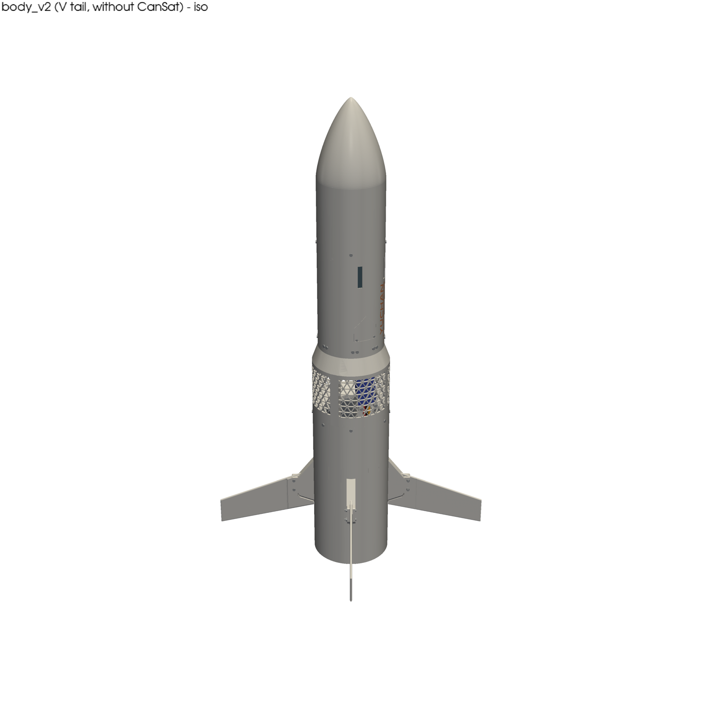
  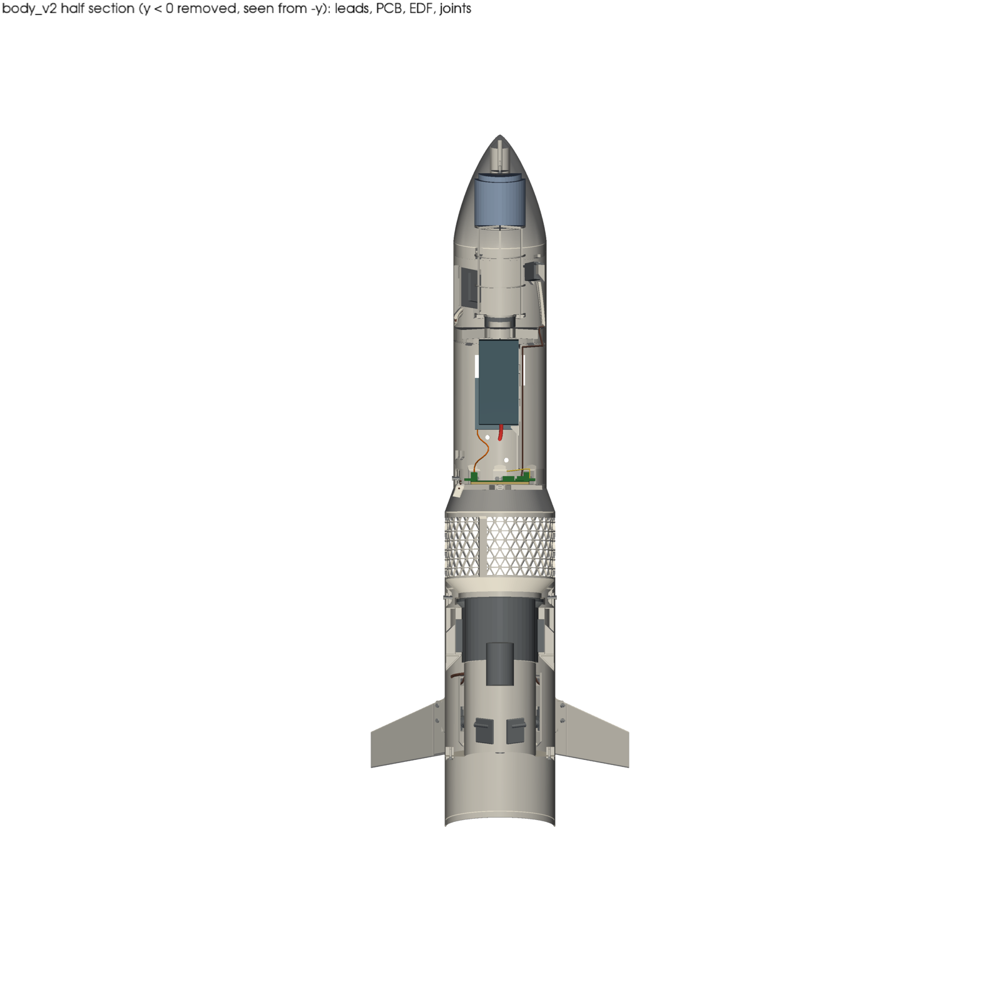
  <br>
  <sub>새 본체 v1.0 (CAD v2, CanSat 없이). 왼쪽 전체, 오른쪽 반 단면(선, 캐리어 PCB, EDF, 이음부). CadQuery 형상의 렌더, 2026-11-20.</sub>
</p>

로켓은 수직으로 올라가 모터를 끄고, 정점에서 노즈콘을 열어 캔위성을 내보낸 뒤 자체 낙하산으로 내려옵니다.
자세는 배기구의 베인 4개(MG90S 직접 구동)로 잡고, 비행 계산은 모두 ATmega128A 칩 4개가 합니다. 칩 4개와 센서·무선·로거는 [캐리어 PCB rev 3.1](#아비오닉스-캐리어-pcb-rev-31) 한 장에 올라갑니다.
**2026-11-18 사용자 결정으로 VTOL은 빼고 로켓으로만 갑니다.** VTOL 설정·CAD·시뮬레이션·펌웨어 빌드는 지웠습니다.

> **실물 비행·추력 시험 전입니다.** 아래 숫자는 CAD, 슬라이서, 시뮬레이션, KiCad 도구에서 나온 값입니다(M = 도구로 잰 값, E = 추정, A = 가정). 캐리어 PCB도 아직 만들어 본 적이 없습니다.

## 지금 상태 (2026-11-20)

* **새 본체 v1.0 (CAD v2)**: 출력 부품 21종을 실제 출력용 CAD로 만들었고, 통합 검사가 모두 통과했습니다(`all_ok = True`, M). 부품을 새로 사지 않고 선을 자르지 않는 동력 배치(ESC를 흡입 모듈 벽에 세움, XT60 잡이)를 네 번의 검토로 다듬었습니다. 자세한 내용: [cad/body_v2/README_ko.md](cad/body_v2/README_ko.md).
* **추력이 모자랍니다.** 2026-11-18 벤치 시험(PWM 93 %에서 약 1.70 kg이 뜸)으로 추정한 EDF 최대 추력은 17.9-19.3 N(E)입니다. 새 본체는 CanSat 없이도 20 N에서 T/W 0.954-0.969라 **지금 추력으로는 뜨지 못합니다.** 정품 로터로 추력을 잰 뒤 방향을 정합니다.
* **PLA 지상시험 로터**: 9엽 로터를 출력용으로 설계했습니다. 사용자가 잰 구동부(17 × 11 × 8 mm)에 맞춰 시험 상한을 11,000 rpm으로 낮췄습니다(안전계수 4.16, E). 비행에는 쓰지 않습니다. [docs/EDF_로터_설계.md](docs/EDF_로터_설계.md)
* **캐리어 PCB rev 3.1**: 도구 검사(ERC · DRC 0, 배선 규칙 21 / 21)는 통과했지만 아직 만들거나 전원을 넣어 본 적이 없습니다.
* **펌웨어**: 4칩 펌웨어에서 VTOL 코드를 지웠고(2026-11-18~19), 로켓 지상 시험 빌드를 되살렸습니다. 새 본체 기준 제어·펌웨어 라운드는 아직 시작하지 않았습니다.

## 아직 열려 있는 것 (숨기지 않음)

* **EDF 추력 측정**: 정품 로터로 로드셀 추력을 재야 합니다. 지금 추정(17.9-19.3 N)으로는 CanSat을 싣든 안 싣든 이륙하지 못합니다(새 본체 20 N에서 T/W 0.954-0.969, CanSat 실으면 0.84-0.85, E).
* **벤치 시험**: ESC를 흡입 기둥에 넣는 조각 시험, 컵 받침 조각 시험(옆 27 N, E), XT60 잡이 조임 맞추기, 정품 로터 최대 출력에서 ESC 진동 확인, 선 길이·두께 재기([cad/body_v2/README_ko.md](cad/body_v2/README_ko.md) 10장). 강도는 FEA 없이 손 계산(E)입니다.
* **로터 지상 시험**: 보호벽 뒤에서, 밸런싱 후, 11,000 rpm 이하로만([시험 절차](docs/EDF_로터_시험절차.md)).
* **캐리어 PCB**: 제작·전원·동작 전체가 NOT_VERIFIED입니다. 모듈 치수(GY-521, BMP280, OpenLog, NEO-7M)는 가정값입니다.
* **펌웨어·무선**: 실제 칩에서 돌려 본 적이 없습니다. ESP-NOW 1 km 지상 통신 시험이 필요합니다.
* **제어**: 2026-11-18 검증에서 베인 측력이 프로젝트 모델의 16 %로 나왔고(CFD, 격자 수렴 전), 정적 안정 여유와 항력도 모델과 달랐습니다. 새 본체 질량·관성 반영, S5(게인 ±50 %) 유격 보상은 다음 제어 라운드 일입니다.
* **2색 로고 퍼지량**(150 / 210 mm³)은 가정값입니다. 긴 출력 전에 짧은 2색 시험 출력이 필요합니다.

## 블록도 · 순서도

교과서식으로 정리한 그림입니다. 그림을 누르면 주석 표가 있는 문서로 갑니다. 전체 목록과 출처 표가 있는 상세판은 [docs/diagrams](docs/diagrams/README.md)에 있습니다.

<p align="center"><a href="docs/diagrams/01_시스템_블록도.md">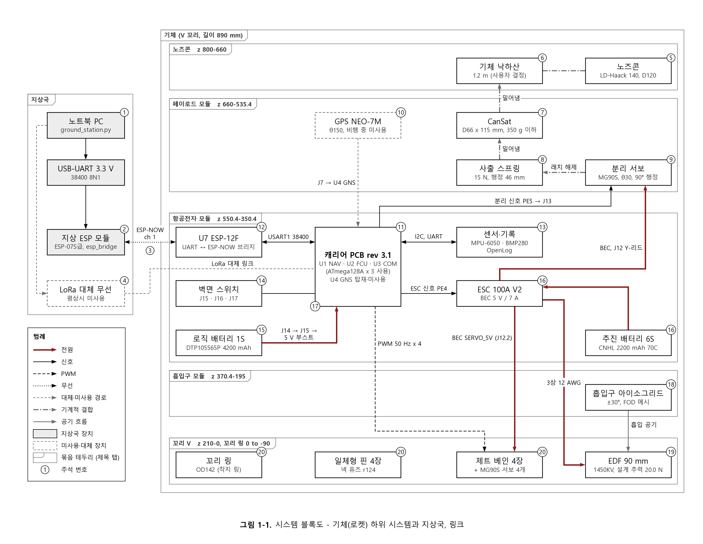</a><br><sub><b>그림 1-1. 시스템 블록도</b></sub></p>
<p align="center"><a href="docs/diagrams/02_전기_전원_블록도.md">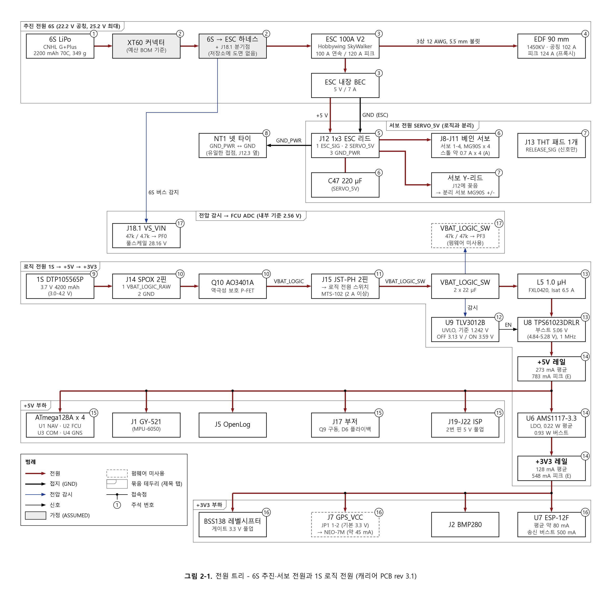</a><br><sub><b>그림 2-1. 전기·전원 블록도 (전원 트리)</b></sub></p>
<p align="center"><a href="docs/diagrams/03_항공전자_데이터_블록도.md"></a><br><sub><b>그림 3-1. 항공전자 데이터 블록도</b></sub></p>
<p align="center"><a href="docs/diagrams/05_비행_순서도.md">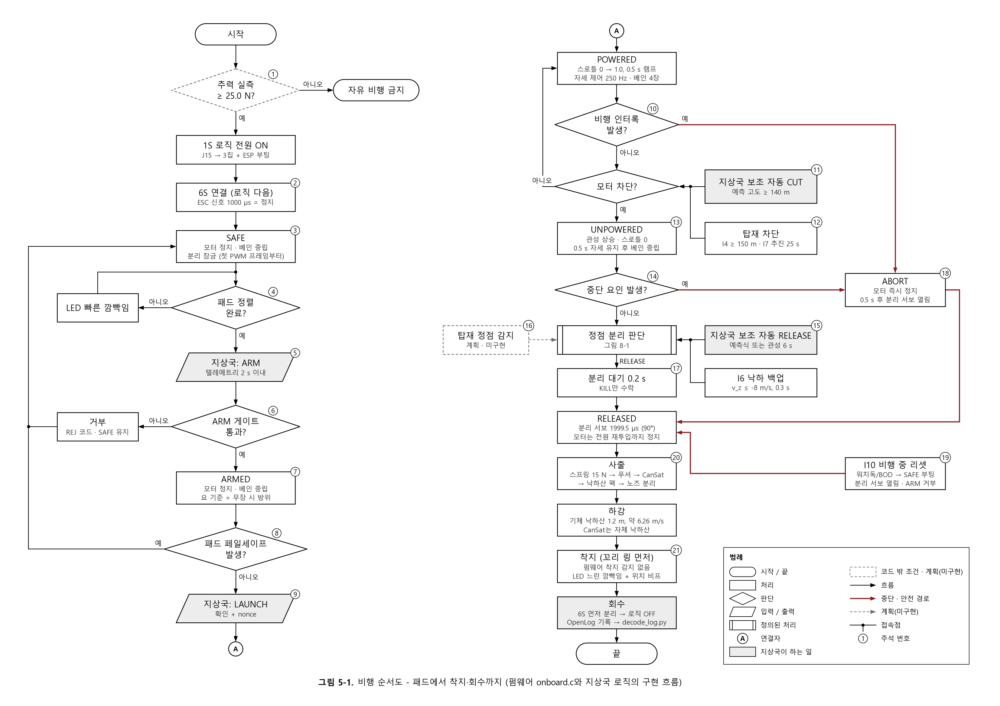</a><br><sub><b>그림 5-1. 비행 순서도 (발사대 → 착지·회수)</b></sub></p>
<p align="center"><a href="docs/diagrams/06_펌웨어_상태도.md"></a><br><sub><b>그림 6-1. 펌웨어 상태도 (UML)</b></sub></p>

<details>
<summary><b>나머지 그림 12장 보기</b></summary>

<p align="center"><a href="docs/diagrams/02_전기_전원_블록도.md"></a><br><sub><b>그림 2-2. 접지 구조</b></sub></p>
<p align="center"><a href="docs/diagrams/04_기계_구성도.md"></a><br><sub><b>그림 4-1. 기계 구성 (적층 순서)</b></sub></p>
<p align="center"><a href="docs/diagrams/04_기계_구성도.md">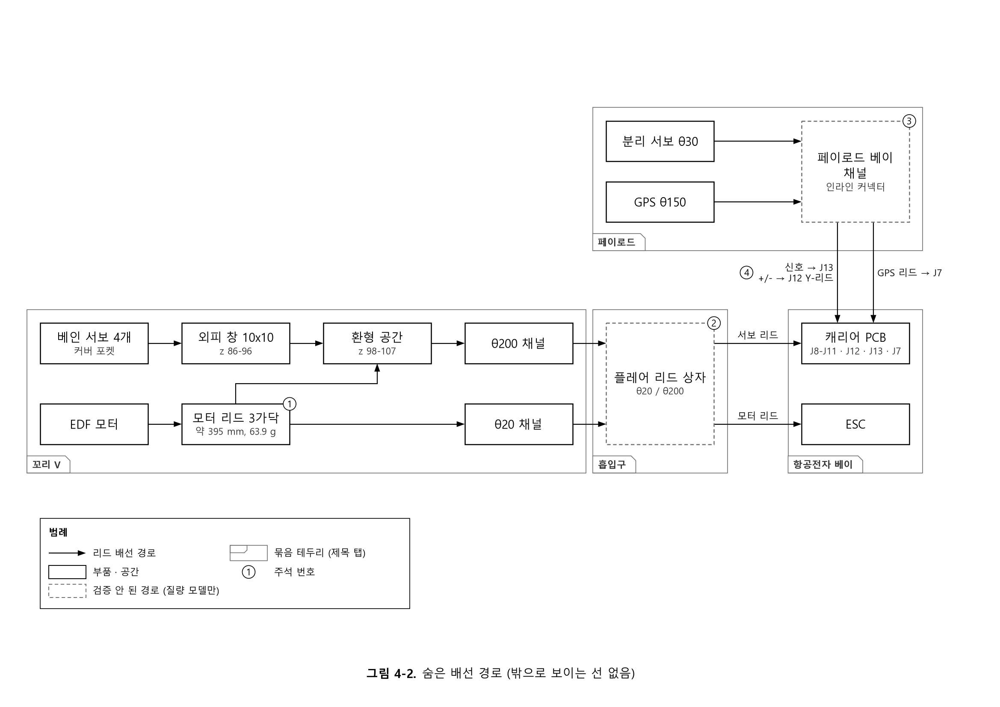</a><br><sub><b>그림 4-2. 숨은 배선 경로</b></sub></p>
<p align="center"><a href="docs/diagrams/04_기계_구성도.md">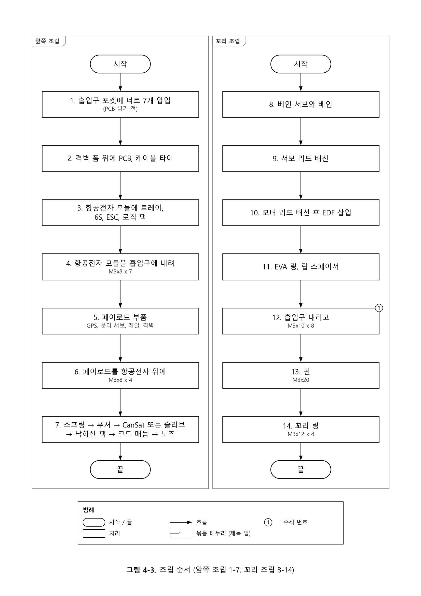</a><br><sub><b>그림 4-3. 조립 순서</b></sub></p>
<p align="center"><a href="docs/diagrams/06_펌웨어_상태도.md"></a><br><sub><b>그림 6-2. 감독기 한 틱 처리 순서</b></sub></p>
<p align="center"><a href="docs/diagrams/07_제어_루프_순서도.md"></a><br><sub><b>그림 7-1. NAV 한 틱</b></sub></p>
<p align="center"><a href="docs/diagrams/07_제어_루프_순서도.md"></a><br><sub><b>그림 7-2. FCU 한 틱 (제어 루프)</b></sub></p>
<p align="center"><a href="docs/diagrams/07_제어_루프_순서도.md"></a><br><sub><b>그림 7-3. 한 주기 시간 순서</b></sub></p>
<p align="center"><a href="docs/diagrams/08_사출_순서도.md"></a><br><sub><b>그림 8-1. 정점 사출 순서도</b></sub></p>
<p align="center"><a href="docs/diagrams/08_사출_순서도.md"></a><br><sub><b>그림 8-2. 사출 시간 순서</b></sub></p>
<p align="center"><a href="docs/diagrams/09_개발_검증_흐름도.md"></a><br><sub><b>그림 9-1. 개발·검증 흐름도</b></sub></p>
<p align="center"><a href="docs/diagrams/09_개발_검증_흐름도.md"></a><br><sub><b>그림 9-2. 시험 계획</b></sub></p>

</details>

## 새 본체 v1.0 (CAD v2)

| 항목 | 값 | 종류 |
|---|---|:-:|
| 출력 부품 | 21종 (핀 4장 + 예비 2장 포함), 모두 유효한 고체 1개, STL 물샘 없음, P2S 판에 들어감 | M |
| 질량 (CanSat 없이, MID) | 2,089 g (CAD 고체 기준) / 2,053 g (슬라이서 그램 기준) | E |
| 정적 안정 여유 | 명목 +1.093 / +1.092 cal (OpenRocket / RocketPy). 무게중심 뒤 경계에서 +0.92 cal → 코 추 49-51 g 필요 | M / E |
| T/W (20 N, 뒤 경계 + 추) | 0.954-0.969 → **이륙 불가** | E |
| 한 벌 출력 | 33.8 시간, 필라멘트 1,411 g (부품 1,156 g), Bambu P2S, Bambu PLA Matte | M |
| 통합 검사 | 모든 쌍 간섭 12,880쌍 결함 0, 선 경로 14가닥 겹침 0, 커넥터 통과 순서, ESC 넣기 자세 30개 × 두께 2가지 겹침 0, 손가락 접근 | M |

| 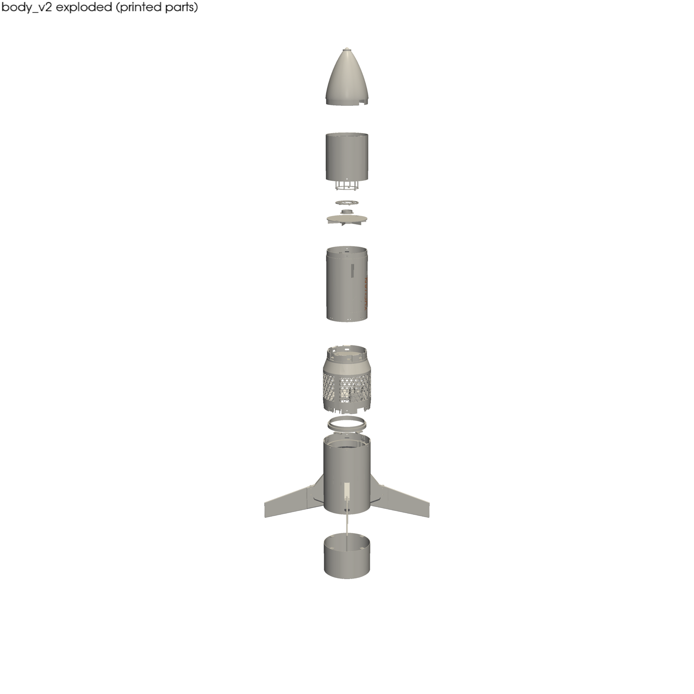 | 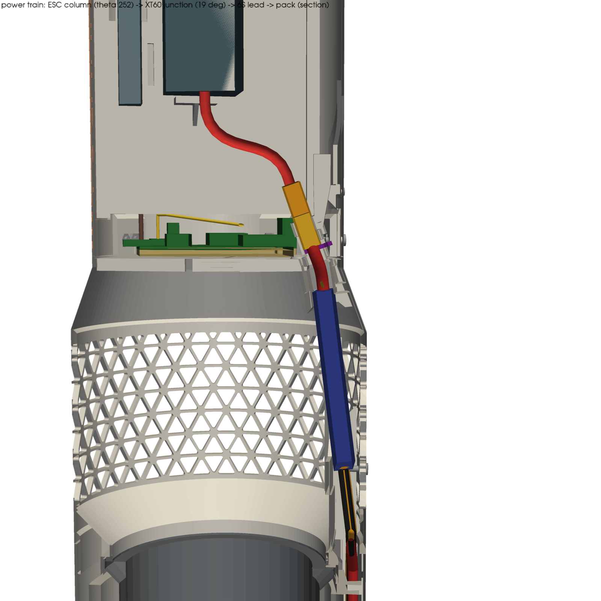 |
|:-:|:-:|
| <sub>분해도</sub> | <sub>동력 배치 확대: ESC를 흡입 모듈 벽에 세우고 XT60 이음을 격벽 위에서 19° 기울임</sub> |
| 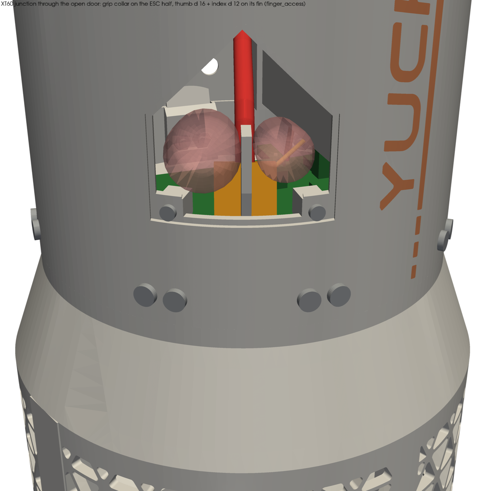 | 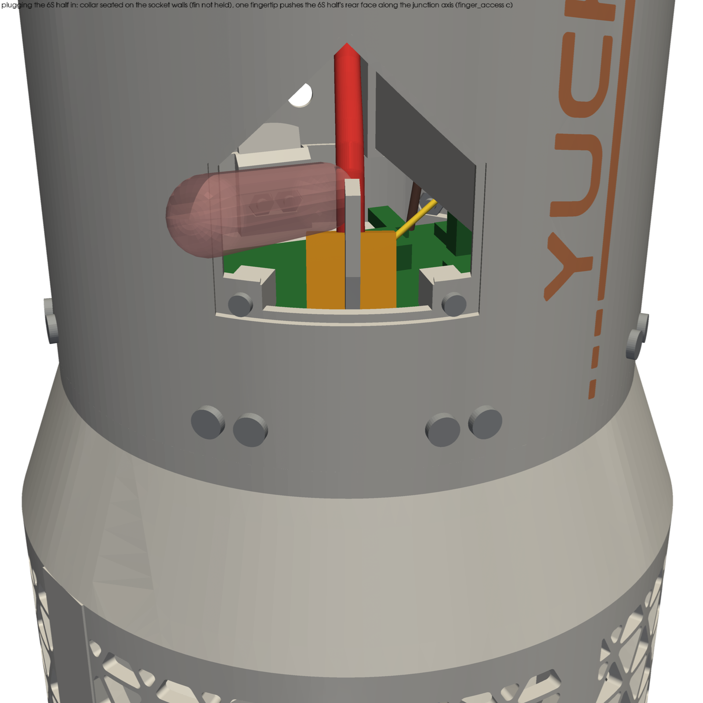 |
| <sub>문으로 본 XT60 이음 + 잡이 + 손가락 접근</sub> | <sub>XT60 끼우기</sub> |

* **출력 파일**: [`cad/body_v2/out/print/`](cad/body_v2/out/print/) - Bambu Studio 프로젝트(`*.3mf`), 슬라이스 결과(`*.gcode.3mf`), 출력 방향 STL(`*_print.stl`), 부품별 시간·그램(`slice_report.json`).
* **CAD**: [`cad/body_v2/out/`](cad/body_v2/out/) - 로켓 좌표의 부품 STEP / STL, OpenRocket 모델 `body_v2_V.ork`, 검사 보고서(`check_body_v2.json` 등), 그림(`render/`).
* 조립 순서, 케이블 목록, 손으로 확인할 것: [cad/body_v2/README_ko.md](cad/body_v2/README_ko.md).

## 시뮬레이션 검증 (2026-11-18)

실제 로켓 팀이 쓰는 도구(OpenRocket, RocketPy, OpenFOAM)와 프로젝트 6-DOF로 **이전 본체(v0.9 로켓, 캐리어 PCB 탑재)** 를 다시 확인했습니다. [보고서](sim/validation_2026-11-18/README.md)

* 벤치 추정 추력(17.9-19.3 N)으로는 CanSat을 실은 로켓이 이륙하지 못합니다(세 도구 모두, M).
* CanSat을 빼면 정적 안정 여유가 +0.29 → -0.02 cal로 떨어졌습니다(M). 새 본체는 이것을 고쳐 명목 +1.09 cal입니다.
* CFD에서 베인 측력은 프로젝트 모델의 16 %, 항력계수는 0.89-0.91(모델 0.6)이었습니다(격자 수렴 전). 그래서 6-DOF 결과는 낙관적입니다.

<p align="center">
  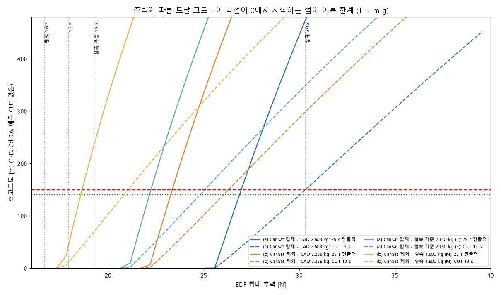<br>
  <sub>추력별 도달 고도 (2026-11-18 검증 라운드)</sub>
</p>

## EDF 로터 (지상 시험용 PLA)

| 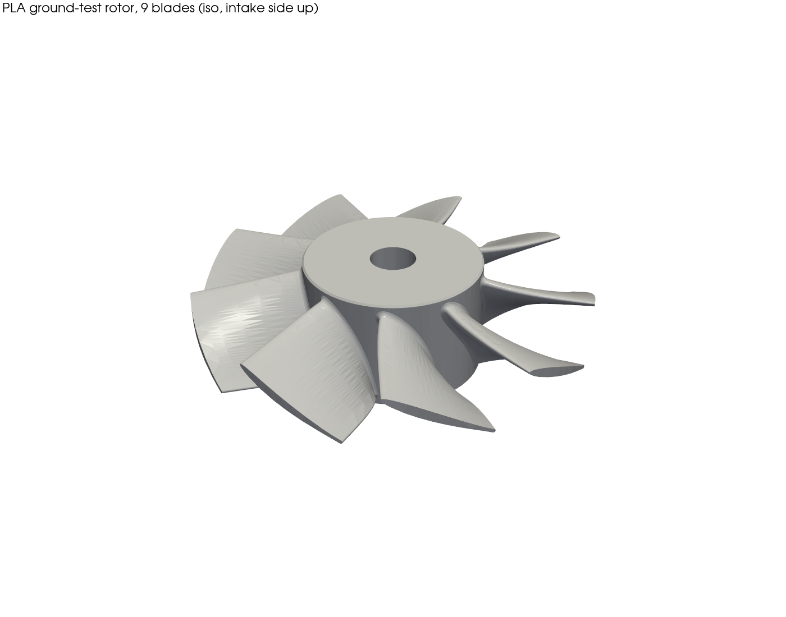 | 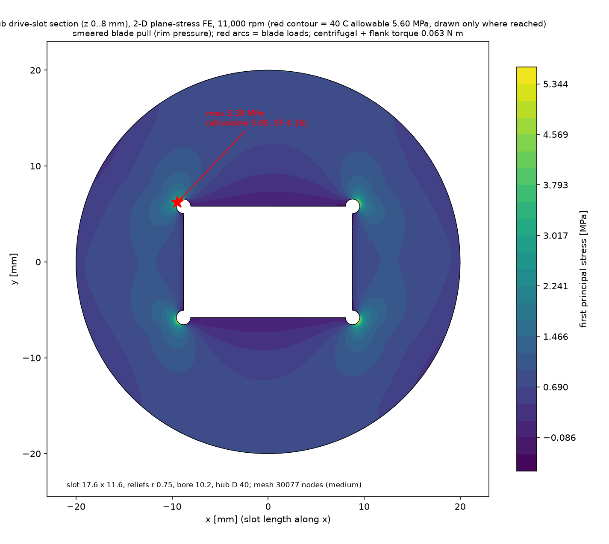 |
|:-:|:-:|
| <sub>9엽 PLA 로터</sub> | <sub>구동 홈 단면 2차원 FE 응력</sub> |

* 대상: Hobbyocean 90 mm 12엽 EDF(6S 1450KV)의 시험용 대체 로터. **비행에는 절대 쓰지 않습니다.**
* 시험 상한 **11,000 rpm** (안전계수 4.16, 가장 큰 응력 5.39 MPa / 허용 5.60 MPa, E), 그때 추력 약 3.1 N(E), 첫 스로틀 끝점 27 % 이하.
* CAD 검사 44개 PASS(M). 출력 파일: [`cad/exports/rotor/`](cad/exports/rotor/) (STEP / STL, 반대 회전용 거울 STL, 밸런서 받침, Bambu 프로젝트와 G-code).
* 설계: [docs/EDF_로터_설계.md](docs/EDF_로터_설계.md), 시험 절차: [docs/EDF_로터_시험절차.md](docs/EDF_로터_시험절차.md).

## 아비오닉스 캐리어 PCB rev 3.1

비행 컴퓨터 칩 4개, 센서, Wi-Fi, 로거를 한 장에 올린 캐리어 PCB입니다. KiCad 10(kicad-cli)과 Freerouting으로 만들었습니다. 2026-11-04 rev 1에서 시작해 2026-11-13 rev 3.1이 지금 판입니다(폴더 이름 `vtol_carrier`는 예전 이름 그대로입니다).
**아직 만들거나 전원을 넣어 본 적이 없습니다(NOT_VERIFIED).** 아래의 PASS는 모두 도구 검사 결과이고, 보드가 동작한다는 뜻이 아닙니다.

| 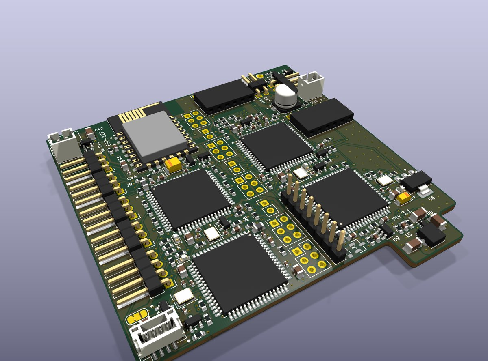 | 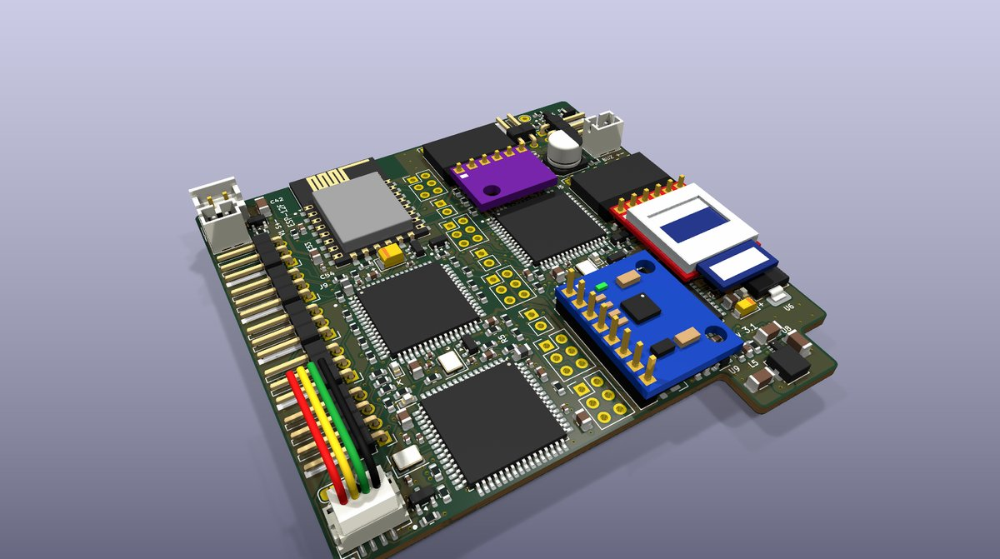 |
|:-:|:-:|
| <sub>rev 3.1 윗면 3/4 렌더, 모든 부품의 라이브러리 3D 모델 (kicad-cli)</sub> | <sub>직접 장착한 뒤: MCU 4개, ESP-12F, GY-521(J1), BMP280(J2), OpenLog(J5), GPS 플러그(J7). 모듈 모양은 가정 치수(A)라 맞춤의 증거가 아닙니다</sub> |
| 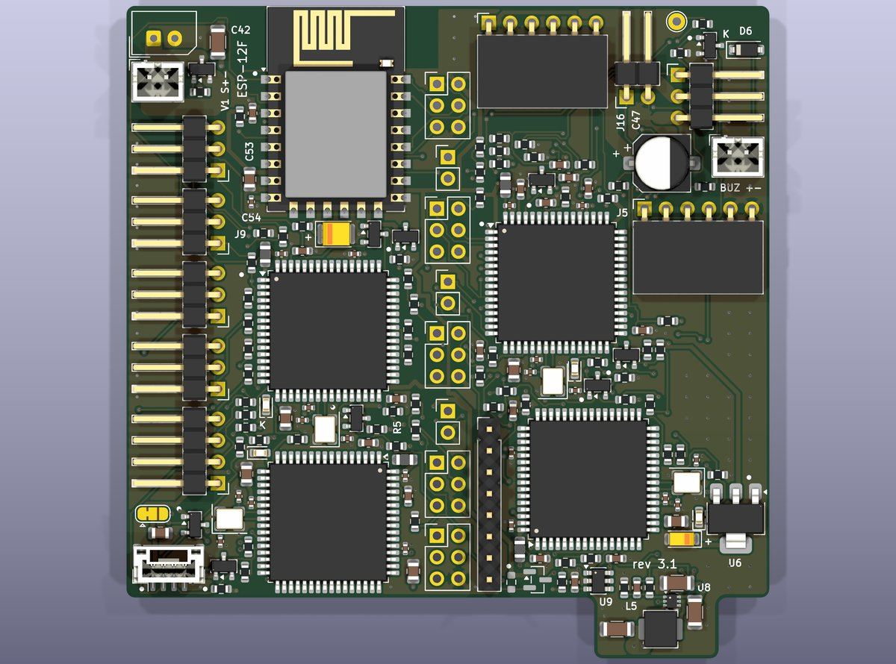 | 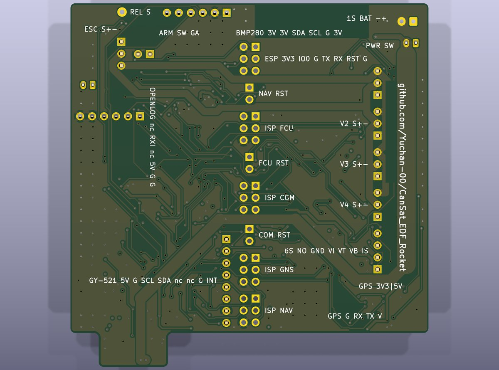 |
| <sub>윗면 (kicad-cli). 아래 변의 탭에 5 V 승압 회로가 있습니다</sub> | <sub>아랫면: 핀 이름표와 저장소 주소 실크 (README 그림에서는 연락처 줄을 가렸습니다)</sub> |

<p align="center">
  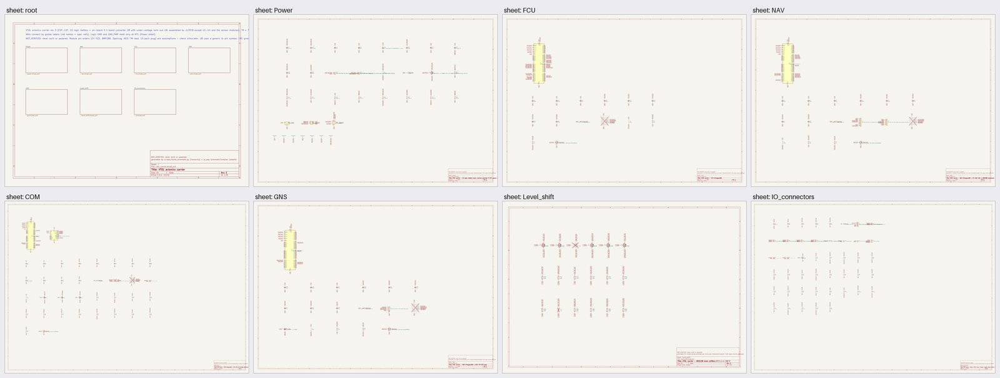<br>
  <sub>회로도 8장 (최상위, 전원, FCU, NAV, COM, GNS, 레벨 시프터, 커넥터), rev 3.1 회로도를 kicad-cli로 다시 그린 것</sub>
</p>

| 항목 | 값 | 종류 |
|---|---|:-:|
| 크기 | 본체 76 × 70 mm + 아래 변 탭(승압 회로 자리) → 외접 76 × 77.2 mm, 두께 1.6 mm, 4층 (신호 / GND 면 / +5V 면 / 신호). 부품은 윗면에만 | 설계 |
| 비행 컴퓨터 | ATmega128A-AU × 4 (NAV · FCU · COM · GNS), 16 MHz, 5 V | 설계 |
| 무선 | ESP-12F (ESP8266 Wi-Fi, ESP-NOW 중계). 사용자가 납땜 | 설계 |
| 센서·로거 | GY-521 (IMU), BMP280 (기압), OpenLog, NEO-7M GPS (케이블로 J7) | 설계 |
| 전원 | 1S 로직 배터리(J14) → 역극성 보호 → 스위치 → 5 V 승압 TPS61023 + 저전압 차단 TLV3012B → +5V 면 → AMS1117 → 3.3 V | 설계 / E |
| 로켓 분리 서보 (rev 3.1) | FCU(U2)의 PE5 / OC3C → R22 220 Ω → J13 (1핀 도금 패드). 서보 전원은 ESC 리드 J12에서 Y자 리드로 | 설계 |
| 조립 | JLC Economic PCBA가 SMT 부품 145개(BOM 33줄)만 실장, 무연 HASL. ESP-12F와 스루홀 커넥터 12개는 사용자가 납땜 | 설계 |

* **검사 (M, kicad-cli 10.0.6)**: ERC 오류 0 · 경고 0, DRC 위반 0 · 경고 0 · 미연결 0 · 회로도 불일치 0, 배선 규칙 21 / 21 PASS, 결정성 PASS, JLC 부품 33 / 33줄 재고·주문 가능(2026-11-13 기준). 도구 출고 판정: **ORDERABLE (도구 검사만, 실물 미검증)**.
* **숨기지 않은 약점**: 배터리 경로 구리 저항이 60 °C에서 목표를 넘습니다(0.03583 Ω > 0.035 Ω, E). 승압부 SW 패드 간격 여유 0.124 mm(M). 스위칭 잡음·리플은 보드에서 재기 전까지 NOT_VERIFIED입니다.
* 자세한 내용: [PCB README](pcb/vtol_carrier/README_ko.md), [주문 안내서](pcb/vtol_carrier/out/ORDER_ko.md), [장착 그림 목록](pcb/vtol_carrier/out/render/INDEX_ko.md).

## 펌웨어 · 지상국

* **비행 펌웨어** ([firmware/atmega128_fc](firmware/README.md)): ATmega128A 4칩(NAV 자세 추정·고도 필터, FCU 감독 로직·자세 제어·서보/ESC, COM 무선·텔레메트리, GNS GPS), avr-gcc + PlatformIO. 호스트 단위시험(`host_test/`)과 simavr 벤치 C 코드(`tools/`)가 함께 있습니다.
* **무선 브리지**: [firmware/esp_bridge](firmware/esp_bridge/README.md)(ESP8266 ESP-NOW, 기본), [firmware/ground_bridge](firmware/ground_bridge/)(SPI형 LoRa 예비용 아두이노 나노). 빌드 때 `params.json`에서 설정 헤더를 만듭니다(`extra_gen.py`).
* **지상국** (`tools/ground_station.py`, 파이썬): 발사·모터 정지·노즈 분리 명령, 텔레메트리, 어시스트(목표 고도 CUT, 정점 RELEASE), 로그, 연습 모드. 필요한 `sim/` 모듈과 `cad/layout.py`가 함께 있습니다. 사용법: [docs/지상국_사용법.md](docs/지상국_사용법.md).

```bash
python tools/ground_station.py --sim          # 연습 모드 (가상 기체, 하드웨어 없이)
python tools/ground_station.py --port COM5    # 실제 연결 (포트는 장치 관리자에서 확인)
```

## YUCHAN 로고

<p align="center">
  <br>
  <sub>최종 로고: 기체 축을 따라 세로로 들어가는 launch 모양. P2S + AMS 2색 상감(흰 몸통의 바깥 벽 한 줄만 주황)</sub>
</p>

## 폴더 구조

| 경로 | 내용 |
|---|---|
| [`cad/body_v2/`](cad/body_v2/) | **새 본체 v1.0**: 출력 파일, STEP / STL, 검사 보고서, 그림, 설명서 |
| [`cad/exports/rotor/`](cad/exports/rotor/) | PLA 지상시험 로터 출력 파일과 검사 보고서 |
| [`cad/exports/`](cad/exports/) | 이전 본체 v0.9의 출력 파일·검사 보고서 (참고용) |
| [`pcb/vtol_carrier/`](pcb/vtol_carrier/) | 캐리어 PCB rev 3.1: KiCad 프로젝트, 거버·BOM·CPL, 검사 보고서, 렌더, 주문 안내서 |
| [`firmware/`](firmware/) | ATmega128A 4칩 펌웨어, ESP-NOW 브리지, 지상 브리지 |
| [`tools/ground_station.py`](tools/ground_station.py), [`sim/`](sim/) | 지상국과 그것이 쓰는 모듈 |
| [`sim/validation_2026-11-18/`](sim/validation_2026-11-18/README.md) | 시뮬레이션 검증 보고서, 비교표, 그래프, 영상 |
| [`docs/`](docs/) | 블록도·순서도, 사양서, 변경 문서, 제작 가이드, 예산, 시험·안전·법규, 로터 설계 |
| `params.json` | 설계값 (펌웨어 설정 생성기와 지상국이 읽음) |

<sub>이 저장소에는 **최신 결과물만 커밋 하나로** 둡니다(2026-11-20 결정). CAD 생성·검사 스크립트, 시뮬레이션 실행 스크립트, PCB 생성 스크립트, 원시 결과 데이터(csv / json)는 올리지 않고, 예전 판(v0.9 등)은 작성자의 PC에 판별 폴더로 보관합니다. 문서에 나오는 스크립트 이름은 그 결과물을 만든 도구를 가리킵니다.</sub>

## 라이선스

[CC BY-NC 4.0](https://creativecommons.org/licenses/by-nc/4.0/) - 출처를 밝히면 비상업적 목적으로 공유·수정할 수 있습니다. 자세한 내용은 [LICENSE](LICENSE). 다른 사람의 자료는 각자의 라이선스를 따릅니다.

<sub>README의 PCB·로고 그림은 기존 렌더를 자르거나 줄인 복사본입니다. 출처와 sha256: [docs/images/SOURCES.md](docs/images/SOURCES.md)</sub>
