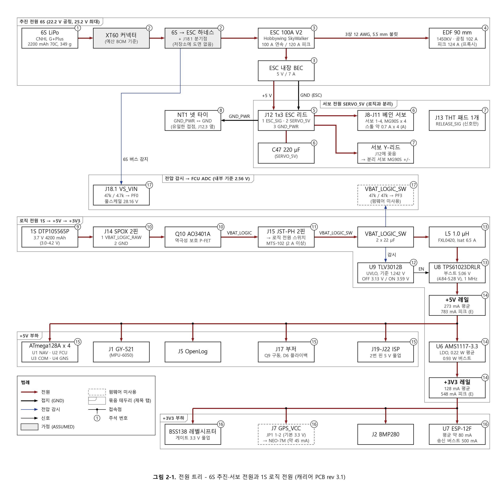

# 02. 전기·전원 블록도 (Power tree and connectors)

이 문서는 캐리어 PCB rev 3.1(`pcb-rev3` / `main` @ 4051623) 기준으로 그렸습니다. 넷 이름은 KiCad 넷리스트 `out/vtol_carrier.net`(rev "3")에서 가져왔습니다.

- **보드 상태:** 이 보드는 아직 제작·통전한 적이 없습니다(NOT_VERIFIED).
  - 도구 검사 결과는 ERC 0, DRC 0입니다.
  - 그래서 아래 전압·전류 값은 모두 **설계값(F) 또는 추정값(E)** 입니다.
- **폴더 주의:** `body-redesign` 워크트리 안의 `pcb/vtol_carrier`는 아직 rev 2c입니다. 이 그림은 그 폴더가 아니라 rev 3.1을 따릅니다.
- Mermaid 원본과 노드별 출처 표는 [상세판](detailed/02_전기_전원_블록도.md)에 있습니다.

## 2.1 전원 트리

**그림 2-1.** 전원 트리 - 6S 추진·서보 전원과 1S 로직 전원 (캐리어 PCB rev 3.1) · [SVG](img/02_전기_전원_블록도_1.svg) · [PNG](img/02_전기_전원_블록도_1.png)

| 주 | 내용 | 출처 |
|---|---|---|
| ① | 6S LiPo CNHL G+Plus 2200 mAh 70C, 349 g, 셀 최소 3.3 V. 추진 전원 6S = 22.2 V 공칭, 25.2 V 최대. | P:1089-1104 |
| ② | **ASSUMED**: XT60 커넥터는 예산 BOM에만 있음 (`docs/budget/bom.json:161`, body-redesign). 6S → ESC 하네스와 J18.1 분기점은 저장소에 도면이 없음 (facts_hw §9 항목 8). J18 VS_VIN을 6S 쪽 어디에서 따는지도 그려져 있지 않음. | `docs/budget/bom.json:161`; facts_hw §9 |
| ③ | ESC Hobbywing SkyWalker 100A V2: 100 A 연속 / 120 A 피크, 92 g, 내장 BEC 5 V / 7 A. 6S 쪽은 ESC 자체 보호에 맡김 (퓨즈 없음). | P:1089-1104 |
| ④ | EDF Hobbyocean 90 mm 1450KV: 공칭 102 A / 피크 124 A (프록시), 새 팩 전개 시 약 114 A. ESC → EDF는 3상 12 AWG, 5.5 mm 불릿. | P:247-248, P:1651 |
| ⑤ | J12 1x3 ESC 리드: 1 ESC_SIG · 2 SERVO_5V (BEC +5 V) · 3 GND_PWR (NT1). SERVO_5V는 로직 전원과 분리됨. | NET; CS:2156 |
| ⑥ | J8-J11 베인 서보 1-4 = MG90S x 4, 스톨 약 0.7 A x 4 (A). C47 220 µF는 SERVO_5V에 붙음. | NET; CS:2156; rev 2c README:123 |
| ⑦ | **분리 서보 전원은 ESC BEC에서 옴**: 서보 Y-리드(J12에 꽂음) → 분리 서보 MG90S +/-. 6S가 연결되지 않으면 분리 서보에 전원이 없음. BEC 여유가 충분한지는 NOT_VERIFIED. J13은 도금 THT 패드 1개로 RELEASE_SIG 신호만 지남. | RD:5, 151; CS:2156 |
| ⑧ | NT1 넷 타이: GND_PWR ↔ GND의 유일한 접점, J12.3 옆 (그림 2-2 참고). | CS:632-634 |
| ⑨ | 1S DTP105565P 3.7 V 4200 mAh (3.0-4.2 V). 팩 PCM이 유일한 전류 제한 (A). 캐리어 BOM에는 퓨즈나 PTC가 하나도 없음 (rev 2c 때 PTC 여부는 사용자 결정으로 남김). | BOM:32; `pcb/vtol_carrier/README_ko.md:119, 146` (rev 2c) |
| ⑩ | J14 Molex SPOX 2핀: 1 VBAT_LOGIC_RAW · 2 GND, 꽂기 전에 극성 확인. Q10 AO3401A = 역극성 보호 P-FET. | BOM:32; CS:334-348 |
| ⑪ | J15 JST-PH 2핀 → 로직 전원 스위치 MTS-102 (2 A 이상, A), 기체 벽면 θ106°. 전원 순서: 로직을 먼저 켜고 6S를 나중에 연결, 끌 때는 6S를 먼저 뺌. | CS; P:2047; NBS:939; rev 2c README:120 |
| ⑫ | U9 TLV3012B UVLO: 기준 1.242 V, OFF 3.13 V / ON 3.59 V. VBAT_LOGIC_SW(2 x 22 µF)를 감시해 U8의 EN을 구동. | BOM:28, 50, 51; CS:352, 405-416, 448; RD:27 |
| ⑬ | L5 1.0 µH FXL0420, Isat 6.5 A. U8 TPS61023DRLR 부스트: 5.06 V (4.84-5.28 V), 1 MHz, 3.0 V 입력에서 1.815 A. | BOM:28, 50, 51; CS:405-416 |
| ⑭ | +5V 레일 (In2 평면) 273 mA 평균 / 783 mA 피크 (E). U6 AMS1117-3.3 LDO 0.22 W 평균 / 0.93 W 버스트. +3V3 레일 128 mA 평균 / 548 mA 피크 (E). 레일 전류와 1S 사용 시간(약 7.7 h)은 추정값(E). | BOM:48; CS:373-385, 405-434, 437-442 |
| ⑮ | ATmega128A x 4 = U1 NAV · U2 FCU · U3 COM · U4 GNS, AVCC는 10 µH LC 필터 경유. J17 부저는 Q9 구동, D6 플라이백. J19-J22 ISP 2번 핀 = 5 V 풀업. | CS:373-385, 405-434 |
| ⑯ | U7 ESP-12F 평균 약 80 mA, 송신 버스트 500 mA, 100 µF 탄탈 + 10 µF + 100 nF. JP1 1-2 (기본 3.3 V) → J7 GPS_VCC → NEO-7M (약 45 mA), 로켓 펌웨어 미사용. BSS138 레벨시프터 게이트는 3.3 V 풀업. | CS:373-385, 405-434 |
| ⑰ | 전압 감시 → FCU ADC (내부 기준 2.56 V). J18.1 VS_VIN 47k / 4.7k → PF0, 풀스케일 28.16 V; I8 저전압 판정은 6S(PF0)로 함. VBAT_LOGIC_SW 47k / 47k → PF3은 회로는 있지만 펌웨어가 아직 읽지 않음. | CS:355, 365-369; `params_gen.h:119`; PG:119-121 |

**그림 읽는 법:**

- **회색 채움:** 이 그림에서 회색으로 채운 상자는 ASSUMED 블록(XT60, 6S → ESC 하네스)입니다. 그림 1-1의 회색(지상국 장비)과 뜻이 다릅니다.
- **점선 상자:** 배선은 있지만 쓰지 않는 것(GPS 전원 경로, 1S 감시)입니다.
- **레일:** 각 레일은 줄기선과 접속점(점)으로 그렸습니다. "로직 전원" 테두리는 부하 묶음을 감싸지 않도록 L자 모양입니다.
- **전압 감시선:** 진한 파랑 선은 전압 감시입니다. CIN → S1(VBAT_LOGIC_SW → PF3)도 감시선으로 그렸습니다. NT1은 원본처럼 어느 묶음에도 넣지 않았습니다.

### 퓨즈와 스위치

- **퓨즈:** 캐리어 BOM에 퓨즈나 PTC가 **하나도 없습니다**.
  - 1S 로직 쪽 전류는 팩 내부 PCM만 제한합니다(A).
  - 6S 쪽은 ESC 자체 보호에 맡깁니다.
  - rev 2c 때 PTC를 넣을지는 사용자 결정으로 남겨 두었습니다(`pcb/vtol_carrier/README_ko.md:119, 146`, rev 2c).
- **로직 전원 스위치:** J15 → MTS-102(2 A 이상, A). 기체 벽면 θ106°에 답니다(P:2047; NBS:939).
- **암 스위치:** J16. 벽면 θ82°에 답니다.
  - 전원 스위치가 아니라 FCU PC2로 들어가는 **입력 신호**입니다.
  - 무장(ARMED) 상태에서 열면 KILL로 처리됩니다(03, 06 참고).
- **전원 순서:** 로직을 먼저 켜고 6S를 나중에 연결합니다. 끌 때는 6S를 먼저 뺍니다(rev 2c README:120).
- **5 V 로직 UBEC:** 기본 구성에는 아직 misc 상자에 들어 있지만, 로직 쪽에서 이것을 쓰는 곳은 이제 없습니다. 뺄지는 사용자 결정 대기 중입니다(P:1117, P:24).

## 2.2 접지 구조

**그림 2-2.** 접지 구조 - GND_PWR와 로직 GND는 NT1 한 점에서만 만난다 · [SVG](img/02_전기_전원_블록도_2.svg) · [PNG](img/02_전기_전원_블록도_2.png)

| 주 | 내용 | 출처 |
|---|---|---|
| ① | NT1 넷 타이 = GND_PWR ↔ GND의 유일한(단일) 접점, J12.3 옆에 있음. | CS:632-634 |
| ② | J8-J11 (1x3 직각): 1 VANEn_SIG, 2 SERVO_5V, 3 GND_PWR. J12: 3 GND_PWR (NT1). 분리 서보 GND는 J12에 꽂은 서보 Y-리드를 거쳐 J12.3으로 감. | NET; CS:2156; RD:5 |
| ③ | 로직 GND는 In1 평면 (MCU · 센서 · ESP). 1S 음극은 J14 2번 핀(GND). | CS:334-348, 632-634 |
| ④ | J18 1x4 감지 커넥터에는 GND 핀이 없음(의도): VS_VIN, VS_VTETHER, VS_VBUFFER, VS_BUF_ISIGN. 로켓은 VS_VIN(6S)만 사용하며, 측정 기준은 NT1을 거친 ESC GND. | CS:634; NET |

**묶음 테두리:** "GND_PWR 쪽 (ESC · 서보)"와 "GND 쪽 (로직)" 테두리는 상세판 Mermaid에는 없고 이 그림에서 새로 둔 것입니다. 묶음 기준은 커넥터 표의 넷 이름입니다(J8-J11 핀 3 = GND_PWR, J14 핀 2 = GND). J18 → NT1 선은 "기준"이라고 적은 감시선으로 그렸습니다.

## 2.3 커넥터 표 (rev 3.1, 넷리스트 기준)

| 커넥터 | 형식 | 핀 → 넷 | 연결 대상 | 출처 |
|---|---|---|---|---|
| J1 | 1x8, 납작 납땜 | 1 +5V, 2 GND, 3 SCL_3V3, 4 SDA_3V3, 7 GND, 8 IMU_INT_3V3 | GY-521 (MPU-6050) | NET; BOM:14-18 |
| J2 | 1x6 직각 소켓 | 1/5/6 +3V3, 2 GND, 3 SCL, 4 SDA | BMP280 (TYE-BMP29, 0x77) | NET; P:1129 |
| J3 | 2x3, 미실장 | IO0, GND, TXD0, RXD0, RST, GND (3.3 V 전용) | ESP 플래시 | NET |
| J4, J6 | - | rev 3.1에는 없음 | - | facts_hw §3 |
| J5 | OpenLog 소켓 | 2 OPENLOG_RXI, 4 +5V, 5/6 GND | OpenLog | NET |
| J7 | JST-GH 4핀 (JLC 실장) | 1 GPS_VCC, 2 GPS_TXD_3V3, 3 GPS_RXD_3V3, 4 GND | NEO-7M (U4 GNS 전용, 미사용) | NET |
| J8-J11 | 1x3 직각 | 1 VANEn_SIG, 2 SERVO_5V, 3 GND_PWR | 베인 서보 1-4 MG90S | NET |
| J12 | 1x3 직각 | 1 ESC_SIG, 2 SERVO_5V (BEC +5 V), 3 GND_PWR (NT1) | ESC 신호선 + BEC, 분리 서보용 Y-리드 | NET; CS:2156 |
| J13 | 도금 THT 패드 1개 (127.05, 66.85) | RELEASE_SIG | 분리 서보 신호선 (사용자 납땜) | RD:5, 100, 126 |
| J14 | Molex SPOX 2핀 | 1 VBAT_LOGIC_RAW, 2 GND | 1S 로직 팩 | CS:334-348 |
| J15 | JST-PH 2핀 | 1 VBAT_LOGIC, 2 VBAT_LOGIC_SW | 로직 전원 스위치 (θ106) | CS; P:2047 |
| J16 | 1x2 | 1 ARM_SW_EXT, 2 GND | 암 스위치 (θ82) | NET |
| J17 | JST-PH | 1 +5V, 2 BUZ_N | 부저 | NET |
| J18 | 1x4, GND 핀 없음 (의도) | VS_VIN, VS_VTETHER, VS_VBUFFER, VS_BUF_ISIGN | 로켓은 VS_VIN(6S)만 사용 | CS:634; NET |
| J19-J22 | 2x3 ISP, 미실장 | 2번 핀 = +5V | NAV / FCU / COM / GNS | NET |
| J24-J26 | 점퍼 | 리셋 유지 | NAV / FCU / COM | NET |
| JP1 | 3패드 | 1-2 브리지 = 3.3 V (기본), 3 = +5V | GPS 전원 선택 | NET |

## 노드 출처 (2.1, 2.2)

노드 이름은 [상세판](detailed/02_전기_전원_블록도.md) Mermaid 코드의 ID입니다. 위 그림 주석 표에도 같은 출처가 들어 있습니다.

| 노드 | 출처 |
|---|---|
| B6, ESC, BEC, EDF | P:1089-1104, P:247-248, P:1651 |
| XT | `docs/budget/bom.json:161` (body-redesign) |
| H6 | 저장소에 도면 없음 → **ASSUMED** (facts_hw §9 항목 8) |
| J12, C47, JV, YL, J13 | NET; CS:2156; RD:5, 151; rev 2c README:123 (스톨 전류 A) |
| B1, J14, Q10, J15 | BOM:32; CS:334-348; P:2047 |
| CIN, L5, U8, U9 | BOM:28, 50, 51; CS:352, 405-416, 448; RD:27 |
| R5V, U6, R3V, 부하 | BOM:48; CS:373-385, 405-434 |
| S6, S1 | CS:355, 365-369; `params_gen.h:119` |
| NT1, 접지 | CS:632-634 |

## 주의 (불일치·가정)

1. **분리 서보 전원은 ESC BEC에서 옵니다.**
   - 6S가 연결되지 않으면 분리 서보에 전원이 없습니다. 이것은 전원 트리에서 직접 따라 나오는 결론입니다.
   - BEC 여유가 충분한지는 NOT_VERIFIED입니다(RD:151).
2. **J18 VS_VIN 분기점:** 6S 쪽 어디에서 따는지가 그려져 있지 않습니다(**ASSUMED**).
3. **1S 감시(PF3):** 회로는 있지만 펌웨어가 아직 읽지 않습니다(CS:365-369).
   - I8 저전압 판정은 6S(PF0)로 합니다(PG:119-121).
4. **수치의 성격:** 레일 전류와 1S 사용 시간(약 7.7 h)은 추정값(E)입니다(CS:437-442).
