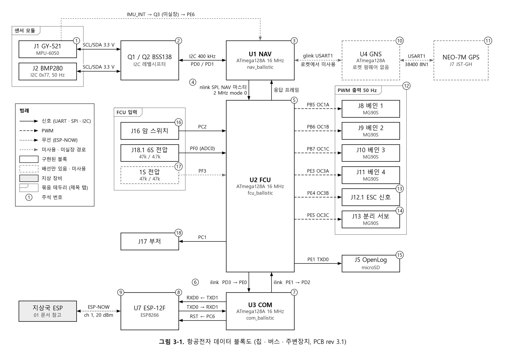

# 03. 항공전자 데이터 블록도 (Avionics data paths)

이 문서는 두 출처를 합쳐 그렸습니다.

- 핀과 넷: 캐리어 PCB rev 3.1 넷리스트(`out/vtol_carrier.net`, 4051623)
- 속도와 프레임: 펌웨어 `body-redesign` @ 78f59fa(`params_gen.h`, `*_proto.h`)

펌웨어의 핀 배치는 넷리스트와 일치합니다(P:1918-1933; `params_gen.h:95-100, 119`; `hal/pwm.c:47-49`).

Mermaid 원본은 [상세판](detailed/03_항공전자_데이터_블록도.md)에 있습니다.

## 3.1 칩·버스·주변장치

**그림 3-1.** 항공전자 데이터 블록도 (칩 · 버스 · 주변장치, PCB rev 3.1) · [SVG](img/03_항공전자_데이터_블록도_1.svg) · [PNG](img/03_항공전자_데이터_블록도_1.png)

| 주 | 내용 |
|---|---|
| ① | J1 GY-521 / MPU-6050: ±2000 °/s, ±16 g, 내부 1 kHz. |
| ② | Q1 / Q2 BSS138 I2C 레벨시프터: 5 V측 4.7k (R42/R44), 3.3 V측 10k (R43/R45). NAV 쪽은 PD0 SCL_5V, PD1 SDA_5V. |
| ③ | U1 NAV 펌웨어 nav_ballistic: 자세 추정 PadAlignGyro, 고도 필터, 센서 상태. 비행 판단 없음. |
| ④ | nlink: SPI PB0-PB3, NAV 마스터, 2 MHz mode 0, 72 B 교환 / 4 ms, SS 풀업 R11 10k. 응답 프레임(같은 교환): state, fflags, params_tag. |
| ⑤ | U2 FCU 펌웨어 fcu_ballistic: 감독기 I1-I10, 자세 제어 + 베인 믹서, PWM 출력, 비행 기록. |
| ⑥ | ilink: FCU USART1 ↔ COM USART0. FCU PD3 → R12 1k → COM PE0, COM PE1 → FCU PD2. 250 kbaud 8N1, CRC16. |
| ⑦ | U3 COM 펌웨어 com_ballistic: 업링크 CMD 해독, TELEM 생성, IL_STAT 1 Hz. |
| ⑧ | COM ↔ ESP: PD3 TXD1 → Q4 → R54 1k → RXD0 (핀 21); TXD0 (핀 22) → Q11 → PD2 RXD1; 38400 8N1. PC6 오픈드레인 → Q5 → RST. |
| ⑨ | U7 ESP-12F (ESP8266): 투명 UART ↔ ESP-NOW, 비행 연산 없음. |
| ⑩ | U4 GNS ATmega128A: 로켓 펌웨어 없음, 2026-11-18 빌드 삭제. glink USART1: PD3 → R13 1k → GNS PE0, GNS PE1 → PD2 (로켓에서 미사용). |
| ⑪ | GPS 연결: PD3 → Q6 → J7.3 / J7.2 → Q7 → PD2, 38400 8N1 (로켓에서 미사용). |
| ⑫ | PWM 출력 50 Hz, 분해능 0.5 µs. 직렬 저항: PB5 OC1A → R17 220 Ω, PB6 OC1B → R18, PB7 OC1C → R19, PE3 OC3A → R20, PE4 OC3B → R21, PE5 OC3C → R22 (rev 3.1 신규). |
| ⑬ | J12.1 ESC 신호: 1000 µs 정지 / 2000 µs 최대. |
| ⑭ | J13 분리 서보 MG90S: 1000.5 µs 잠금 / 1999.5 µs 해제. |
| ⑮ | J5 OpenLog: PE1 TXD0 → Q8 → J5.2, 57600 8N1, 50 Hz 기록. |
| ⑯ | J16 암 스위치: → R28 1k → PC2, R29 10k 풀업 + C48. |
| ⑰ | 1S 전압 47k/47k → PF3: 펌웨어 미사용. |
| ⑱ | J17 부저: PC1 → R30 → Q9. |

**그림 읽는 법:**

- **선:** 실선 = 신호 (UART, SPI, I2C), 파선 = PWM, 점선 = ESP-NOW 무선, 회색 파선 = 미사용 또는 미실장 경로.
- **상자:** 점선 상자 = 배선은 있지만 쓰지 않음 (U4 GNS, GPS, 1S), 회색 상자 = 지상 장비. 제목 탭이 붙은 회색 실선 테두리(센서 모듈, FCU 입력, PWM 출력 50 Hz)는 묶음 표시일 뿐 상태를 뜻하지 않습니다.
- **화살표 방향:** COM ↔ ESP 라벨은 글자 속 화살표가 선의 방향과 같도록 적었습니다 (예: "RXD0 ← TXD1").

## 3.2 링크 요약

| 링크 | 물리 계층 | 속도 | 프레임 | 방향·주기 | 출처 |
|---|---|---|---|---|---|
| I2C | NAV PD0/PD1 ↔ Q1/Q2 ↔ J1, J2 | 400 kHz | - | IMU 매 틱 버스트 읽기(틱 496 µs 전 시작), 기압 50 Hz | PG:56, 64-73; P:1914 |
| nlink | SPI PB0-PB3, NAV 마스터 | 2 MHz, mode 0, 바이트 간격 4 µs | `D5 5D 01 SEQ` + 66 B + CRC16 (NAV→FCU) `D5 5D 02 SEQ state fflags tag thr_q` + CRC16 (FCU→NAV) | NAV 틱(250 Hz)마다 72 B 교환 1회, 전선상 약 630 µs, FCU 타임아웃 4.6 ms | `nlink_proto.h:16-122`; PG:268-277 |
| ilink | FCU USART1 ↔ COM USART0, FCU TX에 1 kΩ | 250 kbaud 8N1 | `C5 5C LEN TYPE` + payload + CRC16-CCITT-FALSE | IL_CMD 0x01 (COM→FCU, 14 B), IL_SNAP 0x02 (FCU→COM, 55 B), IL_STAT 0x03 (COM→FCU, 1 Hz, 42 B) | `ilink_proto.h:11-57`; PG:247-256 |
| COM–ESP | COM USART1 ↔ ESP UART0, BSS138 시프터 | 38400 8N1 | 투명 전달 | ESP 부팅 후 400 ms 동안 COM이 수신 바이트를 버림 | P:2014; FW:181-185, 210-216 |
| 지상 링크 | ESP-NOW ch 1, 802.11b 1 Mbps | - | `A5 5A LEN VEH TYPE SEQ` + payload + CRC16 CMD 0x10 (13 B), TELEM 0x20 (36 B) | 지상국이 2 Hz로 폴링, 기체는 응답만 송신 | `link_proto.h:1-41`; P:2001; `radio.h:13-16` |
| 로그 | FCU USART0 TX → OpenLog | 57600 8N1 | `A5 5A type len` + payload + Fletcher-16 | 'F' 레코드 50 Hz, 'S'·'N' 1 Hz | `log_record.h:1-92`; PG:62-75 |
| glink | NAV USART1 ↔ GNS USART0 | 현재 저장소에 없음 | - | 로켓에서 미사용 | FW:100; `nav_main.c:49-52` |
| GPS | GNS USART1 ↔ J7 | 38400 8N1 | NMEA/UBX (**ASSUMED**: 프레임 형식은 저장소에 없음) | 로켓에서 미사용 | BOM:29 |

## 3.3 레벨시프터와 보조 회로

- **레벨시프터:** BSS138 Q1, Q2, Q4-Q8, Q11은 실장, Q3은 미실장입니다(BOM:29-30).
- **풀다운:** 베인 출력(R24-R27)과 ESC 출력(R23)에는 10k 풀다운이 있습니다. **RELEASE_PWM에는 풀다운이 없습니다.** 이 넷에는 U2.7과 R22.1만 연결됩니다(NET).
- **ESP 부트 스트랩:** EN은 10k 풀업 + 100 nF, GPIO0·GPIO2는 풀업, GPIO15는 풀다운입니다(FW:181-185).
- **LoRa 핀:** COM PC3-PC5는 rev 3.1에서 연결되어 있지 않습니다(FW:218).

## 주의 (불일치)

1. **GPS 비행 중 미사용:** GPS는 U4 GNS에만 배선되어 있고, GNS용 로켓 펌웨어가 없습니다(PIO:28). 그래서 비행 중에는 GPS를 쓰지 않습니다. 반면 params.json:1134는 "NAV USART1"이라고 적고 있는데, 이것은 낡은 설명입니다. 보드에서 NAV USART1은 glink입니다.
2. **기압계 이름:** 펌웨어 주석에는 MS5611이라고 남아 있지만(`main.c:4`, `nlink_proto.h:5`), 기본 빌드는 BMP280입니다(PG:66-70).
3. **타이밍 수치:** 위 타이밍은 모두 시뮬레이션(simavr / co-sim) 값입니다. 하드웨어에서 측정한 적은 없습니다(SPEC:1401-1408).
