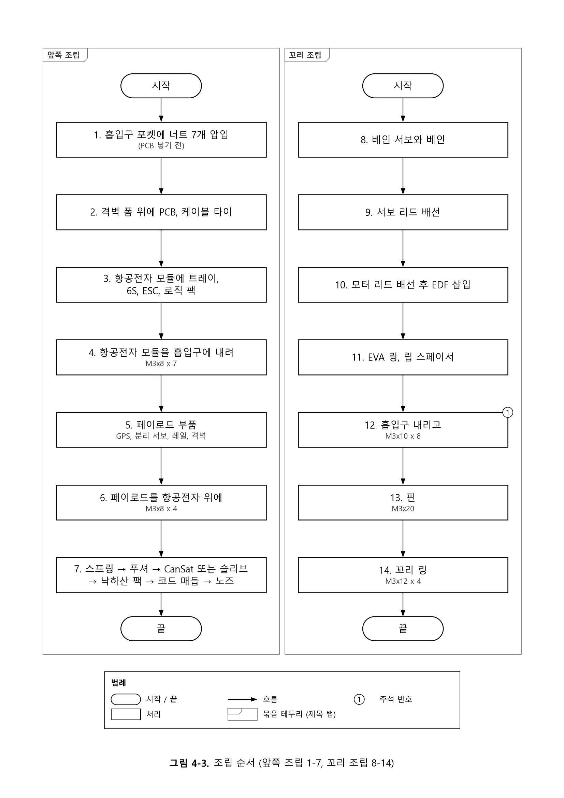

# 04. 기계 구성도 (Mechanical stack, new body rev 3.4.2, V tail)

이 문서는 새 본체 사양 rev 3.4.2(`sim_tools/runs/body_redesign/spec/새_본체_상세사양.md`, 아래에서 NBS)를 따릅니다.

- **설계 단계:** 사양·질량 모델 단계이고, 아직 출력용 CAD가 아닙니다(NBS:4).
- **저장소 CAD:** 저장소의 CAD는 아직 예전 본체(856 mm)입니다(REQ:52).
- **좌표계:**
  - z축은 기체 축을 따라 위쪽입니다. **z 0은 V 꼬리 배기 끝면**입니다.
  - θ는 +x(항공전자 베이의 ESC 쪽)에서 +y 방향으로 잽니다(NBS:843-844).
- **단위:** mm.
- Mermaid 원본은 [상세판](detailed/04_기계_구성도.md)에 있습니다.

## 4.1 적층 순서 (노즈 → 배기)

**그림 4-1.** 기계 적층 순서 (노즈 → 배기, 새 본체 rev 3.4.2, V 꼬리, 단위 mm) · [SVG](img/04_기계_구성도_1.svg) · [PNG](img/04_기계_구성도_1.png)

그림의 결합선 라벨에 결합부 사실이 적혀 있습니다.

- **페이로드 ↔ 항공전자:** 결합부 페이로드 ↔ 항공전자, M3x8 x 4.
- **항공전자 ↔ 흡입구:** FJ-1 항공전자 ↔ 흡입구 · z 357.9, M3x8 x 7 + 너트, θ45/90/132/176/228/270/315.
- **흡입구 ↔ 꼬리:** 흡입구 ↔ 꼬리 결합 · z 210, M3x10 x 8 + 너트 (z 204.5).

| 주 | 내용 |
|---|---|
| ① | 노즈콘: LD-Haack 140, 바닥 D120, 벽 0.84. 스커트 0.84 + θ270 ±10° 슬롯. 래치 러그 θ30, 코드 고리 θ120/300. 밸러스트 포켓 D24 (끝에서 16-50 mm). |
| ② | 낙하산 팩: 1.2 m 낙하산 + 줄 + 스위블 + 코드. |
| ③ | 페이로드 모듈: OD 120, 벽 0.84, 관 124.6 mm. CanSat 또는 더미 슬리브 z 568.4-683.4. 레일 θ90/210/330 (내측 r 34.5). |
| ④ | 페이로드 내부: 분리 서보 MG90S θ30, 몸체 바닥 z 615.7, 혼 끝 651.2. GPS NEO-7M θ150, z 580-630. 사출 스프링 자유장 60, 행정 46, 15 N + 스파이더 푸셔. 낙하산 코드 앵커 θ270 (d 4.5 구멍, 8자 매듭, 나사 없음). |
| ⑤ | 페이로드 격벽: 판 0.8 + 림 + 12 mm 리브. |
| ⑥ | 항공전자 모듈: OD 120, 벽 1.2 (재출력, 이음 개념). 보스: 아래 7개 (4.6 mm), 위 4개. |
| ⑦ | 베이 내부: 6S 상자 x -27..24 (349 g), ESC 상자 x 26..35 (92 g), 1S 로직 팩 84 g (6S의 -x면, A 자리), misc 40 g. J16 암 스위치 θ82, J15 로직 스위치 θ106. |
| ⑧ | 캐리어 PCB rev 3.1: 흡입구 격벽 위, 3 mm 폼 테이프. 케이블 타이 1개 (구멍 θ90/270), 39.4 g. |
| ⑨ | 흡입구 모듈: 너트 포켓, 리브 격벽 z 349.2-350.4. 플레어 OD 120→142, z 315-345, 상단 링 z 309-315. ±30° 아이소그리드 z 229-309 = FOD 메시 (최대 6.7 mm). 깔때기 z 210-228, 리드 상자 θ20/200. |
| ⑩ | 꼬리 V: 덕트 + 키홈, 격납 밴드 r 58-64, z 170-190. 제트 베인 4 + MG90S 4 (커버 r 71→101.6, z 6-104). 핀 클램프: 볼 5.0 + 받침 3, 핀당 M3x20 x 2. 립 스페이서 + EVA 링. |
| ⑪ | EDF Hobbyocean 90 mm 12날, 369 g: 립 앞면 z 202, 탭 z 134.05-176.35, 하우징 뒤 z 120.9, 로터 면 z 180 (A, 실측 필요). |
| ⑫ | 일체형 핀 4장: 반폭 180, 뿌리 80, 끝 50, 후퇴 70. 뿌리 4.8, 넥 퓨즈 r 124, t_n 3.2. 핀 끝 뒷전 z -40. |
| ⑬ | 꼬리 링: OD 142, 외피 1.0, 착지 링. M3x12 셀프태핑 x 4. |

**그림 읽는 법:** 가는 선 = 적층 순서, 굵은 선 = 볼트 결합, 회색 선 = 내부 부품 또는 부착. 회색 상자 = 전기·전원 부품 (PCB, 베이 내부, EDF).

## 4.2 숨은 배선 경로 (밖으로 보이는 선 없음)

**그림 4-2.** 숨은 배선 경로 (밖으로 보이는 선 없음) · [SVG](img/04_기계_구성도_2.svg) · [PNG](img/04_기계_구성도_2.png)

| 주 | 내용 |
|---|---|
| ① | 모터 리드 3가닥(약 395 mm, 63.9 g)은 EDF 넣기 전에 깝니다. |
| ② | 플레어 리드 상자(θ20 / θ200)는 계단형 질량 모델로만 잡혀 있고 검증되지 않았습니다(NBS:1126, 1220). |
| ③ | 페이로드 베이 채널: 인라인 커넥터는 항공전자/페이로드 이음부에 둡니다. 이 채널도 검증되지 않았습니다(NBS:1126, 1220). |
| ④ | 분리 서보 3심 리드를 J13(신호)과 J12 Y-리드(+, -)로 나눠 꽂습니다. 이 리드는 NOT_VERIFIED입니다(P:1411). |

**그림 읽는 법:** 점선 상자 = 검증 안 된 경로(플레어 리드 상자, 페이로드 채널). 제목 탭이 붙은 회색 실선 테두리(꼬리 V, 흡입구, 항공전자 베이, 페이로드)는 위치 묶음일 뿐 검증 상태를 뜻하지 않습니다. 계단형 질량 모델로만 잡혀 있습니다(NBS:1126, 1220).

## 4.3 조립 순서

**그림 4-3.** 조립 순서 (앞쪽 조립 1-7, 꼬리 조립 8-14) · [SVG](img/04_기계_구성도_3.svg) · [PNG](img/04_기계_구성도_3.png)

| 주 | 내용 |
|---|---|
| ① | 12단계의 "흡입구"는 앞쪽 조립 1-4단계에서 항공전자 모듈과 이미 결합한 흡입구입니다. 앞뒤 순서를 어떻게 맞물리는지는 사양 원문 NBS:1136-1157을 따르십시오. |

**그림 읽는 법:** ISO 5807 기호를 씁니다. 각 열은 "시작" 단말에서 처리 상자들을 거쳐 "끝" 단말로 갑니다. 각 단계의 체결류는 상자 안의 작은 글씨(8 pt) 줄입니다. 앞쪽 조립과 꼬리 조립 사이의 순서는 그림에 없습니다(주 ①).

**체결류(V):**

- M3 나사 32개: x8 12개, x10 8개, x12 4개, x20 8개
- 너트 23개
- M2x8 10개, M2x3 4개
- 모두 A2-70 스테인리스입니다(NBS:1163, 1179).

## 4.4 질량·안정성 요약 (rev 3.4.2, 따로 표시가 없으면 E)

| 항목 | 값 | 출처 |
|---|---|---|
| 질량 MID | CanSat 없이 2,079.1 g / CanSat 포함 2,419 g | NBS:120-121 |
| 무게중심 | z 302.2 mm | NBS:122 |
| 정안정 여유 (M, OpenRocket = RocketPy) | +1.10 cal. 뒤쪽 CG 한계에서는 +0.92 (노즈 밸러스트 48 g 필요) | NBS:123 |
| 압력중심, Cd | CP 653.2 mm, Cd 0.296 | NBS:123 |
| T/W (20 N) | **0.981, 이륙 불가** (꼬리 링 손실 포함 시 0.941-0.968) | NBS:9, 126 |
| T/W 1.15에 필요한 추력 | 23.8-25.0 N | NBS:128 |
| 질량 요구 1,770 g | +309 g 초과 (밸러스트 포함 +357 g) | NBS:132 |
| 베인 권한 | CFD 0.137 N m = 이륙 필요량 0.077 N m의 1.77배 | NBS:1076 |
| 핀 넥 퓨즈 | 허용 창 24.5-28.6 N, 27.3 N에서 파단. 플러터 속도 87.8 m/s (E) | NBS:54, 64 |
| 착지 | 꼬리 링이 15.48° 기울기까지 먼저 닿음. 단단한 잔디에서만 비행 | NBS:163; REQ:56 |

## 노드 출처

노드 이름은 [상세판](detailed/04_기계_구성도.md) Mermaid 코드의 ID입니다.

| 노드 | 출처 |
|---|---|
| NOSE, CHUTE | NBS:853-854, 980-982 |
| PAY, PAY_IN | NBS:855, 984-992, 97 |
| PBH, J2 | NBS:856, 986 |
| AVI, AVI_IN | NBS:857, 906, 1317; REQ:38; SP frozen_avionics; P:2048 |
| PCB, FJ1 | NBS:858-859, 1140, 1170 |
| INT, J3 | NBS:860-861, 996, 1018-1020, 1049, 1171 |
| TAIL, EDF, FIN, RING | NBS:862-867, 1052-1072, 1177, 1194 |
| 배선 경로 | NBS:1115-1126, 1148; P:1411 |
| 조립 순서 | NBS:1136-1157 |

## 주의

- **핀 표기:** REQ:51에는 아직 "퓨즈 패널"이라고 적혀 있습니다. rev 3.4.1부터 핀은 일체형 + 넥 퓨즈입니다(NBS:1060).
- **핀 결손:** 한쪽 핀의 바깥 패널이 없으면 비행하지 않습니다. 그 상태에서는 안정 여유가 +0.71 cal로 떨어집니다(NBS:125, 1155).
