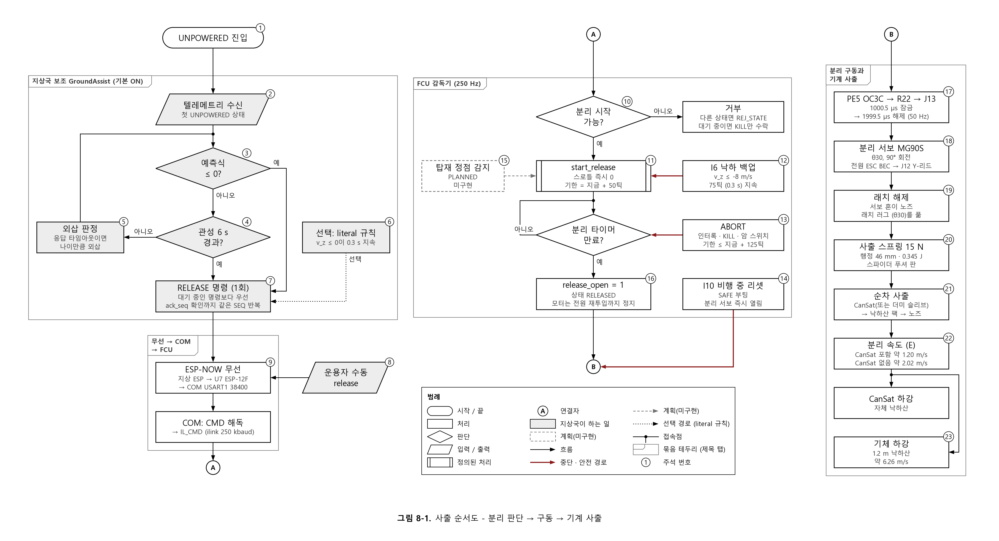

# 08. 사출 순서도 (Apogee detection, CanSat release, parachute)

**누가 정점을 판단하나:** 현재 구현에서는 **지상국 보조(GroundAssist)** 가 정점 분리를 주로 판단합니다.

- 기체가 혼자 분리를 여는 경로는 세 가지뿐입니다.
  - I6 낙하 감지
  - ABORT
  - I10 재부팅
- REQ:18이 요구하는 **탑재 정점 감지 백업(기압 + 가속도 + 시간 상한)은 아직 코드에 없습니다.** 그림에서는 점선 상자(계획)로 표시했습니다.
- `params_gen.h:175-177`에 따르면 target_altitude, apogee_detect_vz, apogee_confirm, coast_timeout은 지상국 전용 값입니다. 펌웨어에는 일부러 넣지 않았습니다.

**낙하산 구동:** 낙하산 전용 구동기는 없습니다. 분리 서보 하나가 래치를 풀면 스프링이 CanSat(또는 더미 슬리브), 낙하산 팩, 노즈를 차례로 밀어냅니다(NBS §12, 1274-1285).

**표기:** ISO 5807 기호. 회색 채움 = 지상국이 하는 일, 점선 상자 = 계획(미구현), 진한 빨강 선 = 중단·안전 경로, 점선 화살표 = 선택 경로(literal 규칙). 제목 탭이 붙은 회색 실선 테두리는 묶음 표시입니다. Mermaid 원본은 [상세판](detailed/08_사출_순서도.md)에 있습니다.

## 8.1 분리 판단 → 구동 → 기계 사출

**그림 8-1.** 사출 순서도 - 분리 판단 → 구동 → 기계 사출 · [SVG](img/08_사출_순서도_1.svg) · [PNG](img/08_사출_순서도_1.png)

| 주 | 내용 |
|---|---|
| ① | UNPOWERED 진입 사유: CUT, THROTTLE 0, I4, I7. |
| ② | 지상국 보조(GroundAssist)는 기본 ON. POWERED 이후 처음 받은 UNPOWERED 텔레메트리부터 판단한다. target_altitude, apogee_detect_vz, apogee_confirm, coast_timeout은 지상국 전용 값이고 펌웨어에는 일부러 넣지 않았다(params_gen.h:175-177). |
| ③ | 예측식: v_z - g·(t_link + 0.2 s + T_tel/2) ≤ 0 m/s. 0.2 s는 release_after_cut_s이며 펌웨어 분리 대기(50틱)와 같은 값. |
| ④ | 관성 타임아웃: 첫 UNPOWERED 텔레메트리 후 6 s. |
| ⑤ | 응답 타임아웃이면 마지막 텔레메트리를 나이만큼 외삽해 판정한다. |
| ⑥ | 선택 규칙(literal): v_z ≤ 0이 0.3 s 지속. |
| ⑦ | RELEASE 명령은 1회만, 대기 중인 명령보다 우선, ack_seq 확인까지 같은 SEQ 반복. |
| ⑧ | 운용자 수동 release 명령도 같은 무선 경로로 들어간다. |
| ⑨ | 지상 ESP → ESP-NOW → U7 ESP-12F → COM USART1 38400. COM은 CMD를 해독해 IL_CMD(ilink 250 kbaud)로 FCU에 보낸다. |
| ⑩ | 분리 시작 조건: 상태가 ARMED, POWERED, UNPOWERED이고 분리 대기 없음. 다른 상태면 REJ_STATE, 대기 중이면 KILL만 수락. |
| ⑪ | start_release: 스로틀 즉시 0 (POWERED → UNPOWERED), 기한 = 지금 + 50틱 (0.2 s). |
| ⑫ | I6 낙하 백업: v_z ≤ -8 m/s가 75틱 (0.3 s) 지속, 분리 열림·대기 없음일 때. |
| ⑬ | ABORT (I1, I2, I3, I5, I8, I9, KILL, 암 스위치): 기한 = min(대기 중 기한, 지금 + 125틱 = 0.5 s). |
| ⑭ | I10 비행 중 리셋: SAFE 부팅 + 분리 서보 즉시 열림 (타이머를 거치지 않음). |
| ⑮ | PLANNED 탑재 정점 감지(미구현, REQ:18): 기압 - 차단 0.5 s 후부터, 최고점보다 1 m 이상 낮고 기압 고도율 < 0이 0.3 s. 가속도 - 차단 시 속도에서 적분, v_z ≤ 0. 시간 상한 - 차단 + v_cut/g + 1.0 s. 둘이 0.5 s 안에 일치하거나 시간 상한이면 분리. 추진 중이나 차단 후 0.5 s 안에는 금지. |
| ⑯ | release_open = 1, 상태 RELEASED. 모터는 전원 재투입까지 정지. |
| ⑰ | FCU PE5 OC3C → R22 → J13. 1000.5 µs 잠금 → 1999.5 µs 해제 (50 Hz 프레임). |
| ⑱ | 분리 서보 MG90S θ30, 90° 회전. 전원: ESC BEC → J12 Y-리드. |
| ⑲ | 낙하산 전용 구동기는 없다. 서보 혼이 노즈 래치 러그(θ30)를 풀면 스프링이 차례로 밀어낸다. |
| ⑳ | 사출 스프링 15 N, 행정 46 mm, 0.345 J. 스파이더 푸셔 판(스프링에 묶임). |
| ㉑ | CanSat 또는 더미 슬리브 → 낙하산 팩 → 노즈. 행정이 노즈 스커트 15 mm보다 31 mm 김. |
| ㉒ | 분리 속도(E, 마찰 20 % 가정): CanSat 포함 약 1.20 m/s (0.038 s에 관 끝), CanSat 없음: 팩 + 노즈 약 2.02 m/s. |
| ㉓ | 기체: 1.2 m 낙하산, 약 6.26 m/s. 노즈와 낙하산은 기체에 묶임 (코드 앵커 θ270, 8자 매듭). |

**그림을 그리며 바꾼 표현 (사실은 그대로):**

- "분리 타이머 만료?" 판단에는 "아니오 → 다시 대기" 되돌림 선이 있습니다. 상세판에는 이 출구가 명시되어 있지 않고, 순서도 형식을 맞추려고 넣은 것입니다.
- "선택: literal 규칙" → "RELEASE 명령" 선은 상세판(`G5 -.-> G6`)처럼 점선으로 그리고, 범례에 "선택 경로 (literal 규칙)"로 적었습니다. 다른 선과 합치지 않고 RELEASE 명령 상자로 따로 들어갑니다.
- 상자 제목 "외삽 판정", "순차 사출", "ESP-NOW 무선", "래치 해제", "CanSat 하강", "기체 하강", "UNPOWERED 진입", "탑재 정점 감지"는 그림용 짧은 제목입니다. 원래 내용은 위 주에 있습니다.

## 8.2 시간축 (지상 보조 정상 분리)

**그림 8-2.** 시간축 - 지상 보조 정상 분리 (UML 시퀀스 다이어그램) · [SVG](img/08_사출_순서도_2.svg) · [PNG](img/08_사출_순서도_2.png)

| 주 | 내용 |
|---|---|
| ① | 링크 지연(참고 값, esp_bridge): 업링크 12.8 ms, 다운링크 24.9 ms, 최악 왕복 146.3 ms, 응답 타임아웃 240.3 ms (PG:236-243). |
| ② | 예측식 안의 0.2 s는 release_after_cut_s이며 펌웨어의 분리 대기 시간(50틱)과 같은 값 (P:1637-1639; PG:192). |

## 8.3 백업 경로 요약

| 경로 | 조건 | 분리까지 | 구현 | 출처 |
|---|---|---|---|---|
| 지상 보조 예측식 | v_z - g(t_link + 0.2 + T_tel/2) ≤ 0 | +0.2 s | IMPL (지상) | `ground_station_logic.py:58-65, 428-451`; P:1637-1639 |
| 지상 관성 타임아웃 | 첫 UNPOWERED 텔레메트리 후 6 s | +0.2 s | IMPL (지상) | `ground_station_logic.py:475-488`; P:1658, 1660 |
| 운용자 수동 RELEASE | 명령 | +0.2 s | IMPL | `ground_station.py:502-545` |
| I6 낙하 | v_z ≤ -8 m/s, 0.3 s | +0.2 s | IMPL (기체) | `onboard.c:290-293, 360-363`; PG:187-188 |
| ABORT | 인터록, KILL, 암 스위치 | +0.5 s (또는 더 이른 대기 기한) | IMPL (기체) | `onboard.c:139-146`; PG:193 |
| I10 | 비행 중 워치독/BOD 리셋 | 부팅 즉시 | IMPL (기체) | `watchdog.c:56-62`; `main.c:987-988, 1030-1034` |
| 탑재 정점 감지 | 기압 + 가속도 + 시간 상한 | - | **PLANNED (미구현)** | REQ:18; `concepts/light/concept_ko.md:89-95`; rev1 사양:340 |

## 주의

1. **분리 서보 전원:** 분리 서보 전원은 ESC BEC에서 J12 Y-리드로 받습니다.
   - 따라서 6S가 연결되지 않은 상태에서는 분리 서보가 움직이지 않습니다.
   - BEC 여유는 NOT_VERIFIED입니다(RD:151). 분리 서보 리드도 NOT_VERIFIED입니다(P:1411).
2. **RELEASE_PWM 풀다운:** RELEASE_PWM 넷에는 부팅 시 풀다운이 없습니다(넷리스트). 베인 출력과 ESC 출력에는 있습니다.
   - 부팅 순간 서보가 튈 수 있는지는 확인되지 않았습니다(**ASSUMED** 위험, 측정 필요).
3. **차단 후 스핀:** 차단 후 약 1,390 °/s 스핀이 있습니다. 분리 0.07 s 동안 기체가 약 100° 돕니다(R2:412; REQ:18).
4. **통신 거리:** 정점 근처에서 Wi-Fi 링크가 끊기면 지상 보조 분리가 불가능합니다. 그때 남는 경로는 다음과 같습니다(FW:240-242).
   - I1 링크 3 s → ABORT → 0.5 s 후 분리
   - I6 낙하 감지
5. **낙하산 크기:** params.json:1426은 아직 1.4 m입니다. 사용자는 1.2 m로 결정했습니다(REQ:32; NBS:1283).
