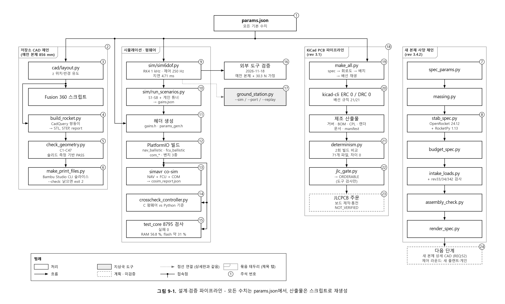

# 09. 개발·검증 흐름도 (Design / verification pipeline and test plan)

원칙은 하나입니다. **모든 숫자는 `params.json` 한 곳에서 나오고, 산출물(CAD, 펌웨어 헤더, PCB 파일)은 스크립트로 다시 생성합니다.**

- **PASS의 근거:** "PASS"는 도구로 측정한 결과로만 인정합니다(`check_geometry.py:1-6`, KiCad ERC/DRC, simavr co-sim).
- **아직 안 된 것:** 기체 실물, 보드, 추력 측정은 아직 없습니다. 그래서 모두 NOT_VERIFIED입니다.
- **표기:** 점선 상자 = 계획·미수행, 회색 채움 = 지상국 도구, 제목 탭이 붙은 회색 실선 테두리 = 묶음(체인·시험 단계). Mermaid 원본은 [상세판](detailed/09_개발_검증_흐름도.md)에 있습니다.

## 9.1 설계·검증 파이프라인

**그림 9-1.** 설계·검증 파이프라인 - 모든 수치는 params.json에서, 산출물은 스크립트로 재생성 · [SVG](img/09_개발_검증_흐름도_1.svg) · [PNG](img/09_개발_검증_흐름도_1.png)

| 주 | 내용 |
|---|---|
| ① | params.json: 모든 기본 수치의 단일 출처. 산출물(CAD, 펌웨어 헤더, PCB 파일)은 스크립트로 다시 생성한다. |
| ② | 저장소 CAD 체인은 예전 본체(856 mm) 기준. 새 본체(890 mm)는 아직 이 파이프라인에 없다(REQ:52; NBS:4). |
| ③ | cad/layout.py: z 위치·반경 유도. |
| ④ | CadQuery 쌍둥이 build_rocket.py → STL, STEP, cadquery_report.json. |
| ⑤ | check_geometry.py: C1-C47, 솔리드 측정 기반 PASS. |
| ⑥ | tools/make_print_files.py: Bambu Studio CLI 슬라이스, --check: 낡으면 exit 2. |
| ⑦ | 새 본체 사양 체인: sim_tools/runs/body_redesign/spec, rev 3.4.2. |
| ⑧ | stab_spec.py: OpenRocket 24.12 + RocketPy 1.13. intake_loads.py는 rev33/34/342 검사 포함. |
| ⑨ | sim/sim6dof.py: RK4 1 kHz, 제어 250 Hz, 지연 4.71 ms, 센서·Barrowman 공력·낙하산 모델. |
| ⑩ | sim/run_scenarios.py: S1-S8 + 게인 튜너 → gains.json. |
| ⑪ | gen_gains_header.py → gains.h, gen_firmware_params.py → params_gen.h. |
| ⑫ | PlatformIO 빌드: nav_ballistic · fcu_ballistic · com_*, 벤치: fcu_bench_vanes / tether / hover. |
| ⑬ | simavr co-sim (NAV + FCU + COM): run_cosim.py → cosim_report.json. |
| ⑭ | crosscheck_controller.py: C 펌웨어 vs Python 기준. |
| ⑮ | test_core 8795 검사, 실패 0. RAM 56.8 %, flash 약 31 %. |
| ⑯ | 외부 도구 검증 2026-11-18: OpenRocket, RocketPy, OpenFOAM v2606 (예전 본체 + 30.3 N 가정). |
| ⑰ | tools/ground_station.py: --sim 연습 / --port 실링크 / --replay. |
| ⑱ | KiCad PCB 파이프라인 rev 3.1, 브랜치 pcb-rev3. |
| ⑲ | make_all.py: spec → 회로도 → 배치 → 배선 재생 (Freerouting 기록). |
| ⑳ | kicad-cli ERC 0 / DRC 0, 배선 규칙 21/21. |
| ㉑ | determinism.py 2회 빌드 비교: 71개 파일, 차이 0. |
| ㉒ | jlc_gate.py (주문일 재고, 온라인 읽기 전용) → ORDERABLE (도구 검사만). |
| ㉓ | JLCPCB 주문: 보드 제작·통전 NOT_VERIFIED. |
| ㉔ | 다음: 새 본체 상세 CAD (REQ:52). 제어 라운드: 새 플랜트·게인 (보관 + 전후 비교 영상 규칙). |

상자 제목 "헤더 생성", "제조 산출물", "다음 단계"는 그림용 짧은 제목입니다. 원래 내용은 주 ⑪, ㉔와 상세판에 있습니다.

sim/sim6dof.py → ground_station.py 회색 점선은 상세판의 점선 연결(`M1 -.-> GSW`)을 그대로 옮긴 것입니다. 상세판은 이 점선의 뜻을 따로 적지 않았으므로 범례에도 "점선 연결 (상세판과 같음)"이라고만 적었습니다.

## 9.2 시험 계획: 새 본체 측정 → 단계별 시험

**그림 9-2.** 시험 계획 - 새 본체 측정 → 낙하·쿠폰 시험 → 단계별 시험 (모두 미수행) · [SVG](img/09_개발_검증_흐름도_2.svg) · [PNG](img/09_개발_검증_흐름도_2.png)

| 주 | 내용 |
|---|---|
| ① | 새 본체 측정 항목은 사용자_결정_목록 DEC:70-87. 추력은 정품 로터로, 꼬리 링 장착 / 미장착 둘 다, 롤 반력 토크도 측정 (벤치는 꼬리 모듈만 고정). |
| ② | 추력 25.0 N 이상(T/W 1.15)이 비행 전제 조건(DEC:72). 미달이면 자유 비행 금지 (20 N이면 T/W 0.981). |
| ③ | 완성 질량·무게중심 → 노즈 밸러스트. 부품별 질량, 모터 리드 길이·각도, 로터 면 높이, M3 수량, 시험 출력. |
| ④ | 낙하·쿠폰 시험의 권장 순서는 NBS:1584-1586. |
| ⑤ | B-2-2 (가) 넥 퓨즈 파단: t_n 3.0/3.2/3.4 각 3개. 합격: 최저 24.5 N 이상, 최고 28.6 N 이하. |
| ⑥ | B-2-3 항공전자 보스 인발: 3:1 시소, 나사당 474 N (CanSat 포함). |
| ⑦ | B-2-4 (나) 감속 낙하: 2.0 kg 썰매, 최대 2.0 m. 합격 40 g 이하 (CanSat 포함 31 g). |
| ⑧ | B-2-2 (나) 전도 낙하 · (다) 측면 낙하 0.1/0.2/0.3 m. |
| ⑨ | B-2-6 결과를 spec/test_results/에 기록. |
| ⑩ | 단계별 시험은 docs/시험_안전_법규.md:7-16. |
| ⑪ | 0 벤치 전원: NAV/FCU/COM + 무선, ESC 없음. 합격: 루프 < 4 ms, 지상국 정지 2 s 후 ARMED → SAFE. |
| ⑫ | 2 로드셀 추력: 0-50 % fcu_bench_tether, 50-100 % fcu_ballistic + --allow-throttle-cmd. 시험 문서의 옛 합격 기준은 '30 N 이상, 120 A 이하'(시험_안전_법규.md:13), 새 규칙은 꼬리 링 장착 상태 25.0 N 이상(DEC:72). |
| ⑬ | 측정 → 낙하 → 단계 순서는 가정(ASSUMED)이다. 저장소 문서는 이 순서를 직접 정하지 않는다. |

**시험 상태:** 모든 시험 상자가 점선(계획)입니다. 아직 한 번도 수행하지 않았기 때문입니다.

**측정 → 낙하 → 단계 순서는 가정입니다(ASSUMED).** 저장소 문서는 이 순서를 직접 정하지 않습니다. 근거는 다음 두 가지뿐입니다.

- 추력 25 N이 비행 전제 조건이라는 것(DEC:72)
- 낙하 시험의 권장 순서(NBS:1584-1586)

## 노드 출처

노드 이름은 [상세판](detailed/09_개발_검증_흐름도.md) Mermaid 코드의 ID입니다.

| 노드 | 출처 |
|---|---|
| P, C1-C5 | SPEC:82-87; `cad/layout.py:1-10`; `build_rocket.py:1-8`; `check_geometry.py:1-6`; `make_print_files.py:1-16`; README.md:129, 279 |
| S1-S7 | NBS:16, 1512-1525 |
| M1-M7 | `sim6dof.py:1-20`; SPEC:964-967, 1077-1118; `tools/cosim/README.md:1-28`; `verify_log.txt`; PIO:68-253 |
| K1-K6 | PCB31:1-3, 21, 27, 171-187; REQ:20-21, 66 |
| EXT | ST:5-12; VAL |
| NEXT | REQ:52; NBS:1469-1474 |
| T0, TQ, TN, MM | DEC:70-87; NBS:9, 126, 136, 1157 |
| D1-D9 | NBS:1537-1586 |
| G0-G5 | `docs/시험_안전_법규.md:7-16` |

## 주의

1. **추력 합격 기준 불일치:** 시험 문서는 2단계 합격을 "30 N 이상, 120 A 이하"로 적고 있습니다(옛 기준, `시험_안전_법규.md:13`). 새 규칙은 꼬리 링 장착 상태에서 25.0 N 이상입니다(DEC:72).
2. **PCB 폴더 불일치:** `body-redesign`의 `pcb/vtol_carrier`는 rev 2c입니다. 주문한 rev 3.1 커밋 4051623은 `pcb-rev3`와 `main`에만 있습니다.
3. **새 본체가 파이프라인 밖에 있음:** 새 본체(890 mm)는 아직 저장소 CAD 파이프라인에 없습니다(REQ:52; NBS:4).
