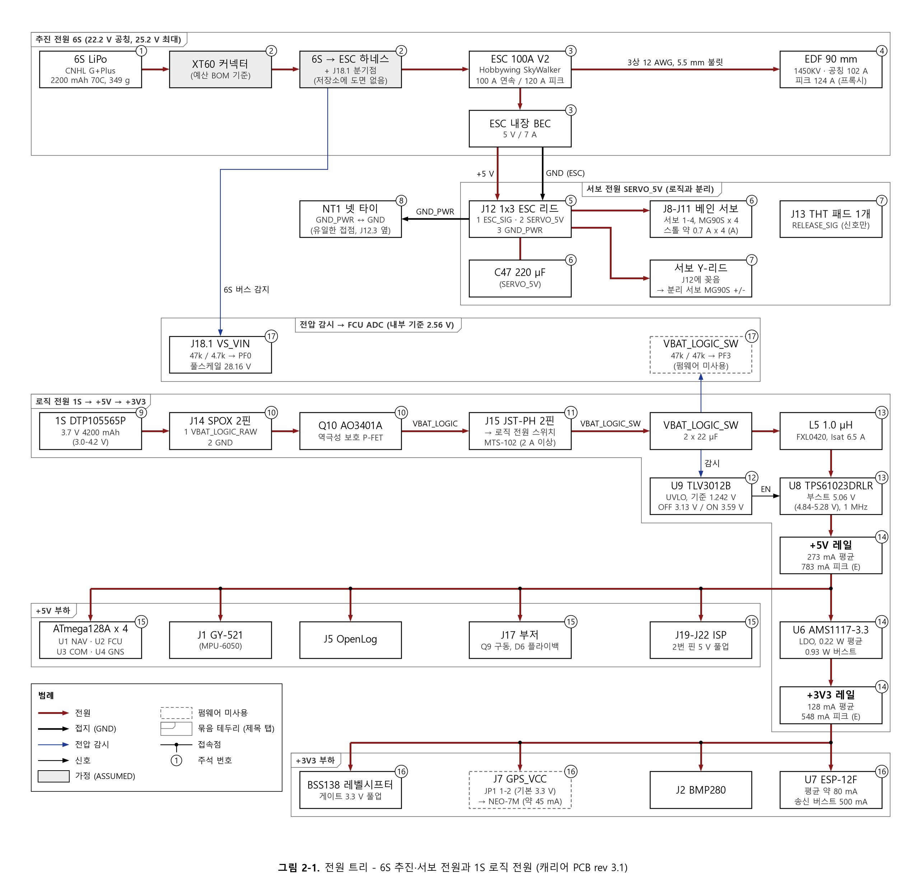
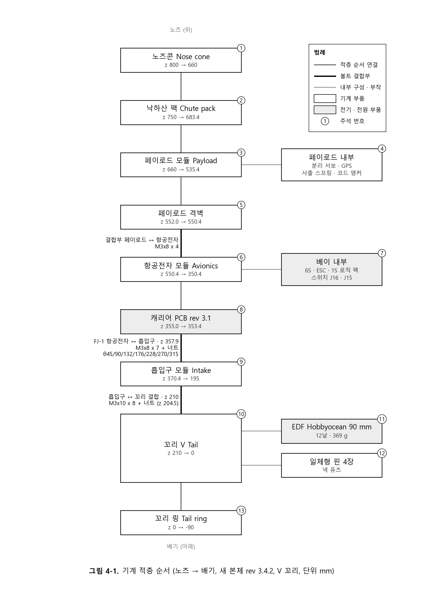
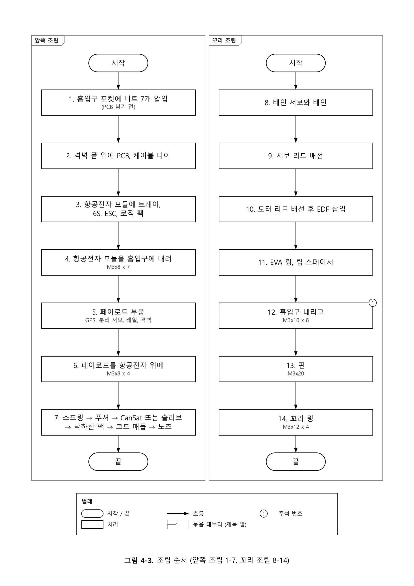
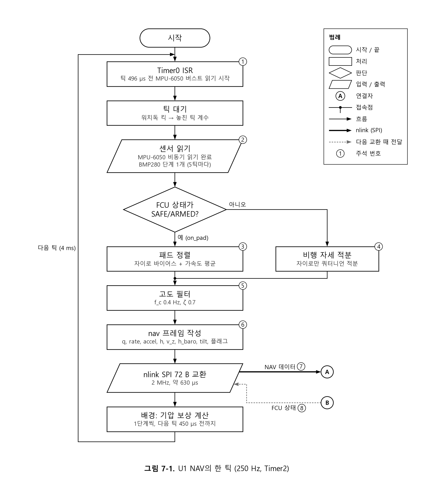

# CanSat EDF Rocket with ATmega128 - 블록도·순서도 (교과서식)

작성일: **2026-11-19**

이 폴더는 같은 블록도·순서도를 교과서 형식으로 다시 그린 판입니다. **사실은 바꾸지 않았고 그리는 방식만 바꿨습니다.** 상자에 다 들어가지 않는 내용은 그림 아래 번호 주석 표로 옮겼습니다.

- **그림 파일:** `img/`에 SVG와 PNG가 있습니다. 문서에는 PNG를 넣고 SVG를 링크했습니다.
- **그리는 방식:** matplotlib 스크립트로 그렸습니다(`sim_tools/runs/diagrams_textbook/tbdraw.py`와 `draw_*.py`). 같은 스크립트를 두 번 돌리면 바이트 단위로 같은 파일이 나옵니다.
- **출처:** 각 문서의 주석 표, "노드 출처" 표, 그리고 [상세판](#상세판-mermaid-검증용-출처-표-포함)에 있습니다.

## 교과서식 그림

| 번호 | 문서 | 그림 | 그림 종류 |
|---|---|---|---|
| 01 | [시스템 블록도](01_시스템_블록도.md) | 그림 1-1 시스템 블록도 | 블록도 |
| 02 | [전기·전원 블록도](02_전기_전원_블록도.md) | 그림 2-1 전원 트리, 그림 2-2 접지 구조 (+ 커넥터 J1-J26 표) | 블록도 + 표 |
| 03 | [항공전자 데이터 블록도](03_항공전자_데이터_블록도.md) | 그림 3-1 칩·버스·주변장치 (+ 링크 표) | 블록도 + 표 |
| 04 | [기계 구성도](04_기계_구성도.md) | 그림 4-1 적층 순서, 그림 4-2 숨은 배선 경로, 그림 4-3 조립 순서 | 구성도 + 순서도 |
| 05 | [비행 순서도](05_비행_순서도.md) | 그림 5-1 패드 → 착지·회수 | 순서도 (ISO 5807) |
| 06 | [펌웨어 상태도](06_펌웨어_상태도.md) | 그림 6-1 감독기 상태도, 그림 6-2 한 틱 처리 순서 | UML 상태도 + 순서도 |
| 07 | [제어 루프 순서도](07_제어_루프_순서도.md) | 그림 7-1 NAV 한 틱, 그림 7-2 FCU 한 틱, 그림 7-3 시간 순서 | 순서도 + UML 시퀀스 |
| 08 | [사출 순서도](08_사출_순서도.md) | 그림 8-1 분리 판단 → 기계 사출, 그림 8-2 시간축 | 순서도 + UML 시퀀스 |
| 09 | [개발·검증 흐름도](09_개발_검증_흐름도.md) | 그림 9-1 설계·검증 파이프라인, 그림 9-2 시험 계획 | 흐름도 |

### 표기 규칙

- **공통:** 흰 바탕, 검정·회색 선, 글꼴 하나(맑은 고딕), 크기 14 / 10 / 8 pt(제목 / 상자 / 라벨). 선은 직각으로만 꺾고, 신호 이름은 선 위에 적습니다. 그림마다 범례 상자와 "그림 n." 캡션이 있습니다.
- **번호 주석:** 그림 속 ①, ② 같은 표시는 그림 아래 주석 표("주" 열)의 번호입니다. 범례 이름은 모두 "주석 번호"입니다.
- **블록도 선:** 굵은 진한 빨강 = 전원, 가는 검정 = 신호, 파선 = PWM, 점선 = 무선. 그림에 따라 추가한 선 종류(접지, 전압 감시, 공기 흐름, 미사용 경로 등)는 각 그림의 범례에 있습니다.
- **채움과 테두리:** 점선 상자 = 미사용·대체 경로 또는 계획(미구현). 제목 탭이 붙은 회색 실선 테두리 = 묶음(모듈·영역·단계)이며 상태를 뜻하지 않습니다. 범례에는 "묶음 테두리 (제목 탭)"으로 적었습니다. 회색 채움의 뜻은 그림마다 범례에 적었습니다(예: 그림 1-1은 지상국 장비, 그림 2-1은 ASSUMED 블록).
- **순서도 (ISO 5807):** 둥근 단말 = 시작·끝, 직사각형 = 처리, 마름모 = 판단(예 / 아니오), 평행사변형 = 입출력, 양옆 이중선 상자 = 미리 정의된 처리. 주 흐름은 위에서 아래, 되돌림은 왼쪽. 진한 빨강 선 = 중단·안전 경로.
- **상태도 (UML):** 둥근 사각형 = 상태, 채운 점 = 시작, 전이 라벨 = "사건 [가드] / 동작".
- **연결자:** 원 안의 A, B는 같은 그림(또는 짝이 되는 그림) 안의 같은 글자로 이어집니다.

**수치 라벨:**

- **M** = 도구로 측정한 값
- **F** = 설계 파일 값
- **E** = 추정값
- **A** = 가정값

라벨이 없는 수치는 설계 파일이나 펌웨어 상수입니다.

## 그림 모아 보기

                 

## 각 그림이 반영한 버전

| 대상 | 기준 | 사용한 그림 |
|---|---|---|
| 펌웨어, 시뮬레이션, 지상국, params.json | 워크트리 `CanSat_EDF_Rocket_body`, 브랜치 **`body-redesign` @ 78f59fa** (2026-11-19, 로켓 전용, VTOL 제거) | 01, 03, 05, 06, 07, 08, 09 |
| 캐리어 PCB | **rev 3.1**, 커밋 **4051623** (`pcb-rev3`, `main`에도 있음), 넷리스트 `out/vtol_carrier.net` (title block rev "3") | 01, 02, 03 |
| 기체 구조 (새 본체) | `sim_tools/runs/body_redesign/spec/새_본체_상세사양.md` **rev 3.4.2**, 꼬리 V 1안 (사양·질량 모델 단계, 출력용 CAD 아님) | 01, 04, 05, 08, 09 |
| 요구사항·사용자 결정 | `REQUIREMENTS.md`, `사용자_결정_목록.md` rev 3.4.2 | 전체 |

**PCB 버전 주의:** (2026-11-20 GitHub 판에는 `pcb/vtol_carrier`가 rev 3.1로 들어 있습니다. 아래 문장은 그림을 그린 시점의 기록입니다.) `body-redesign` 안의 `pcb/vtol_carrier` 폴더는 아직 **rev 2c**입니다. 이 폴더에는 J13이 없습니다. 실제로 주문해서 비행할 보드는 rev 3.1이고, 그림은 rev 3.1을 따릅니다. 폴더 이름의 "vtol"은 예전 이름이 남은 것입니다.

## 출처 키

| 키 | 경로 |
|---|---|
| P | `CanSat_EDF_Rocket_body/params.json` (body-redesign) |
| PG | `firmware/atmega128_fc/src/params_gen.h` (params.json에서 생성) |
| PIO | `firmware/atmega128_fc/platformio.ini` |
| FW | `firmware/README.md` |
| `*.c`, `*.h` | `firmware/atmega128_fc/src/` 아래 (예: `core/onboard.c`, `main.c`, `nav/nav_main.c`, `com/com_link.c`) |
| SPEC | `docs/SPEC.md` (body-redesign) |
| RD, CS, NET, BOM, BUY | rev 3.1 PCB 폴더(`pcb-rev3` 워크트리)의 `pcb/vtol_carrier/` 아래 파일 RD = `README_ko.md`, CS = `spec/carrier_spec.json`, NET = `out/vtol_carrier.net`, BOM = `out/vtol_carrier_bom.csv`, BUY = `out/따로_살_부품_ko.md` |
| PCB31 | RD와 같은 파일 |
| NBS | `sim_tools/runs/body_redesign/spec/새_본체_상세사양.md` (rev 3.4.2) |
| REQ | `sim_tools/runs/body_redesign/REQUIREMENTS.md` |
| DEC | `sim_tools/runs/body_redesign/spec/사용자_결정_목록.md` |
| SP | `sim_tools/runs/body_redesign/spec/spec_params.json` |
| R2 | `sim_tools/runs/body_redesign/spec/rev2_archive/새_본체_상세사양.md` |
| VAL | `sim/validation_2026-11-18/README.md` (body-redesign) |
| ST | `sim_tools/README_ko.md` |
| facts_hw / facts_fw / facts_sys | 이 그림을 만들 때 쓴 조사 메모 (`sim_tools/runs/diagrams/facts_*.md`) |

`sim_tools/...` 아래 파일(NBS, REQ, DEC, SP, R2, ST)은 이 저장소 밖의 로컬 작업 폴더에 있습니다.

## ASSUMED (저장소에 없는 내용)

1. **6S → ESC 하네스와 J18.1 VS_VIN 분기 위치:** 도면이 없습니다. XT60은 예산 BOM(`docs/budget/bom.json:161`)에만 나옵니다. (02)
2. **LoRa 대체 링크의 기체 쪽 연결:** rev 3.1에서는 COM PC3-PC5가 미연결입니다. LoRa를 쓰려면 보드를 수정해야 한다고 봅니다. (01, 03)
3. **GPS 프레임 형식(NMEA/UBX):** 저장소에 없습니다. 어차피 로켓 펌웨어는 GPS를 읽지 않습니다. (03)
4. **분리 서보 부팅 튐 위험:** RELEASE_PWM에 풀다운이 없다는 것은 넷리스트에서 확인한 사실입니다. 다만 그 결과 서보가 실제로 튀는지는 가정이고, 측정이 필요합니다. (08)
5. **지상 ESP-07S의 USB 연결 방식:** 펌웨어 `firmware/esp_bridge`에는 있습니다. 하드웨어 구성은 가정입니다. (01)
6. **시험 순서:** 측정 → 낙하 시험 → 단계별 시험의 연결 순서는 문서에 명시되어 있지 않습니다. (09)
7. **스톨 전류:** 서보 스톨 전류 약 0.7 A x 4, 1S 팩 PCM만으로 하는 전류 제한, MTS-102 정격 2 A 이상은 원문에서도 가정(A)입니다. (02)

## 문서·코드·보드 사이의 불일치 (그림은 코드와 rev 3.1 보드를 따름)

1. **칩 수:** 보드에는 ATmega128A가 4개 있지만 로켓 펌웨어는 3칩(NAV, FCU, COM)만 씁니다.
   - U4 GNS와 GPS(J7)는 배선만 있고 쓰이지 않습니다.
   - `firmware/README.md:1`과 저장소 README에는 아직 "네 칩"이라고 적혀 있습니다.
2. **GPS 연결:** params.json:1134는 GPS가 "NAV USART1"에 붙어 있다고 적고 있습니다. 보드에서 NAV USART1은 GNS와의 링크(glink)입니다.
3. **낙하산 크기:** params.json:1426은 1.4 m입니다. 사용자는 **1.2 m**로 결정했습니다(REQ:32; NBS:1283).
4. **탑재 정점 감지 백업:** 기압 + 가속도 + 시간 상한 방식이 REQ:18에 요구되어 있지만 **펌웨어에 없습니다**. 현재 정점 분리는 지상국 보조가 판단합니다.
5. **플랜트 상수와 게인:** 펌웨어의 값은 예전 본체 것입니다(`gains.h:39` STALE = 1). 예: l_v 0.3495 m. 새 본체 V 꼬리 팔은 272 mm입니다.
6. **기압계 이름:** 주석에는 MS5611이 남아 있지만 기본 빌드는 BMP280입니다.
7. **분리 출력 풀다운:** 분리 출력(PE5)에만 부팅 풀다운이 없습니다. 베인 출력과 ESC 출력에는 있습니다.
8. **로직 쪽 퓨즈:** 로직 쪽에 퓨즈나 PTC가 없습니다.
9. **추력 합격 기준:** 시험 문서의 2단계 합격 기준은 30 N입니다. 새 규칙은 꼬리 링 장착 상태에서 25.0 N 이상입니다.
10. **이륙 가능 여부:** 설계 추력 20 N에서 T/W는 0.981이므로 이륙하지 못합니다. 25.0 N 이상을 실측하기 전에는 자유 비행이 금지입니다.
11. **하드웨어 검증 상태:** 보드(rev 3.1)는 제작·통전한 적이 없습니다. 펌웨어 타이밍은 모두 시뮬레이션 값입니다. 둘 다 NOT_VERIFIED입니다.

## 상세판 (Mermaid, 검증용 출처 표 포함)

처음 만든 판입니다. Mermaid 코드 블록과 노드 ID별 출처 표가 그대로 있어 사실 확인에 씁니다. 교과서식 문서의 "노드 출처" 표에 나오는 노드 ID(예: G_PC, B6, F7)는 이 Mermaid 코드의 ID입니다.

| 번호 | 상세판 문서 |
|---|---|
| - | [상세판 README (범례·출처 키)](detailed/README.md) |
| 01 | [시스템 블록도](detailed/01_시스템_블록도.md) |
| 02 | [전기·전원 블록도](detailed/02_전기_전원_블록도.md) |
| 03 | [항공전자 데이터 블록도](detailed/03_항공전자_데이터_블록도.md) |
| 04 | [기계 구성도](detailed/04_기계_구성도.md) |
| 05 | [비행 순서도](detailed/05_비행_순서도.md) |
| 06 | [펌웨어 상태도](detailed/06_펌웨어_상태도.md) |
| 07 | [제어 루프 순서도](detailed/07_제어_루프_순서도.md) |
| 08 | [사출 순서도](detailed/08_사출_순서도.md) |
| 09 | [개발·검증 흐름도](detailed/09_개발_검증_흐름도.md) |

상세판의 렌더 이미지는 `detailed/img/`에 있습니다(Mermaid 11.17.2, 헤드리스 Chrome).

## 그림 다시 만들기

`sim_tools/runs/diagrams_textbook/`에서 다음 스크립트를 실행하면 `img/`에 SVG와 PNG가 다시 만들어집니다. 각 스크립트는 경로, sha256, 검사(lint) 결과를 출력합니다.

| 스크립트 | 그림 |
|---|---|
| `draw_blocks_a.py` | 01, 02 |
| `draw_blocks_b.py` (`-X utf8`로 실행) | 03, 04 |
| `draw_flows.py` | 05, 08, 09 |
| `draw_states.py` | 06, 07 |

그리기 스크립트(공통 그리기 도구 `tbdraw.py`, matplotlib)는 저장소에 올리지 않고 작성자의 PC에만 둡니다(2026-11-20 결정: 저장소에는 결과물만). 같은 입력이면 같은 SVG·PNG가 나옵니다. 이 폴더의 `img/`는 그 결과입니다.
