# 01. 시스템 블록도 (System block diagram)

<!-- detailed-banner -->
> **상세판 (Mermaid 원본, 검증용 출처 표 포함).** 교과서식 그림은 [01_시스템_블록도.md](../01_시스템_블록도.md)에 있습니다.

이 그림은 기체(로켓)의 하위 시스템과 지상국, 그리고 그 사이의 링크를 한 장에 보여 줍니다.

- **반영 버전**
  - 펌웨어·도구: `body-redesign` @ 78f59fa (로켓 전용, VTOL 제거)
  - 탑재 보드: 캐리어 PCB **rev 3.1** (`pcb-rev3` / `main` @ 4051623)
  - 기체 구조: 새 본체 사양 **rev 3.4.2** (꼬리 V 1안)
- 범례와 출처 키는 [README](README.md)에 있습니다.

```mermaid
flowchart LR
    subgraph GND["지상국 Ground station"]
        direction TB
        G_PC["노트북 PC<br/>tools/ground_station.py<br/>GroundAssist: 자동 CUT·RELEASE<br/>2 Hz 폴링, CSV 기록"]
        G_UART["USB-UART 3.3 V<br/>38400 8N1"]
        G_ESP["지상 ESP-07S급 모듈<br/>esp_bridge (role ground)<br/>u.FL + 8-14 dBi 안테나"]
        G_LORA["대체 무선 LoRa fallback<br/>Ebyte UART 9600 또는<br/>Arduino Nano + SX1276 922.1 MHz"]
        G_PC --> G_UART --> G_ESP
        G_PC -.-> G_LORA
    end

    subgraph VEH["기체 Vehicle (V 꼬리, 길이 890 mm)"]
        direction TB
        subgraph NOSE["노즈콘 Nose cone z 800-660"]
            N_CONE["LD-Haack 140, D120<br/>래치 러그 θ30, 밸러스트 포켓"]
            N_CHUTE["기체 낙하산 1.2 m<br/>(사용자 결정)"]
        end
        subgraph PAY["페이로드 모듈 Payload z 660-535.4"]
            P_CANSAT["CanSat D66 x 115 mm, 350 g 이하<br/>또는 더미 슬리브"]
            P_SPRING["사출 스프링 15 N, 행정 46 mm<br/>+ 스파이더 푸셔 판"]
            P_REL["분리 서보 Release servo<br/>MG90S, θ30, 90° 행정"]
            P_GPS["GPS NEO-7M θ150<br/>(배선됨, 비행 중 미사용)"]
        end
        subgraph AVI["항공전자 모듈 Avionics z 550.4-350.4"]
            A_PCB["캐리어 PCB rev 3.1<br/>U1 NAV · U2 FCU · U3 COM<br/>(ATmega128A x 3 사용)<br/>U4 GNS 탑재·미사용"]
            A_ESPV["U7 ESP-12F<br/>UART ↔ ESP-NOW 브리지"]
            A_SENS["센서·기록<br/>GY-521 MPU-6050, BMP280,<br/>OpenLog"]
            A_1S["로직 배터리 1S<br/>DTP105565P 4200 mAh"]
            A_6S["추진 배터리 6S<br/>CNHL 2200 mAh 70C"]
            A_ESC["ESC Hobbywing<br/>SkyWalker 100A V2<br/>BEC 5 V / 7 A"]
            A_SW["벽면 스위치<br/>J15 로직 전원 θ106<br/>J16 암 스위치 θ82<br/>J17 부저"]
        end
        subgraph INT["흡입구 모듈 Intake z 370.4-195"]
            I_GRID["±30° 아이소그리드<br/>= FOD 메시 (최대 구멍 6.7 mm)"]
        end
        subgraph TAIL["꼬리 V Tail z 210-0, 꼬리 링 0 to -90"]
            T_EDF["EDF Hobbyocean 90 mm<br/>12날 1450KV, 369 g<br/>설계 추력 20.0 N"]
            T_VANE["제트 베인 4장<br/>+ MG90S 서보 4개"]
            T_FIN["일체형 핀 4장<br/>(넥 퓨즈 r124)"]
            T_RING["꼬리 링 OD142<br/>(착지 링)"]
        end
    end

    G_ESP <==>|"ESP-NOW ch 1, 802.11b<br/>1 Mbps, 20 dBm"| A_ESPV
    G_LORA -.-|"LoRa 대체 링크<br/>(평상시 미사용)"| A_PCB
    A_ESPV <-->|"COM USART1 38400"| A_PCB
    A_SENS <-->|"I2C 400 kHz,<br/>OpenLog UART 57600"| A_PCB
    A_PCB -->|"PWM 50 Hz x 4"| T_VANE
    A_PCB -->|"ESC 신호 PE4"| A_ESC
    A_PCB -->|"분리 신호 PE5 → J13"| P_REL
    P_GPS -.->|"J7 → U4 GNS (펌웨어 없음)"| A_PCB
    A_1S -->|"J14 → J15 → 5 V 부스트"| A_PCB
    A_6S --> A_ESC
    A_ESC -->|"3상 12 AWG"| T_EDF
    A_ESC -->|"BEC SERVO_5V (J12.2)"| T_VANE
    A_ESC -->|"BEC, J12 Y-리드"| P_REL
    A_SW --- A_PCB
    P_REL -->|"래치 해제"| P_SPRING
    P_SPRING -->|"밀어냄"| P_CANSAT
    P_CANSAT -->|"밀어냄"| N_CHUTE
    N_CHUTE --- N_CONE
    I_GRID -->|"흡입 공기"| T_EDF

    classDef impl fill:#e8f4ea,stroke:#2e7d32,color:#111
    classDef ground fill:#e3f0fb,stroke:#1565c0,color:#111
    classDef power fill:#fff8d6,stroke:#b08900,color:#111
    classDef idle fill:#eeeeee,stroke:#757575,stroke-dasharray:4 3,color:#333
    classDef mech fill:#f3eafa,stroke:#6a1b9a,color:#111
    class G_PC,G_UART,G_ESP ground
    class G_LORA,P_GPS idle
    class A_PCB,A_ESPV,A_SENS,A_SW impl
    class A_1S,A_6S,A_ESC power
    class N_CONE,N_CHUTE,P_CANSAT,P_SPRING,P_REL,I_GRID,T_EDF,T_VANE,T_FIN,T_RING mech
```

렌더 이미지: [SVG](img/01_시스템_블록도_1.svg) · [PNG](img/01_시스템_블록도_1.png)

## 읽는 법

- **기체 쪽에서 판단하는 것**
  - 자세 제어와 안전 인터록(I1-I10)만 기체에서 판단합니다.
  - LAUNCH, THROTTLE, CUT, RELEASE는 지상국이 무선으로 보내는 명령입니다.
  - 기체 자체의 임무 시퀀서는 없습니다.
- **기본 무선**
  - 2026-11-06부터 기본 무선은 ESP-NOW(ESP8266) 브리지입니다.
  - LoRa는 대체 수단입니다(점선).
- **실제 동작하는 칩은 3개**
  - 캐리어에는 ATmega128A가 4개 실려 있지만, 로켓 펌웨어가 도는 칩은 NAV·FCU·COM 3개입니다.
  - U4 GNS와 GPS(J7)는 배선만 되어 있고 쓰이지 않습니다(회색 점선).

## 노드 출처

| 노드 | 내용 | 출처 |
|---|---|---|
| G_PC | ground_station.py, GroundAssist, 2 Hz, CSV | facts_fw §8; `tools/ground_station.py:1-75`; `sim/ground_station_logic.py:1-84`; P:2001 |
| G_UART, G_ESP | USB-UART 38400, ESP-07S, ESP-NOW ch 1, 20 dBm | facts_hw §8; `tools/ground_station.py:23-27`; `firmware/esp_bridge/README.md` |
| G_LORA | Ebyte 9600, Nano + SX1276 922.1 MHz | P:1998, P:2004; `firmware/ground_bridge/README.md:1-4` |
| N_CONE | LD-Haack 140, D120, 래치 러그 θ30 | NBS:853, 980-982 |
| N_CHUTE | 1.2 m (params.json에는 아직 1.4 m) | NBS:1283; REQ:32; P:1426 |
| P_CANSAT | D66 x 115, 350 g 이하 | P:35-38; NBS:855 |
| P_SPRING | 15 N, 행정 46 mm, 스파이더 푸셔 | NBS:988, 1278 |
| P_REL | MG90S θ30, z 615.7, 90° | NBS:990; P:1640 |
| P_GPS | NEO-7M θ150; GNS 전용, 펌웨어 없음 | NBS:991; facts_hw §7; PIO:28 |
| A_PCB | rev 3.1, ATmega128A x 4, 로켓 펌웨어 3칩 | RD:74; P:1906; FW:70-71 |
| A_ESPV | U7 ESP-12F, 투명 UART 브리지 | BOM:49; RD:11, 98; `esp_bridge.h:1-13` |
| A_SENS | J1 GY-521, J2 BMP280, J5 OpenLog | BOM:14-18; PG:62-75 |
| A_1S | DTP105565P 3.7 V 4200 mAh | facts_hw §6 |
| A_6S, A_ESC | CNHL 6S 2200 mAh 70C, SkyWalker 100A V2, BEC 5 V / 7 A | P:1089-1104 |
| A_SW | J15 θ106, J16 θ82, J17 부저 | P:2047; NBS:939; facts_hw §3 |
| I_GRID | 아이소그리드 = FOD 메시, 6.7 mm | NBS:860, 996; REQ:27 |
| T_EDF | 90 mm 12날 1450KV 369 g, 설계 추력 20.0 N | P:234-250; REQ:6-8, 62-63 |
| T_VANE | 제트 베인 4 + MG90S 4 | REQ:40-41; NBS:862 |
| T_FIN, T_RING | 일체형 핀 4장(넥 퓨즈), 꼬리 링 OD142 | NBS:1060, 1072, 863 |
| 링크: PWM / ESC / 분리 | PB5-PB7·PE3 / PE4 / PE5 | PG:89-94; NET |
| 링크: BEC → 서보 | J12.2 SERVO_5V, Y-리드 | CS:2156; RD:5; [BUY] 82행 |

## 주의 (불일치·가정)

- **추력 부족:** 설계 추력 20 N에서 T/W는 0.981이라 **이륙하지 못합니다**. 자유 비행 전에 25.0 N 이상을 실측해야 합니다(NBS:9, 126; DEC:72).
- **LoRa 링크 위치:** 그림의 LoRa 대체 링크를 어느 칩에 연결하는지는 rev 3.1 보드에 배선이 없습니다. COM PC3-PC5가 미연결입니다(FW:218). **ASSUMED**: 이 링크를 쓰려면 보드를 수정해야 합니다.
- **6S·ESC 배선:** 6S → ESC 사이 하네스(XT60)는 저장소에 그려져 있지 않습니다. XT60은 예산 BOM에만 있습니다(`docs/budget/bom.json:161`). **ASSUMED**
