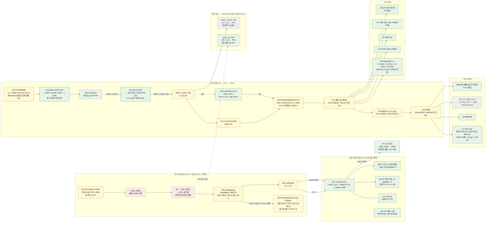
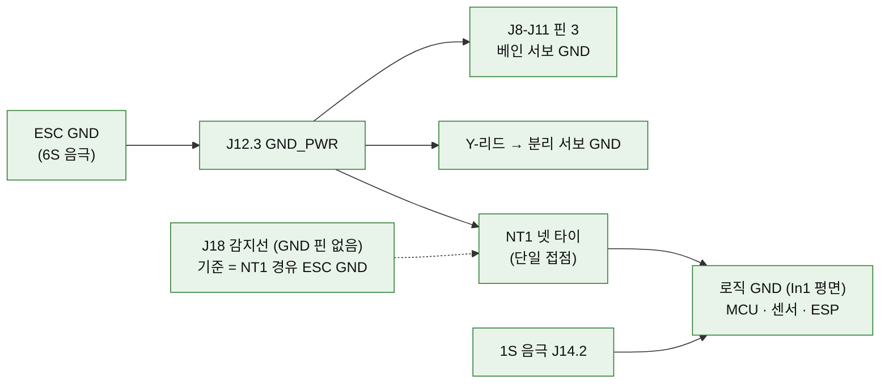

# 02. 전기·전원 블록도 (Power tree and connectors)

<!-- detailed-banner -->
> **상세판 (Mermaid 원본, 검증용 출처 표 포함).** 교과서식 그림은 [02_전기_전원_블록도.md](../02_전기_전원_블록도.md)에 있습니다.

이 문서는 캐리어 PCB rev 3.1(`pcb-rev3` / `main` @ 4051623) 기준으로 그렸습니다. 넷 이름은 KiCad 넷리스트 `out/vtol_carrier.net`(rev "3")에서 가져왔습니다.

- **보드 상태:** 이 보드는 아직 제작·통전한 적이 없습니다(NOT_VERIFIED).
  - 도구 검사 결과는 ERC 0, DRC 0입니다.
  - 그래서 아래 전압·전류 값은 모두 **설계값(F) 또는 추정값(E)** 입니다.
- **폴더 주의:** `body-redesign` 워크트리 안의 `pcb/vtol_carrier`는 아직 rev 2c입니다. 이 그림은 그 폴더가 아니라 rev 3.1을 따릅니다.

## 2.1 전원 트리

렌더 이미지: [SVG](img/02_전기_전원_블록도_1.svg) · [PNG](img/02_전기_전원_블록도_1.png)

### 퓨즈와 스위치

- **퓨즈:** 캐리어 BOM에 퓨즈나 PTC가 **하나도 없습니다**.
  - 1S 로직 쪽 전류는 팩 내부 PCM만 제한합니다(A).
  - 6S 쪽은 ESC 자체 보호에 맡깁니다.
  - rev 2c 때 PTC를 넣을지는 사용자 결정으로 남겨 두었습니다(`pcb/vtol_carrier/README_ko.md:119, 146`, rev 2c).
- **로직 전원 스위치:** J15 → MTS-102(2 A 이상, A). 기체 벽면 θ106°에 답니다(P:2047; NBS:939).
- **암 스위치:** J16. 벽면 θ82°에 답니다.
  - 전원 스위치가 아니라 FCU PC2로 들어가는 **입력 신호**입니다.
  - 무장(ARMED) 상태에서 열면 KILL로 처리됩니다(03, 06 참고).
- **전원 순서:** 로직을 먼저 켜고 6S를 나중에 연결합니다. 끌 때는 6S를 먼저 뺍니다(rev 2c README:120).
- **5 V 로직 UBEC:** 기본 구성에는 아직 misc 상자에 들어 있지만, 로직 쪽에서 이것을 쓰는 곳은 이제 없습니다. 뺄지는 사용자 결정 대기 중입니다(P:1117, P:24).

## 2.2 접지 구조

렌더 이미지: [SVG](img/02_전기_전원_블록도_2.svg) · [PNG](img/02_전기_전원_블록도_2.png)

## 2.3 커넥터 표 (rev 3.1, 넷리스트 기준)

| 커넥터 | 형식 | 핀 → 넷 | 연결 대상 | 출처 |
|---|---|---|---|---|
| J1 | 1x8, 납작 납땜 | 1 +5V, 2 GND, 3 SCL_3V3, 4 SDA_3V3, 7 GND, 8 IMU_INT_3V3 | GY-521 (MPU-6050) | NET; BOM:14-18 |
| J2 | 1x6 직각 소켓 | 1/5/6 +3V3, 2 GND, 3 SCL, 4 SDA | BMP280 (TYE-BMP29, 0x77) | NET; P:1129 |
| J3 | 2x3, 미실장 | IO0, GND, TXD0, RXD0, RST, GND (3.3 V 전용) | ESP 플래시 | NET |
| J4, J6 | - | rev 3.1에는 없음 | - | facts_hw §3 |
| J5 | OpenLog 소켓 | 2 OPENLOG_RXI, 4 +5V, 5/6 GND | OpenLog | NET |
| J7 | JST-GH 4핀 (JLC 실장) | 1 GPS_VCC, 2 GPS_TXD_3V3, 3 GPS_RXD_3V3, 4 GND | NEO-7M (U4 GNS 전용, 미사용) | NET |
| J8-J11 | 1x3 직각 | 1 VANEn_SIG, 2 SERVO_5V, 3 GND_PWR | 베인 서보 1-4 MG90S | NET |
| J12 | 1x3 직각 | 1 ESC_SIG, 2 SERVO_5V (BEC +5 V), 3 GND_PWR (NT1) | ESC 신호선 + BEC, 분리 서보용 Y-리드 | NET; CS:2156 |
| J13 | 도금 THT 패드 1개 (127.05, 66.85) | RELEASE_SIG | 분리 서보 신호선 (사용자 납땜) | RD:5, 100, 126 |
| J14 | Molex SPOX 2핀 | 1 VBAT_LOGIC_RAW, 2 GND | 1S 로직 팩 | CS:334-348 |
| J15 | JST-PH 2핀 | 1 VBAT_LOGIC, 2 VBAT_LOGIC_SW | 로직 전원 스위치 (θ106) | CS; P:2047 |
| J16 | 1x2 | 1 ARM_SW_EXT, 2 GND | 암 스위치 (θ82) | NET |
| J17 | JST-PH | 1 +5V, 2 BUZ_N | 부저 | NET |
| J18 | 1x4, GND 핀 없음 (의도) | VS_VIN, VS_VTETHER, VS_VBUFFER, VS_BUF_ISIGN | 로켓은 VS_VIN(6S)만 사용 | CS:634; NET |
| J19-J22 | 2x3 ISP, 미실장 | 2번 핀 = +5V | NAV / FCU / COM / GNS | NET |
| J24-J26 | 점퍼 | 리셋 유지 | NAV / FCU / COM | NET |
| JP1 | 3패드 | 1-2 브리지 = 3.3 V (기본), 3 = +5V | GPS 전원 선택 | NET |

## 노드 출처 (2.1, 2.2)

| 노드 | 출처 |
|---|---|
| B6, ESC, BEC, EDF | P:1089-1104, P:247-248, P:1651 |
| XT | `docs/budget/bom.json:161` (body-redesign) |
| H6 | 저장소에 도면 없음 → **ASSUMED** (facts_hw §9 항목 8) |
| J12, C47, JV, YL, J13 | NET; CS:2156; RD:5, 151; rev 2c README:123 (스톨 전류 A) |
| B1, J14, Q10, J15 | BOM:32; CS:334-348; P:2047 |
| CIN, L5, U8, U9 | BOM:28, 50, 51; CS:352, 405-416, 448; RD:27 |
| R5V, U6, R3V, 부하 | BOM:48; CS:373-385, 405-434 |
| S6, S1 | CS:355, 365-369; `params_gen.h:119` |
| NT1, 접지 | CS:632-634 |

## 주의 (불일치·가정)

1. **분리 서보 전원은 ESC BEC에서 옵니다.**
   - 6S가 연결되지 않으면 분리 서보에 전원이 없습니다. 이것은 전원 트리에서 직접 따라 나오는 결론입니다.
   - BEC 여유가 충분한지는 NOT_VERIFIED입니다(RD:151).
2. **J18 VS_VIN 분기점:** 6S 쪽 어디에서 따는지가 그려져 있지 않습니다(**ASSUMED**).
3. **1S 감시(PF3):** 회로는 있지만 펌웨어가 아직 읽지 않습니다(CS:365-369).
   - I8 저전압 판정은 6S(PF0)로 합니다(PG:119-121).
4. **수치의 성격:** 레일 전류와 1S 사용 시간(약 7.7 h)은 추정값(E)입니다(CS:437-442).
