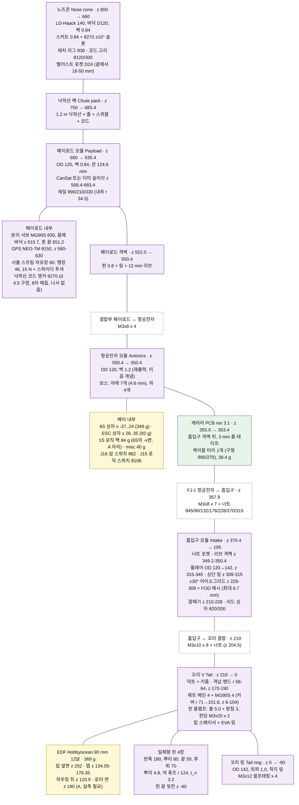
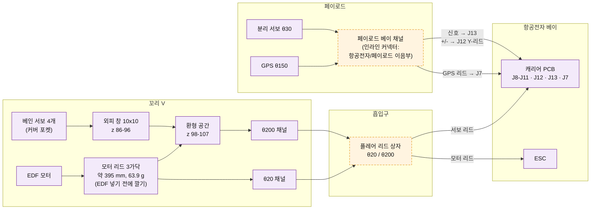
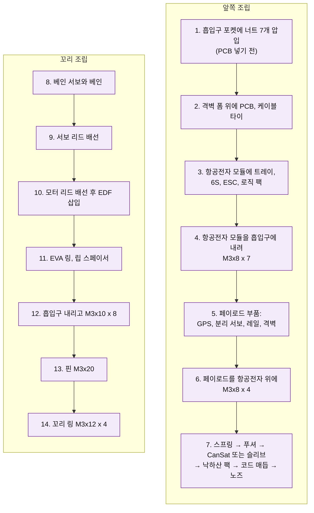

# 04. 기계 구성도 (Mechanical stack, new body rev 3.4.2, V tail)

<!-- detailed-banner -->
> **상세판 (Mermaid 원본, 검증용 출처 표 포함).** 교과서식 그림은 [04_기계_구성도.md](../04_기계_구성도.md)에 있습니다.

이 문서는 새 본체 사양 rev 3.4.2(`sim_tools/runs/body_redesign/spec/새_본체_상세사양.md`, 아래에서 NBS)를 따릅니다.

- **설계 단계:** 사양·질량 모델 단계이고, 아직 출력용 CAD가 아닙니다(NBS:4).
- **저장소 CAD:** 저장소의 CAD는 아직 예전 본체(856 mm)입니다(REQ:52).
- **좌표계:**
  - z축은 기체 축을 따라 위쪽입니다. **z 0은 V 꼬리 배기 끝면**입니다.
  - θ는 +x(항공전자 베이의 ESC 쪽)에서 +y 방향으로 잽니다(NBS:843-844).
- **단위:** mm.

## 4.1 적층 순서 (노즈 → 배기)

렌더 이미지: [SVG](img/04_기계_구성도_1.svg) · [PNG](img/04_기계_구성도_1.png)

## 4.2 숨은 배선 경로 (밖으로 보이는 선 없음)

렌더 이미지: [SVG](img/04_기계_구성도_2.svg) · [PNG](img/04_기계_구성도_2.png)

- **검증 안 된 경로:** 주황 점선 노드(플레어 리드 상자, 페이로드 채널)는 계단형 질량 모델로만 잡혀 있고 **검증되지 않았습니다**(NBS:1126, 1220).
- **분리 서보 리드:** 3심 리드를 J13(신호)과 J12 Y-리드(+, -)로 나눠 꽂습니다. 이음부에 인라인 커넥터를 둡니다. 이 리드는 NOT_VERIFIED입니다(P:1411).

## 4.3 조립 순서

렌더 이미지: [SVG](img/04_기계_구성도_3.svg) · [PNG](img/04_기계_구성도_3.png)

**체결류(V):**

- M3 나사 32개: x8 12개, x10 8개, x12 4개, x20 8개
- 너트 23개
- M2x8 10개, M2x3 4개
- 모두 A2-70 스테인리스입니다(NBS:1163, 1179).

**앞뒤 조립 순서:** 꼬리 조립 12단계(흡입구 결합)의 "흡입구"는 앞쪽 조립 1-4단계에서 항공전자 모듈과 이미 결합한 흡입구입니다. 앞뒤 순서를 어떻게 맞물리는지는 사양 원문 NBS:1136-1157을 따르십시오.

## 4.4 질량·안정성 요약 (rev 3.4.2, 따로 표시가 없으면 E)

| 항목 | 값 | 출처 |
|---|---|---|
| 질량 MID | CanSat 없이 2,079.1 g / CanSat 포함 2,419 g | NBS:120-121 |
| 무게중심 | z 302.2 mm | NBS:122 |
| 정안정 여유 (M, OpenRocket = RocketPy) | +1.10 cal. 뒤쪽 CG 한계에서는 +0.92 (노즈 밸러스트 48 g 필요) | NBS:123 |
| 압력중심, Cd | CP 653.2 mm, Cd 0.296 | NBS:123 |
| T/W (20 N) | **0.981, 이륙 불가** (꼬리 링 손실 포함 시 0.941-0.968) | NBS:9, 126 |
| T/W 1.15에 필요한 추력 | 23.8-25.0 N | NBS:128 |
| 질량 요구 1,770 g | +309 g 초과 (밸러스트 포함 +357 g) | NBS:132 |
| 베인 권한 | CFD 0.137 N m = 이륙 필요량 0.077 N m의 1.77배 | NBS:1076 |
| 핀 넥 퓨즈 | 허용 창 24.5-28.6 N, 27.3 N에서 파단. 플러터 속도 87.8 m/s (E) | NBS:54, 64 |
| 착지 | 꼬리 링이 15.48° 기울기까지 먼저 닿음. 단단한 잔디에서만 비행 | NBS:163; REQ:56 |

## 노드 출처

| 노드 | 출처 |
|---|---|
| NOSE, CHUTE | NBS:853-854, 980-982 |
| PAY, PAY_IN | NBS:855, 984-992, 97 |
| PBH, J2 | NBS:856, 986 |
| AVI, AVI_IN | NBS:857, 906, 1317; REQ:38; SP frozen_avionics; P:2048 |
| PCB, FJ1 | NBS:858-859, 1140, 1170 |
| INT, J3 | NBS:860-861, 996, 1018-1020, 1049, 1171 |
| TAIL, EDF, FIN, RING | NBS:862-867, 1052-1072, 1177, 1194 |
| 배선 경로 | NBS:1115-1126, 1148; P:1411 |
| 조립 순서 | NBS:1136-1157 |

## 주의

- **핀 표기:** REQ:51에는 아직 "퓨즈 패널"이라고 적혀 있습니다. rev 3.4.1부터 핀은 일체형 + 넥 퓨즈입니다(NBS:1060).
- **핀 결손:** 한쪽 핀의 바깥 패널이 없으면 비행하지 않습니다. 그 상태에서는 안정 여유가 +0.71 cal로 떨어집니다(NBS:125, 1155).
