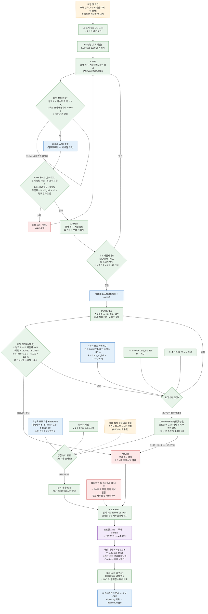

# 05. 비행 순서도 (Mission flow: pad → landing)

<!-- detailed-banner -->
> **상세판 (Mermaid 원본, 검증용 출처 표 포함).** 교과서식 그림은 [05_비행_순서도.md](../05_비행_순서도.md)에 있습니다.

이 순서도는 펌웨어 `body-redesign` @ 78f59fa(`src/core/onboard.c`)와 지상국 `sim/ground_station_logic.py`가 **실제로 구현한** 흐름을 따릅니다.

- **노드 종류**
  - 초록: 기체가 하는 일
  - 파랑: 지상국이 하는 일
  - 빨강: 중단(ABORT)과 안전 동작
  - 주황 점선: 계획만 있고 구현되지 않은 것
- **아래 숫자의 출처:** params.json mission 값을 생성한 `params_gen.h`(PG)입니다.

렌더 이미지: [SVG](img/05_비행_순서도_1.svg) · [PNG](img/05_비행_순서도_1.png)

## 단계별 근거

| 단계 / 노드 | 규칙·수치 | 출처 |
|---|---|---|
| PRE | 25.0 N 이상을 실측하기 전에는 자유 비행 금지. 20 N에서 T/W 0.981 | DEC:72; NBS:9, 126, 136 |
| P1, P2, REC | 켤 때 로직 먼저, 끌 때 6S 먼저 | rev 2c README:120 |
| BOOT | 모든 부팅은 SAFE에서 시작. pwm_init가 핀 출력 전에 비교값을 먼저 씀 | `main.c:53-60, 981-989`; `onboard.h:9` |
| ALIGN | N_avg 500틱 = 2 s, 정지 판정 3 °/s, 0.05 g | PG:304-306; `nav_main.c:328-368` |
| GS_ARM | 최근 텔레메트리(2 s 미만)가 없으면 ARM/LAUNCH/THROTTLE을 거부 | `ground_station.py:50-62` |
| GATE | 게이트 순서, 기울기 5°, V_cell 3.3 V | `onboard.c:168-186`; PG:182-183 |
| PADFS | I1p 500틱(2 s), I9 IMU 25틱 / 기압 125틱, 암 스위치는 KILL과 같음 | `onboard.c:297-318`; PG:190, 198-199 |
| GS_L, POW | nonce 필수. 125틱(0.5 s) 동안 램프로 0 → 1000‰ | `onboard.c:223-226, 368-386`; PG:178-179 |
| INTL | I1 750틱(3 s), I2 45°, I3 180/720 °/s 5틱, I8 3.3 V, I5 160 m | `onboard.c:275-345`; PG:181-199 |
| CUT_GS | 목표 140 m, 응답 타임아웃이면 외삽값으로 판정 | `ground_station_logic.py:51-76, 406-427, 453-474`; P:1632 |
| CUT_I4, CUT_I7 | k = 1.2/(2g) = 0.0612, 150 m / 6250틱 = 25 s | `onboard.c:346-358`; PG:185-191 |
| UNP | 관성 구간 자세 유지 0.5 s, 그 뒤 베인 중립 | P:1645; `onboard.c:89-94` |
| REL_GS | 예측식, 관성 타임아웃 6 s | `ground_station_logic.py:58-65, 428-451, 475-488`; P:1637-1639, 1658 |
| REL_I6 | -8 m/s, 75틱(0.3 s) | `onboard.c:290-293, 360-363`; PG:187-188 |
| PEND | 50틱(0.2 s). 대기 중에는 KILL만 수락 | `onboard.c:148-155, 202-203`; PG:192 |
| RELD | 1999.5 µs, 이후 종단 상태 | PG:152-153; `onboard.h:13` |
| EJ | 15 N, 46 mm, 분리 속도 약 1.20 m/s (CanSat 포함, E) | NBS:988, 1278-1279 |
| DESC | 1.2 m, 6.26 m/s | NBS:133, 1283; REQ:32 |
| LAND | 착지 감지 없음, 위치 비프 | `main.c:909-912`; facts_fw §3.1 |
| ABORT | 0.5 s(125틱) 뒤 분리 → RELEASED | `onboard.c:139-146`; PG:193 |
| I10 | 워치독/BOD 리셋 + 유효한 .noinit 기록 | `watchdog.c:56-62`; `onboard.c:71-75`; `main.c:987-988` |
| APX | 요구는 있으나 코드 없음 | REQ:18; NBS:1469-1475 |

## 주의

1. **차단 후 스핀:** I3 회전 중단은 POWERED에서만 평가합니다. 그래서 차단 후 약 1,390 °/s 스핀으로는 ABORT가 나지 않습니다(`onboard.c:282-289`; R2:412).
2. **비행 전 실측:** 비행 전 1 km 지상 통신 시험이 필요합니다. 정점 140-150 m에 낙하산 표류가 더해지면 Wi-Fi 거리에 가깝거나 그 밖일 수 있습니다(E)(FW:240-242).
3. **예전 검증 결과:** 아래는 30.3 N을 가정한 예전 본체의 결과이고, 새 본체 결과가 **아닙니다**(VAL:41-53).
   - 정점 127.6-149.1 m, 150 m 초과는 0/30
   - 착지점 평균 74-86 m 풍하
