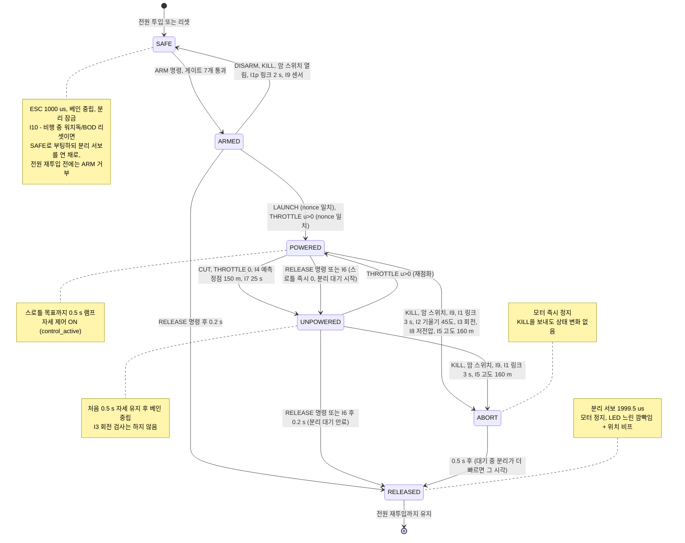
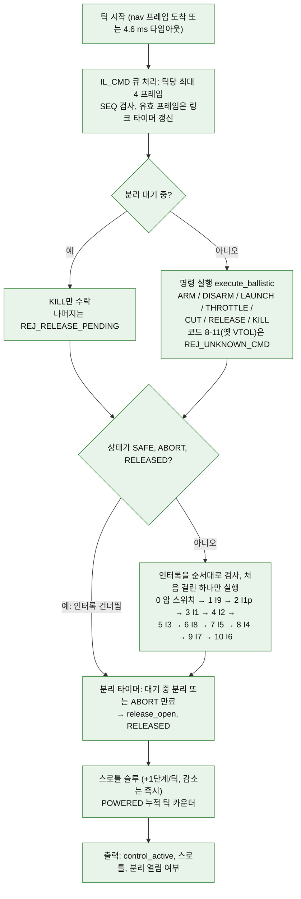

# 06. 펌웨어 상태도 (FCU onboard supervisor)

<!-- detailed-banner -->
> **상세판 (Mermaid 원본, 검증용 출처 표 포함).** 교과서식 그림은 [06_펌웨어_상태도.md](../06_펌웨어_상태도.md)에 있습니다.

이 상태도는 펌웨어 `firmware/atmega128_fc/src/core/onboard.c`(`body-redesign` @ 78f59fa)를 그대로 옮긴 것입니다. 이 C 코드는 Python 감독기 `sim/onboard.py`의 `OnboardSupervisor`를 틱 단위로 똑같이 포팅한 것입니다.

- **상태:** SAFE, ARMED, POWERED, UNPOWERED, RELEASED, ABORT의 6개뿐입니다.
- **예전 상태:** 예전 v0.3의 LAUNCH..LANDED 상태들은 폐기되었고 비행에 쓰이지 않습니다(`sim/state_machine.py:9-28`).
- **틱 주기:** 250 Hz(4 ms)입니다.
- **약어:** "nonce"는 16비트 LFSR 값입니다. 성공한 LAUNCH와 THROTTLE을 실행할 때마다 다음 값으로 넘어갑니다.

## 6.1 상태 전이도

렌더 이미지: [SVG](img/06_펌웨어_상태도_1.svg) · [PNG](img/06_펌웨어_상태도_1.png)

## 6.2 한 틱 안의 감독기 처리 순서

렌더 이미지: [SVG](img/06_펌웨어_상태도_2.svg) · [PNG](img/06_펌웨어_상태도_2.png)

## 6.3 명령 전이 표

| 명령 (코드) | 허용 상태 | 가드 | 결과 | 출처 |
|---|---|---|---|---|
| ARM (1) | SAFE | ① 분리 열림 아님 ② 암 스위치 닫힘 ③ IMU·기압 정상 + 실패 카운터 0 ④ 정렬됨 ⑤ 기울기 < 5° ⑥ V_cell ≥ 3.3 V ⑦ 이번 프레임 **이전부터** 링크 살아 있음 | ARMED | `onboard.c:168-186`; PG:182-183 |
| DISARM (2) | ARMED | - | SAFE | `onboard.c:188-270` |
| LAUNCH (3) | ARMED | nonce == 현재 nonce | POWERED, 목표 1000‰ | PG:178 |
| THROTTLE u (4) | ARMED | nonce 일치, u > 0 (u = 0이면 REJ_THROTTLE_ZERO) | POWERED, 목표 min(u, climb) | 같은 곳 |
| THROTTLE u | POWERED | u = 0이면 UNPOWERED, 아니면 목표 변경 | UNPOWERED / POWERED | 같은 곳 |
| THROTTLE u | UNPOWERED | u > 0 | POWERED (재점화) | 같은 곳 |
| CUT (5) | POWERED | - | UNPOWERED | 같은 곳 |
| RELEASE (6) | ARMED, POWERED, UNPOWERED | - | 스로틀 즉시 0, 분리 기한 = 지금 + 50틱(0.2 s) | `onboard.c:148-155`; PG:192 |
| KILL (7) | ARMED → SAFE; POWERED/UNPOWERED → ABORT; ABORT/RELEASED는 변화 없음; SAFE는 REJ_STATE | - | - | `onboard.c:157-163, 195-201` |

## 6.4 인터록 표 (명령으로 끌 수 없음)

| 순서 | 이름 (사유 코드) | 조건 | 적용 상태 | 동작 | 파라미터 |
|---|---|---|---|---|---|
| 0 | 암 스위치 (13) | 디바운스 5틱 후 열림 | ARMED, 비행 | KILL과 같음 | `onboard.c:297-301`; PG:308 |
| 1 | I9 (10 IMU / 11 기압) | IMU 실패 25틱(0.1 s) 이상 / 기압 125틱(0.5 s) 이상. NAV 프레임이 없으면 둘 다로 셈 | ARMED → SAFE, 비행 → ABORT | 왼쪽 | PG:198-199 |
| 2 | I1p (2) | 유효 지상 프레임 없음 500틱(2 s) | ARMED | SAFE | PG:190 |
| 3 | I1 (1) | 프레임 없음 750틱(3 s) | POWERED, UNPOWERED | ABORT | PG:189 |
| 4 | I2 (3) | 기울기 > 45° | POWERED | ABORT | PG:181 |
| 5 | I3 (4) | 자이로 포화, 또는 abs(w_xy) > 180 °/s, 또는 abs(w_z) > 720 °/s가 5틱 지속 | POWERED | ABORT | PG:194-197 |
| 6 | I8 (9) | V_cell < 3.3 V | POWERED | ABORT | PG:183 |
| 7 | I5 (6) | h > 160 m | POWERED, UNPOWERED | ABORT | PG:184 |
| 8 | I4 (5) | h + 0.0612·max(v_z,0)² ≥ 150 m | POWERED | CUT만 | PG:185-186 |
| 9 | I7 (8) | POWERED 누적 6250틱(25 s) | POWERED | CUT | PG:191 |
| 10 | I6 (7) | 분리 열림·대기 없음, v_z ≤ -8 m/s가 75틱(0.3 s) 지속 | POWERED, UNPOWERED | RELEASE (0.2 s) | PG:187-188 |
| 부팅 | I10 (12) | 워치독/BOD 리셋(전원 투입 리셋 아님) + .noinit 기록 상태가 POWERED/UNPOWERED/ABORT/RELEASED | 부팅 | SAFE + 분리 열림, ARM 거부 | `watchdog.c:56-62`; `onboard.c:71-75` |

## 6.5 상태와 출력

| 코드 | 상태 | ESC | 베인 | 분리 서보 | LED / 부저 (FCU) |
|---|---|---|---|---|---|
| 0 | SAFE | 1000 µs | 중립 + 트림 | 잠금 1000.5 µs (I10이면 열림) | 준비됨: 짧은 섬광, 준비 안 됨: 빠른 깜빡임 |
| 1 | ARMED | 1000 µs | 중립 | 잠금 | LED 켜짐 + 비프 |
| 2 | POWERED | 1000 + u·1000 µs | 자세 제어 | 잠금 | LED 켜짐 |
| 3 | UNPOWERED | 1000 µs | 0.5 s 제어 후 중립 | 잠금 (대기 중이면 0.2 s 뒤 열림) | LED 켜짐 |
| 4 | RELEASED | 1000 µs | 중립 | 열림 1999.5 µs | 느린 깜빡임 + 위치 비프 |
| 5 | ABORT | 1000 µs | 중립 | 0.5 s 후 열림 | 빠른 깜빡임 |

출처: `link_proto.h:84-90`; `onboard.h:9-14`; `main.c:338-360, 883-920, 1205-1212`; PG:152-156

## 주의

- **SEQ 처리:**
  - 유효한 프레임은 모두 링크 타이머를 갱신하고 응답을 받습니다.
  - 이미 처리한 SEQ는 확인 응답만 합니다.
  - 거부된 명령도 SEQ를 소모합니다(`onboard.c:429-462`).
- **분리 대기 취소:** 패드에서 KILL, I1p, I9, 암 스위치로 SAFE에 들어가면 대기 중인 분리가 취소됩니다(`onboard.c:126-127`).
- **회전 검사 범위:** I3은 POWERED에서만 평가합니다. 차단 후 약 1,390 °/s 스핀으로는 I3이 걸리지 않습니다. rev1 사양 메모("차단 후 발동할 수 있음")는 코드와 다릅니다(facts_fw §11 항목 7).
