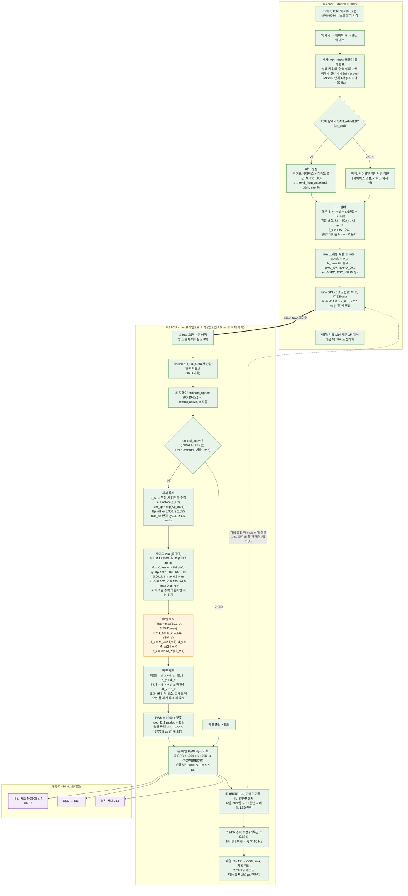
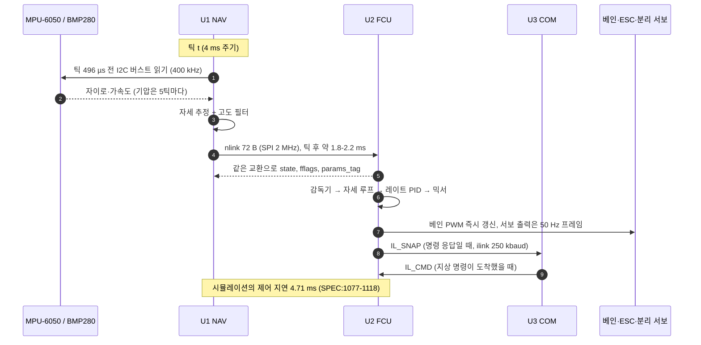

# 07. 제어 루프 순서도 (One 250 Hz control cycle)

<!-- detailed-banner -->
> **상세판 (Mermaid 원본, 검증용 출처 표 포함).** 교과서식 그림은 [07_제어_루프_순서도.md](../07_제어_루프_순서도.md)에 있습니다.

이 순서도는 펌웨어 `body-redesign` @ 78f59fa의 한 틱을 따라갑니다. 틱 길이는 4 ms입니다.

- **NAV(U1):** Timer2로 틱을 셉니다(`nav_main.c:273-442`).
- **FCU(U2):** 자체 틱 인터럽트 없이, nav 프레임이 도착하면 그 틱을 시작합니다(`main.c:1047-1410`).
- **COM(U3):** 마감이 없는 슈퍼루프입니다(`com_main.c:108-150`).

## 7.1 한 틱의 데이터 흐름

렌더 이미지: [SVG](img/07_제어_루프_순서도_1.svg) · [PNG](img/07_제어_루프_순서도_1.png)

**믹서 플랜트 상수(주황 노드)는 예전 본체 값입니다.**

- 현재 값: l_v 0.3495 m, r_v 0.028 m, S_v 960 mm², C_La 2.4/rad, A_e 5073 mm², T_max 30.3 N(PG:124-131)
- 새 본체의 V 꼬리 팔 길이는 272 mm입니다(NBS:1453).
- 이 값의 갱신은 이후 제어 라운드로 미뤄졌습니다(PG:26-31; `gains.h:39` GAINS_PARAMS_STALE 1).

## 7.2 한 틱의 시간 순서 (시뮬레이션 수치)

렌더 이미지: [SVG](img/07_제어_루프_순서도_2.svg) · [PNG](img/07_제어_루프_순서도_2.png)

## 7.3 주기 표

| 항목 | 주기 | 출처 |
|---|---|---|
| 제어·NAV·COM 틱 | 250 Hz (4000 µs) | PG:49-51, 250, 267 |
| MPU-6050 내부 | 1 kHz, DLPF_CFG 2, ±2000 °/s, ±16 g | PG:71-72, 285-290 |
| BMP280 | 50 Hz (5틱) | PG:64-70 |
| PWM 프레임 | 50 Hz, 분해능 0.5 µs | PG:57-61 |
| 비행 기록 'F' | 50 Hz, 57600 baud | PG:62-63, 75 |
| 'S' 상태 / 'N' NAV 링크 기록 | 1 Hz | `main.c:1330-1334` |
| IL_STAT | 1 Hz | PG:254 |
| 지상 폴링·텔레메트리 | 2 Hz | P:2001; PG:214 |
| 워치독 | 60 ms (모든 칩) | `watchdog.h:25` |
| 배터리 전압 LPF | 2 Hz | PG:119-121, 307 |

## 노드 출처

| 노드 | 출처 |
|---|---|
| N0-N9 | `nav_main.c:273-442, 45-47`; PG:56; `att_estimator.c:56-84`; `alt_filter.c:32-48`; PG:291-292 |
| F1-F3, F11-F14 | `main.c:17-36, 1072-1367, 184-186` |
| F4 | `main.c:1168-1195`; `onboard.c:89-94` |
| F5 | `attitude_ctrl.c:33-60`; `gains.h:15-18, 31` |
| F6 | `pid.h:1-12`; `attitude_ctrl.c:61-66`; `gains.h:19-29` |
| F7-F9 | `mixer.c:69-125`; `mixer.h:1-16`; PG:124-151; `gains.h:30` |
| 2틱 지연 | `nlink_proto.h:47-51` |

## 주의

1. **추정기:** 펌웨어의 자세 추정기는 Mahony가 아니라 **PadAlignGyroEstimator**입니다. Mahony는 시뮬레이션의 레거시 옵션으로만 남아 있습니다(`sim/sim6dof.py:43, 107, 172-180`).
2. **타이밍 수치:** 모든 타이밍은 simavr·co-sim 값입니다. 하드웨어에서 측정한 적은 없습니다(SPEC:1401-1408).
3. **축 정의:** x, y는 측방향 축(피치, 요)이고 z는 롤 축입니다. 롤 관성 Izz는 0.005 kg m²입니다(PG:172).
