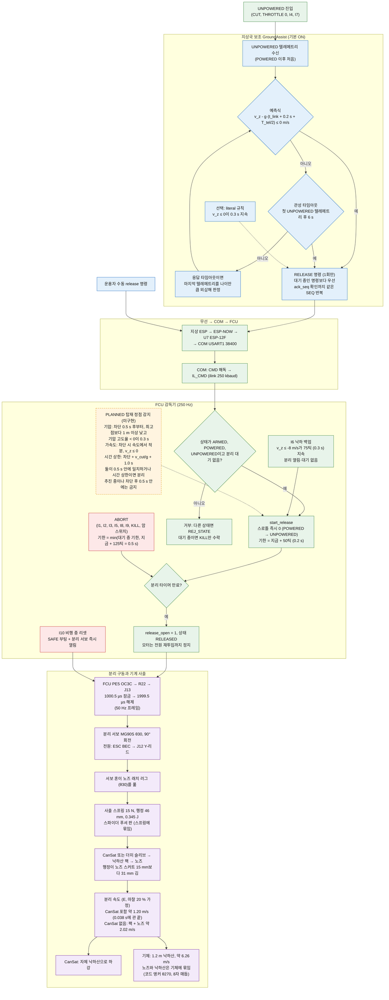
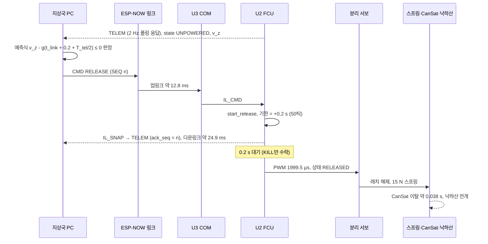

# 08. 사출 순서도 (Apogee detection, CanSat release, parachute)

<!-- detailed-banner -->
> **상세판 (Mermaid 원본, 검증용 출처 표 포함).** 교과서식 그림은 [08_사출_순서도.md](../08_사출_순서도.md)에 있습니다.

**누가 정점을 판단하나:** 현재 구현에서는 **지상국 보조(GroundAssist)** 가 정점 분리를 주로 판단합니다.

- 기체가 혼자 분리를 여는 경로는 세 가지뿐입니다.
  - I6 낙하 감지
  - ABORT
  - I10 재부팅
- REQ:18이 요구하는 **탑재 정점 감지 백업(기압 + 가속도 + 시간 상한)은 아직 코드에 없습니다.** 그림에서는 주황 점선 PLANNED로 표시했습니다.
- `params_gen.h:175-177`에 따르면 target_altitude, apogee_detect_vz, apogee_confirm, coast_timeout은 지상국 전용 값입니다. 펌웨어에는 일부러 넣지 않았습니다.

**낙하산 구동:** 낙하산 전용 구동기는 없습니다. 분리 서보 하나가 래치를 풀면 스프링이 CanSat(또는 더미 슬리브), 낙하산 팩, 노즈를 차례로 밀어냅니다(NBS §12, 1274-1285).

## 8.1 분리 판단 → 구동 → 기계 사출

렌더 이미지: [SVG](img/08_사출_순서도_1.svg) · [PNG](img/08_사출_순서도_1.png)

## 8.2 시간축 (지상 보조 정상 분리)

렌더 이미지: [SVG](img/08_사출_순서도_2.svg) · [PNG](img/08_사출_순서도_2.png)

- **링크 지연(참고 값, esp_bridge):**
  - 업링크 12.8 ms, 다운링크 24.9 ms
  - 최악 왕복 146.3 ms, 응답 타임아웃 240.3 ms
  - 출처: PG:236-243
- **예측식의 0.2 s:** 예측식 안의 0.2 s는 release_after_cut_s입니다. 펌웨어의 분리 대기 시간(50틱)과 같은 값입니다(P:1637-1639; PG:192).

## 8.3 백업 경로 요약

| 경로 | 조건 | 분리까지 | 구현 | 출처 |
|---|---|---|---|---|
| 지상 보조 예측식 | v_z - g(t_link + 0.2 + T_tel/2) ≤ 0 | +0.2 s | IMPL (지상) | `ground_station_logic.py:58-65, 428-451`; P:1637-1639 |
| 지상 관성 타임아웃 | 첫 UNPOWERED 텔레메트리 후 6 s | +0.2 s | IMPL (지상) | `ground_station_logic.py:475-488`; P:1658, 1660 |
| 운용자 수동 RELEASE | 명령 | +0.2 s | IMPL | `ground_station.py:502-545` |
| I6 낙하 | v_z ≤ -8 m/s, 0.3 s | +0.2 s | IMPL (기체) | `onboard.c:290-293, 360-363`; PG:187-188 |
| ABORT | 인터록, KILL, 암 스위치 | +0.5 s (또는 더 이른 대기 기한) | IMPL (기체) | `onboard.c:139-146`; PG:193 |
| I10 | 비행 중 워치독/BOD 리셋 | 부팅 즉시 | IMPL (기체) | `watchdog.c:56-62`; `main.c:987-988, 1030-1034` |
| 탑재 정점 감지 | 기압 + 가속도 + 시간 상한 | - | **PLANNED (미구현)** | REQ:18; `concepts/light/concept_ko.md:89-95`; rev1 사양:340 |

## 주의

1. **분리 서보 전원:** 분리 서보 전원은 ESC BEC에서 J12 Y-리드로 받습니다.
   - 따라서 6S가 연결되지 않은 상태에서는 분리 서보가 움직이지 않습니다.
   - BEC 여유는 NOT_VERIFIED입니다(RD:151). 분리 서보 리드도 NOT_VERIFIED입니다(P:1411).
2. **RELEASE_PWM 풀다운:** RELEASE_PWM 넷에는 부팅 시 풀다운이 없습니다(넷리스트). 베인 출력과 ESC 출력에는 있습니다.
   - 부팅 순간 서보가 튈 수 있는지는 확인되지 않았습니다(**ASSUMED** 위험, 측정 필요).
3. **차단 후 스핀:** 차단 후 약 1,390 °/s 스핀이 있습니다. 분리 0.07 s 동안 기체가 약 100° 돕니다(R2:412; REQ:18).
4. **통신 거리:** 정점 근처에서 Wi-Fi 링크가 끊기면 지상 보조 분리가 불가능합니다. 그때 남는 경로는 다음과 같습니다(FW:240-242).
   - I1 링크 3 s → ABORT → 0.5 s 후 분리
   - I6 낙하 감지
5. **낙하산 크기:** params.json:1426은 아직 1.4 m입니다. 사용자는 1.2 m로 결정했습니다(REQ:32; NBS:1283).
