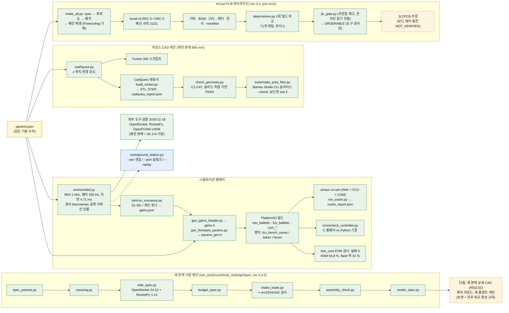

# 09. 개발·검증 흐름도 (Design / verification pipeline and test plan)

<!-- detailed-banner -->
> **상세판 (Mermaid 원본, 검증용 출처 표 포함).** 교과서식 그림은 [09_개발_검증_흐름도.md](../09_개발_검증_흐름도.md)에 있습니다.

원칙은 하나입니다. **모든 숫자는 `params.json` 한 곳에서 나오고, 산출물(CAD, 펌웨어 헤더, PCB 파일)은 스크립트로 다시 생성합니다.**

- **PASS의 근거:** "PASS"는 도구로 측정한 결과로만 인정합니다(`check_geometry.py:1-6`, KiCad ERC/DRC, simavr co-sim).
- **아직 안 된 것:** 기체 실물, 보드, 추력 측정은 아직 없습니다. 그래서 모두 NOT_VERIFIED입니다.

## 9.1 설계·검증 파이프라인

렌더 이미지: [SVG](img/09_개발_검증_흐름도_1.svg) · [PNG](img/09_개발_검증_흐름도_1.png)

## 9.2 시험 계획: 새 본체 측정 → 단계별 시험

```mermaid
flowchart TD
    subgraph MEAS["새 본체 측정 (사용자_결정_목록 DEC:70-87)"]
        direction TB
        T0["추력 측정: 정품 로터<br/>꼬리 링 장착 / 미장착 둘 다<br/>롤 반력 토크도 측정<br/>(벤치는 꼬리 모듈만 고정)"]
        TQ{"추력 25.0 N 이상?<br/>(T/W 1.15)"}
        TN["자유 비행 금지<br/>(20 N이면 T/W 0.981)"]
        MM["완성 질량·무게중심 → 노즈 밸러스트<br/>부품별 질량, 모터 리드 길이·각도<br/>로터 면 높이, M3 수량, 시험 출력"]
        T0 --> TQ
        TQ -->|"아니오"| TN
        TQ -->|"예"| MM
    end

    subgraph DROP["낙하·쿠폰 시험 (권장 순서, NBS:1584-1586)"]
        direction TB
        D1["B-2-2 (가) 넥 퓨즈 파단<br/>t_n 3.0/3.2/3.4 각 3개<br/>합격: 최저 24.5 N 이상, 최고 28.6 N 이하"]
        D2["B-2-3 항공전자 보스 인발<br/>3:1 시소, 나사당 474 N (CanSat 포함)"]
        D3["B-2-4 (나) 감속 낙하<br/>2.0 kg 썰매, 최대 2.0 m<br/>합격 40 g 이하 (CanSat 포함 31 g)"]
        D4["B-2-2 (나) 전도 낙하 · (다) 측면 낙하 0.1/0.2/0.3 m"]
        D5["B-2-4 (가) 꼬리 링 1,069 N 압축"]
        D6["B-2-1 핀 끝 면내 하중<br/>(예측 75.6 N)"]
        D7["B-2-5 낙하산 코드 고리 675 N<br/>(CanSat 포함 774 N)"]
        D8["B-2-4 (다) 선택: 핀 흙 박힘 낙하"]
        D9["B-2-6 결과를 spec/test_results/에 기록"]
        D1 --> D2 --> D3 --> D4 --> D5 --> D6 --> D7 --> D8 --> D9
    end

    subgraph STAGE["단계별 시험 (docs/시험_안전_법규.md:7-16)"]
        direction TB
        G0["0 벤치 전원: NAV/FCU/COM + 무선, ESC 없음<br/>합격: 루프 < 4 ms, 지상국 정지 2 s 후 ARMED → SAFE"]
        G0a["0a 무선 거리 (1 km 지상 시험)"]
        G0b["0b 보드 고장 시험: I9 / I1p / I1"]
        G1["1 베인 방향 (fcu_bench_vanes)<br/>복원 방향으로 꺾이는지"]
        G2["2 로드셀 추력: 0-50 % fcu_bench_tether<br/>50-100 % fcu_ballistic + --allow-throttle-cmd"]
        G3["3 테더 호버: 10° 외란 후 1 s 안에 1° 이내"]
        G4["4 10 m 비행: 정점 → 분리 → 낙하산"]
        G5["5 140 m 비행: 기록이 시뮬과 일치"]
        G0 --> G0a --> G0b --> G1 --> G2 --> G3 --> G4 --> G5
    end

    MM --> D1
    D9 --> G0

    classDef impl fill:#e8f4ea,stroke:#2e7d32,color:#111
    classDef abort fill:#fde8e8,stroke:#c62828,color:#111
    classDef planned fill:#fff4e0,stroke:#e08a00,stroke-dasharray:5 3,color:#111
    class T0,TQ,MM,D1,D2,D3,D4,D5,D6,D7,D8,D9,G0,G0a,G0b,G1,G2,G3,G4,G5 planned
    class TN abort
```

렌더 이미지: [SVG](img/09_개발_검증_흐름도_2.svg) · [PNG](img/09_개발_검증_흐름도_2.png)

**시험 상태:** 모든 시험 노드가 주황(PLANNED)입니다. 아직 한 번도 수행하지 않았기 때문입니다.

**측정 → 낙하 → 단계 순서는 가정입니다(ASSUMED).** 저장소 문서는 이 순서를 직접 정하지 않습니다. 근거는 다음 두 가지뿐입니다.

- 추력 25 N이 비행 전제 조건이라는 것(DEC:72)
- 낙하 시험의 권장 순서(NBS:1584-1586)

## 노드 출처

| 노드 | 출처 |
|---|---|
| P, C1-C5 | SPEC:82-87; `cad/layout.py:1-10`; `build_rocket.py:1-8`; `check_geometry.py:1-6`; `make_print_files.py:1-16`; README.md:129, 279 |
| S1-S7 | NBS:16, 1512-1525 |
| M1-M7 | `sim6dof.py:1-20`; SPEC:964-967, 1077-1118; `tools/cosim/README.md:1-28`; `verify_log.txt`; PIO:68-253 |
| K1-K6 | PCB31:1-3, 21, 27, 171-187; REQ:20-21, 66 |
| EXT | ST:5-12; VAL |
| NEXT | REQ:52; NBS:1469-1474 |
| T0, TQ, TN, MM | DEC:70-87; NBS:9, 126, 136, 1157 |
| D1-D9 | NBS:1537-1586 |
| G0-G5 | `docs/시험_안전_법규.md:7-16` |

## 주의

1. **추력 합격 기준 불일치:** 시험 문서는 2단계 합격을 "30 N 이상, 120 A 이하"로 적고 있습니다(옛 기준, `시험_안전_법규.md:13`). 새 규칙은 꼬리 링 장착 상태에서 25.0 N 이상입니다(DEC:72).
2. **PCB 폴더 불일치:** `body-redesign`의 `pcb/vtol_carrier`는 rev 2c입니다. 주문한 rev 3.1 커밋 4051623은 `pcb-rev3`와 `main`에만 있습니다.
3. **새 본체가 파이프라인 밖에 있음:** 새 본체(890 mm)는 아직 저장소 CAD 파이프라인에 없습니다(REQ:52; NBS:4).
